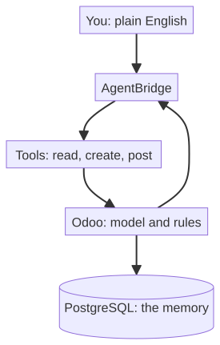

# 6. Tre macchine in una stanza

Sam Okafor installava sistemi aziendali per piccole imprese, e aveva una regola: non avrebbe venduto a nessuno un sistema finché non aveva visto il loro magazzino.

"È molto insistente riguardo al magazzino," disse Priya, quando fece l'introduzione. "Mi ha fatto girare il nostro per venti minuti e poi mi ha detto che avevamo trecentoquaranta pallet che il sistema non conosceva."

"Trecentoquarantuno," disse Sam, quando arrivò in ufficio. "Uno era dietro la porta."

Era sui cinquant'anni, portava una borsa di tela invece di una valigetta, e rifiutava il caffè con la giustificazione che ne beveva troppo. Nella piccola stanza con la fotocopiatrice, estrasse un foglio di carta dalla stampante e disegnò tre riquadri su di esso.

"Bene," disse. "Tutto quello che sto per dirti sta su questo tovagliolo. Il resto sono dettagli."

---

**Il primo riquadro è la memoria.**

Un sistema aziendale deve ricordare le cose. Clienti, prodotti, ordini, fatture, scorte, prezzi, pagamenti. Non in un archivio, e non in un foglio di calcolo, ma in un database: un programma il cui unico compito è conservare i fatti e restituirli con precisione, anche se l'energia elettrica si interrompe a metà della scrittura di uno di essi.

Il database che Riverton avrebbe usato si chiama PostgreSQL, ed è uno dei miracoli silenziosi del mondo moderno. È nato all'Università della California a Berkeley negli anni '80, in un progetto di ricerca guidato da un uomo di nome Michael Stonebraker, ed è stato sviluppato in modo aperto da allora: nessuna compagnia lo possiede, chiunque può leggere le sue istruzioni, e gestisce una percentuale sorprendente di tutto—banche, governi, siti web, e, a breve, un grossista di cancelleria in un paese di mercato.

Ciò che differenzia un database da un foglio di calcolo non è la dimensione. Sono le promesse.

Un foglio di calcolo ti permetterà di digitare una parola in una colonna di numeri, e non si lamenterà. Un foglio di calcolo ti permetterà a due persone di aprire lo stesso file e sovrascrivere il lavoro dell'altra. Un foglio di calcolo ti permetterà di salvare una modifica a metà. Un database fa tre promises invece: che una modifica accade completamente o per niente; che i dati soddisfano sempre le regole che hai dichiarato; e che due persone che modificano le cose nello stesso tempo non possono distruggere silenziosamente il lavoro dell'altra.

Queste promises hanno un nome poco affascinante—*transazioni*—e sono la ragione per cui una compagnia può fidarsi di un numero su uno schermo. Quando l'assistente crea una fattura, o la fattura, le sue righe, le sue voci di registro e il suo collegamento con l'ordine esistono tutti, o nessuno di essi esiste. Non esiste alcuno stato in cui la fattura esiste ma il registro non esiste.

**Il secondo riquadro è il modello.**

Sopra la memoria si trova la cosa che sa cosa i fatti *significano*: che una fattura deve avere un cliente, che una consegna deve provenire dalle scorte, che un tasso di tassazione si applica a un prodotto e non a una pagina di appunti. Questo è l'ERP, e per Riverton è un sistema chiamato Odoo.

Odoo ha una storia che vale la pena conoscere, perché spiega perché una piccola impresa può permetterselo. È iniziato nel 2005 come un progetto chiamato TinyERP, scritto da un belga di nome Fabien Pinckaers. Nel 2008 è stato ribattezzato OpenERP, e nel 2014 ha preso il suo nome attuale. È open source—la edizione della comunità è sotto una licenza che permette a chiunque di usare, studiare e modificare—ed è anche una compagnia, che vende un'edizione più ricca e il supporto. Questa combinazione, open core con un braccio commerciale, è come viene finanziata gran parte del software aziendale moderno.

L'edizione della comunità è gratuita, e non è una demo. Contiene vendite, acquisti, inventario, contabilità, fatturazione, progetti, manifattura, un sito web e un negozio web. Odoo 20, la versione usata in questo libro, è arrivata nel settembre 2026. La compagnia riporta milioni di utenti; il numero esatto conta meno del fatto che il software è usato, in molte lingue, da compagnie di ogni dimensione, e che una domanda su di esso è stata solitamente fatta e risposta da qualcuno prima.

La cosa importante di Odoo, per i nostri scopi, è che è *riguardo al suo modello*. Non ti permetterà di pubblicare una fattura senza righe. Non ti permetterà di spedire merci che non hai, a meno che non gli dici di permettere ciò. Conserva la storia. Questa rigidità non è un difetto di personalità; è l'intera ragione per cui il sistema può essere fidato da un contabile.

**Il terzo riquadro è il giudizio.**

Questo è il nuovo, ed è la cosa di cui questo libro parla davvero.

Un database non ha opinioni. Un modello non ha iniziativa. Nessuno di essi mai noterà che un cliente ha cessato di ordinare, o che i prezzi di un fornitore sono saliti lentamente, o che la fattura per il distretto scolastico è stata stampata e mai inviata. Rispondono a domande; non le fanno.

La terza macchina è un agente: un programma che può ricevere una istruzioni in lingua ordinaria, capire quali fatti gli servono, recuperarli, decidere cosa fare, farlo, e riferire. A Riverton si chiama AgentBridge, ed è eseguito sullo stesso computer di tutto il resto—che conta più di quanto sembri, e ci torneremo.

Un agente non è un chatbot. Un chatbot prende una domanda e produce testo. Un agente prende una istruzione e produce *effetti*: un record creato, un documento pubblicato, una email inviata. Per farlo in modo sicuro ha bisogno di due cose: un insieme di strumenti che gli è permesso usare, e un insieme di limiti che non può oltrepassare.

Gli strumenti, nel caso di Riverton, sono le operazioni dello stesso ERP: cercare clienti, leggere un prodotto, creare un ordine, confermarlo, pubblicare una fattura, fare una domanda al registro. Ogni strumento è un'azione piccola e ben definita con un nome e una descrizione, e l'agente scegle tra di esse nel modo in cui un nuovo dipendente scegle tra i pulsanti su uno schermo—leggendo cosa fanno.

I limiti sono di Odoo stesso. Questa è la parte che ha preso a Maggie un po' di tempo per capire, ed vale la pena dichiararla lentamente.

L'agente non ha una chiave maestra. Si collega a Odoo come un *utente*—un vero conto utente, con una password e un insieme di permessi, creato per lui dall'installatore. Quando chiede di creare una fattura, la richiesta viaggia verso Odoo, e Odoo controlla se quell'utente è permesso di creare fatture, su quella compagnia, con quelle tasse. Se la risposta è no, la risposta è no. L'agente non può discutere, perché l'agente non è l'autorità. Odoo lo è.

Questo è la decisione architettonica più importante dell'intero sistema, ed è la ragione per cui il libro può raccomandarla a una compagnia che non ha mai usato l'intelligenza artificiale prima. L'intelligenza è nuova e leggermente imprevedibile; le regole sono vecchie e completamente imprevedibili. La cosa nuova è solo permessa di agire dentro le regole della cosa vecchia.

## Perché tre e non uno

Una domanda ragionevole, e Sam aveva una risposta che ha preso dieci secondi e è rimasta con Maggie da allora.

"Perché falliscono diversamente," disse. "Se il database si ferma, lo sai subito: nulla funziona. Se il modello è sbagliato, lo scopri lentamente: i numeri sembrano strani. Se l'assistente è sbagliato, lo scopri tardi: qualcuno si è fidato di una risposta. Tre macchine significa tre tipi di fallimento, e tre tipi di fallimento possono essere distinti."

Un singolo programma che facesse tutte e tre sarebbe più semplice da installare e impossibile da diagnosticare. Quando si comportava male, la domanda *è i dati, le regole o il giudizio?* non avrebbe avuto risposta, e l'unica cura sarebbe stata reinstallare e sperare.

La separazione ha un secondo beneficio che appare solo in seguito: ogni macchina può essere sostituita da sola. Una compagnia che supera le dimensioni del database si sposta verso uno più grande; una compagnia che supera le dimensioni del modello si sposta verso un altro ERP, conservando i dati; una compagnia che supera le dimensioni dell'assistente cambia il modello con cui parla. Nessuna di quelle migrazioni richiede le altre, ed è per questo che lo stack in questo libro rimarrà ragionevole tra cinque anni.

---

"Come parlano tra loro?" chiese Maggie.

"Due modi, e entrambi sono noiosi, il che è buono," disse Sam.

L'agente parla a Odoo attraverso l'interfaccia esterna di Odoo stesso—un modo documentato affinché un altro programma chieda a Odoo di fare cose attraverso la rete. Odoo la chiama API JSON-2, che è un nome che solo un programmatore potrebbe amare. Ciò che significa è: c'è una porta, ha una serratura, hai bisogno di una chiave, e dietro la porta ci sono le stesse operazioni che usano le schermate web. Nulla di ciò che l'agente può fare è qualcosa che una persona non potrebbe fare cliccando; l'agente è semplicemente più veloce e non si stanca.

E gli strumenti stessi sono descritti all'agente usando una convenzione chiamata Model Context Protocol, o MCP. È stato pubblicato da Anthropic nel novembre 2024 come standard aperto, e fa una cosa semplice: dà a un programma un modo standard per dire "ecco una lista di cose che posso fare, ecco cosa serve a ciascuna, e ecco cosa restituisce." Prima di esso, ogni assistente aveva bisogno di un connettore su misura per ogni sistema, e i connettori si moltiplicavano. Con esso, uno strumento scritto una volta può essere usato da qualsiasi assistente che parla il protocollo—e ora ci sono migliaia di tali strumenti nel mondo.

Lo strumento ERP di Riverton è uno di essi. Si chiama OdooTool, è open source, ed è stato scritto dalle stesse persone che hanno scritto l'assistente. Il suo compito è essere il traduttore: l'agente dice "crea un cliente chiamato Ashfield Academy," lo strumento trasforma ciò nella sequenza esatta di chiamate che Odoo si aspetta, controlla le risposte, e riferisce in lingua ordinaria.

---

C'era una cosa in più sul tovagliolo, nell'angolo, nella piccola scrittura di Sam: *la stanza.*

"Tutte e tre corrono sul tuo computer," disse. "Non su un server in un altro paese. Il database, l'ERP e l'assistente. Questo significa che l'unica cosa che lascia questo edificio è ciò che scegli di inviare al modello linguistico, e se fai correre il modello localmente, nulla lascia affatto."

Maggie fece la domanda ovvia. "È meglio?"

"È diverso," disse Sam. "È meglio per il controllo e per la privacy, ed è peggio per la comodità, perché hai cura di esso. Non c'è una linea di supporto da chiamare alle undici di notte. Ma non c'è nemmeno chi può spegnerti, o alzare il prezzo, o leggere la tua lista di clienti. Per una compagnia come la tua, prenderei quel compromesso."

Aggiunse una quarta linea al tovagliolo, sotto i tre riquadri, con lettere così piccole che Maggie dovette avvicinarsi: *i backup.*

"Due cose ti accadranno," disse. "La prima è che la macchina si romperà, o si andrà via l'energia, o qualcuno verserà il tè sulla cosa sbagliata. La seconda è che una nuova versione di uno di questi programmi arriverà e vorrà essere installato. Entrambi sono ordinari. Nessuno di essi è un disastro, purché tu abbia una copia del database di ieri e una nota di ciò che hai cambiato. Ciò che trasforma un fallimento ordinario in un disastro è scoprire, al momento del fallimento, che l'unica copia della memoria della tua era sulla macchina che si è appena fermata."

"Quante volte?" chiese Maggie.

"Notte per il database. Settimana per l'intera cartella. E una volta al mese, apri il backup e controlla che contenga ciò che credi contenga. Un backup non verificato è un desiderio."

Mise giù la penna. "Un'altra cosa, e poi cesserò di farti la lezione. Decidi ora chi possiede questo. Non chi l'ha pagato—chi *possiede* questo. Qualcuno deve essere permesso di dire no a una modifica, di insistere sul backup, di leggere il log quando qualcosa sembra strano. In una piccola impresa quella persona è solitamente l'owner, e il modo di fallire è che l'owner è troppo occupato, e il sistema silenziosamente diventa di nessuno."

Maggie guardò il tovagliolo. Tre riquadri per le macchine, una parola per la persona che ha cura di esse.

Piegò il tovagliolo e glielo porse.

"Conservalo," disse. "Quando qualcosa va—e qualcosa andrà—torna al tovagliolo. Chiediti quale dei tre riquadri è infelice. Nove volte su dieci, la risposta ti dice cosa fare."

---

Quella sera, Maggie appuntò il tovagliolo sulla tavola nella stanza delle fatture, accanto a uno schedule di consegna del 2019 che nessuno aveva mai rimosso.

Doreen lo guardò per un po'.

"Quale sono io?" chiese.

Maggie ci pensò. "Sei la parte che nota," disse. "Il tovagliolo non ha ancora un riquadro per quello."

"Allora non è completo," disse Doreen, e tornò alla sua scrivania.

Aveva ragione, ovviamente. Il tovagliolo aveva tre riquadri per la macchina e nessun riquadro per la persona che decide che un numero sembra sbagliato. Ogni sistema che Maggie aveva letto nell'ultimo mese aveva fatto la stessa omissione, e ciascuno di essi era fallito per la stessa ragione: trattavano le persone come dispositivi di input.

Il sistema che stava per installare non avrebbe fatto quell'errore, per una ragione che era quasi un incidente di progettazione. Perché l'assistente prende istruzioni in lingua ordinaria, la persona resta nella conversazione. Doreen non sarebbe stata sostituita da un database. Sarebbe stata lei a dire al database cosa notare.
