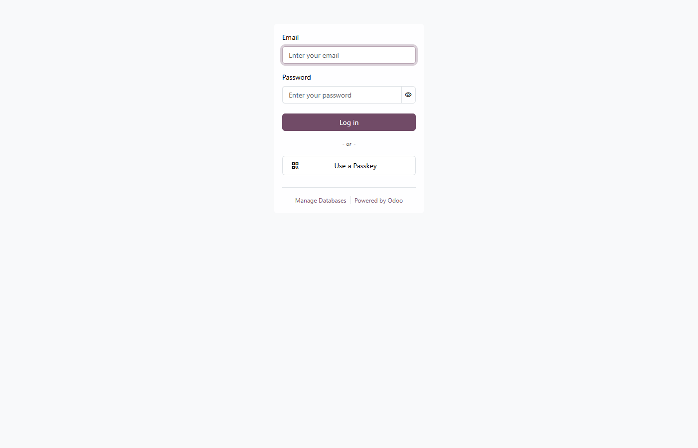

# 9. Il primo accesso

Il browser si è aperto da solo, che è il genere di piccola cortesia che fa sentire un sistema finito. L'indirizzo era `http://localhost:8069`—`localhost` che è il modo della macchina di dire *questo computer*, e 8069 che è la porta attraverso cui l'ERP ascolta.

La pagina che è apparsa era quasi vuota: una carta bianca, un logo composto da due forme viola, e due campi.

Maggie ha digitato l'indirizzo dell'amministratore che l'installatore aveva stampato, e la password, e ha premuto Invio.

Niente di drammatico è successo. Questa è la prima cosa che vale la pena dire sull'ERP: non ti saluta. Non ti complimenta. Apre una pagina con un menu in alto e poche carte colorate, e aspetta di essere detto chi è.

Questo è il momento in cui una piccola company di solito perde coraggio. Il sistema sembra vuoto, le carte sono prive di significato, e c'è la tentazione di concludere che qualcosa è andato storto—o, peggio, di iniziare a cliccare, che è così che una company finisce con quattro magazzini, tre valute e un cliente chiamato "test".

La pagina vuota non è un difetto. È la verità. Il sistema non sa ancora nulla di Riverton: non il suo nome, non i suoi soldi, non cosa vende. Quello che sa è come *essere* una company. L'ora successiva è l'ora in cui im quale company sia.

---

## La prima cosa da cambiare: la lingua della macchina

Odoo parla molte lingue, e l'installatore ha preso quella della macchina, che su questo PC era l'italiano. Una company in un mercato dell'Inghilterra vuole le sue fatture in inglese, i suoi nomi di tasse in inglese, e i suoi messaggi di errore in inglese, quindi la lingua è la prima impostazione da cambiare, prima che qualsiasi cosa sia stata nominata.

L'impostazione vive nelle preferenze dell'utente—il piccolo cerchio in alto a destra, *Il mio profilo*, *Preferenze*—ed è per utente, non per company. Questa distinzione vale la pena di essere compresa presto: Odoo è pieno di impostazioni che appartengono *a te* (lingua, fuso orario, quali notifiche vuoi) e impostazioni che appartengono *alla company* (valuta, tasse, lo schema dei conti). Cambiare la tua lingua non cambia nulla per chiunque altro; cambiare la valuta cambia tutto per tutti.

## La seconda cosa: la company stessa

Sotto *Impostazioni*, la prima voce è la company. È un modulo con un nome, un indirizzo, un numero di tasse, una valuta, un paese e un logo, ed è il modulo più importante di tutto il sistema, perché ogni documento che esce dall'edificio è timbrato con ciò che dice.

Tre campi di quel modulo meritano un paragrafo ciascuno.

**Il nome** è ciò che appare sulle fatture. Non è necessariamente il nome che la company usa nella conversazione; è il nome che il reparto amministrazione del cliente vedrà e il nome che l'ufficio tasse confronterà con una registrazione. Se differiscono, usa quello registrato.

**Il paese** decide una quantità sorprendente: quale schema di conti il sistema offre, quali tasse esistono, il formato degli indirizzi, il modo in cui le date sono stampate. Sceglierlo tardi è possibile e doloroso; sceglierlo per primo è gratuito.

**La valuta** è quella in cui la company tiene i suoi libri. Non la valuta di ogni transazione—Odoo gestisce la valuta estera, con tassi di cambio e guadagni e perdite—ma la valuta del libro mastro. Per Riverton, quella è la sterlina.

C'è un avvertimento collegato al cambio della valuta dopo che esistono dei documenti, e non è una formalità: il libro mastro è denominato in essa, e cambiarla a ritroso è come cambiare l'unità di misura di un magazzino dopo che le scaffali sono piene. Fallo ora, su un sistema vuoto, ed è un menu a tendina.

## La terza cosa: le persone

Odoo viene con un utente—l'amministratore—e la tentazione è di continuare a usarlo per tutto, perché è l'unico che esiste.

Resistile, e resistile per un motivo che non ha nulla a che fare con il teatro di sicurezza. Ogni record nell'ERP ricorda chi l'ha creato e chi l'ha cambiato. Se tutti lavorano come amministratore, quella memoria diventa inutile: il sistema dirà che *admin* ha creato la fattura, *admin* ha approvato lo sconto e *admin* ha cancellato il cliente, e la domanda "chi ha fatto questo?" non avrà risposta. La traccia di controllo vale qualcosa solo se le persone sono separate.

Per Riverton, quattro utenti bastavano per iniziare:

| Utente | Ruolo | Perché |
|---|---|---|
| Amministratore | pieni diritti | configurazione, e nient'altro |
| Doreen | contabilità, fatturazione | il suo lavoro, e la sua firma sul libro mastro |
| Priya | vendite | preventivi, ordini, clienti |
| Tom | inventario | ricevute, consegne, aggiustamenti di scorta |

Ognuno di loro ha un accesso, una password e un ruolo. Ognuno di loro appare nella traccia di controllo con il nome. E ognuno di loro può ricevere più o meno diritti senza toccare i diritti di chiunque altro.

C'è un quinto utente, come cui nessuno effettua l'accesso: l'assistente. È stato creato dall'installatore, ha la sua chiave, e ha esattamente i diritti di cui ha bisogno per fare il lavoro descritto in questo libro. Lo incontreremo a dovere nel capitolo dodici.

## La quarta cosa: cosa fa la company

L'ultima domanda della prima ora è quella che decide quali parti dell'ERP sono accese. Odoo è modulare: può essere un programma di fatturazione, o un magazzino, o una fabbrica, o un negozio, e la differenza è quali applicazioni sono installate.

Per un grossista, la risposta è breve: *Vendite*, *Acquisti*, *Inventario*, *Fatturazione*, e *Contabilità*. Non *Produzione* (Riverton non produce nulla), non *Punto di vendita* (non c'è un negozio), non *Sito web* (il negozio online è una cosa separata e può essere collegato in seguito). Ogni applicazione che viene installata aggiunge menu, e ogni menu è un invito alla confusione se a nessuno serve.

Maggie ha installato cinque applicazioni nella prima ora e ha resistito alle altre venti. Quella moderazione vale più di qualsiasi configurazione: un sistema con cinque applicazioni che tutti usano vale più di un sistema con venti che a nessuno piace fidarsi.

## Il dashboard, e perché è vuoto apposta

Le carte colorate sulla prima schermata sono il tentativo di Odoo di rispondere alla domanda *cosa dovrei guardare?* prima che tu sappia abbastanza da chiederlo. C'è una carta per le vendite, una per le fatture, una per la scorta, e ciascuna mostra un numero e un piccolo grafico.

Su una nuova company ogni carta mostra zero, e i grafici sono linee piatte. Questo non è un bug e non è una brutta prima impressione; è l'unica cosa onesta che il sistema poteva mostrare. Un dashboard che avesse inventato un numero plausibile per una company vuota sarebbe un dashboard di cui non saresti mai più potuto fidarti.

Le carte diventano utili in tempi diversi, e sapere quali ignorare fa parte del primo mese.

**Vendite** è utile dalla prima preventivo. Mostra la pipeline in soldi: preventivi inviati, ordini confermati, fatture da emettere.

**Fatturazione** è utile dalla prima fattura registrata, ed è la carta che Maggie guardava ogni mattina: quanto è dovuto, quanto è in ritardo.

**Inventario** è inutile finché i prodotti esistono e la scorta è stata contata, ed è perché il capitolo undici viene prima dell'assistente.

**Contabilità** è utile finché lo schema è configurato e le prime inserzioni sono registrate.

Una company che cerca di rendere tutti e quattro le carte significative nella prima settimana spenderà una settimana e mezza in configurazione e perderà coraggio. Una company che ignora tre di esse e ne rende una utile avrà un sistema che è utile venerdi.

## La prima persona che non è il proprietario

Priya ha effettuato l'accesso il secondo pomeriggio, dalla sua scrivania, con l'account che Maggie aveva creato per lei, e la prima cosa che ha detto è: "Dov'è tutto?"

La schermata che ha visto non era la schermata che Maggie stava guardando. I menu erano più brevi. Non c'era *Impostazioni*, non c'era *Utenti*, non c'era *Contabilità* oltre le fatture che le era permesso vedere. C'era *Vendite*, con preventivi e ordini, e *Clienti*, e una casella di ricerca.

Questo è tutto il punto di un utente, ed vale la pena di guardare qualcuno che lo incontra per la prima volta. Per trenta anni Priya aveva lavorato in un sistema in cui tutti potevano fare tutto, perché il sistema era una cartella condivisa e un insieme di file. L'idea che un programma le mostrasse *meno*, apposta, ha impiegato circa dieci minuti per cessare di sembrare un'offesa e iniziare a sembrare un sollievo.

"Non posso rompere nulla," ha detto, alla fine del pomeriggio.

"Puoi rompere un preventivo," ha detto Maggie. "Non puoi rompere il libro mastro."

C'è un punto più profondo in quello scambio, ed è la ragione per cui gli utenti sono stati configurati prima che qualsiasi dato fosse inserito. In un sistema in cui tutti possono fare tutto, nessuno è responsabile di nulla: quando un prezzo è sbagliato, è sbagliato perché qualcuno, da qualche parte, l'ha digitato. In un sistema in cui ogni persona ha un ruolo, il prezzo è sbagliato perché Priya l'ha digitato—che suona più duro ed è in realtà più gentile, perché significa che il prezzo può essere corretto, e la persona che lo ha corretto può essere ringraziata.

L'assistente, quando è arrivato, ha ricevuto esattamente lo stesso trattamento. È un utente in quella lista, con un ruolo, e appare nella traccia di controllo come tutti gli altri.

## La pagina che ti dice cosa fare dopo

La prima schermata dopo l'accesso non è il dashboard. È una pagina chiamata *Primi passi*, ed è la cosa più premurosa di tutta l'applicazione.

Elenca cinque cose: scegli il paese della tua company, configura lo schema di conti, aggiungi i tuoi prodotti, aggiungi i tuoi clienti, e invita i tuoi colleghi. Ognuna è un link, e ognuna scompare quando è fatta. Quando tutte e cinque sono fatte, la pagina scompare anche lei.

C'è un principio di progettazione in quello, ed vale la pena di nominarlo perché la maggior parte del software lo sbaglia: **il sistema dovrebbe sapere ciò che non sa ancora.** Un dashboard che mostra zero è un dashboard che non ti dice nulla. Una checklist che dice *non hai clienti* è una checklist che ti dice esattamente cosa fare dopo, nell'ordine che ha senso.

L'ordine conta anche lui. Paese per primo, perché decide lo schema di conti; schema di conti prima dei prodotti, perché i prodotti hanno bisogno di conti di reddito; prodotti prima dei clienti, perché un preventivo ha bisogno di entrambi. Una company che inizia con i clienti—che è l'istinto naturale, perché i clienti sono ciò di cui un affare si occupa—scoprirà in un'ora che non può preventivare nulla.

Maggie ha fatto le cinque passi in un pomeriggio, nell'ordine dato, e l'unica che ha saltato è *invita i tuoi colleghi*, perché voleva una giornata per fare i propri errori prima che qualcuno la guardasse.

Quello era una buona decisione, ed è l'unica pezzo di consiglio in questo capitolo che non è nel software.

---

Alla fine del pomeriggio la pagina era diversa. C'erano menu: *Vendite*, *Acquisti*, *Inventario*, *Contabilità*. C'erano quattro utenti. C'era una company con un nome, una valuta e un paese. C'era ancora nessun dato—nessun cliente, nessun prodotto, nessuna fattura—ma il sistema ora sapeva per che tipo di company stava lavorando, che è la differenza tra una pagina bianca e un libro mastro vuoto.

Doreen è arrivata alle quattro e mezza, come concordato, e si è seduta davanti ad esso.

Ha guardato la schermata per un po' senza dire nulla. Poi ha detto: "È molto vuoto."

"Lo è."

"E questo saprà di più su questa company di quanto non faccia io."

Maggie si aspettava la domanda in una forma o nell'altra, e aveva deciso di rispondervi onestamente.

"Va *ricordare* più di quanto non faccia tu," ha detto. "Non saprà di più. Non sa che l'ufficiale di finanza di Ashfield si chiama Carol, o che il cancello della scuola è chiuso prima delle otto, o che il manager lì preferisce una telefonata a una email. Non sa che i raccoglitori blu sono quelli che vendono, o che il fornitore di carta è inaffidabile ad agosto. Sa ciò che gli diciamo, e non dimentica mai ciò che gli è stato detto."

Doreen ha considerato questo.

"Quindi sono io quella che glielo dico," ha detto.

"Sei tu quella che decide ciò che è vero. Quello è un lavoro diverso da quello che avevi lunedì."

Lo era, e le sono necessarie poche settimane per cessare di sentire che il sistema la stava guardando. Ma è stata la prima a ammettere, verso la primavera, che il libro mastro era diventato un luogo in cui poteva *chiedere*—e che chiedere è un modo migliore di passare una mattina che cercare.

Il mattino successivo sono partiti dai soldi, perché i soldi sono dove cominciano tutte le discussioni di ogni company.
