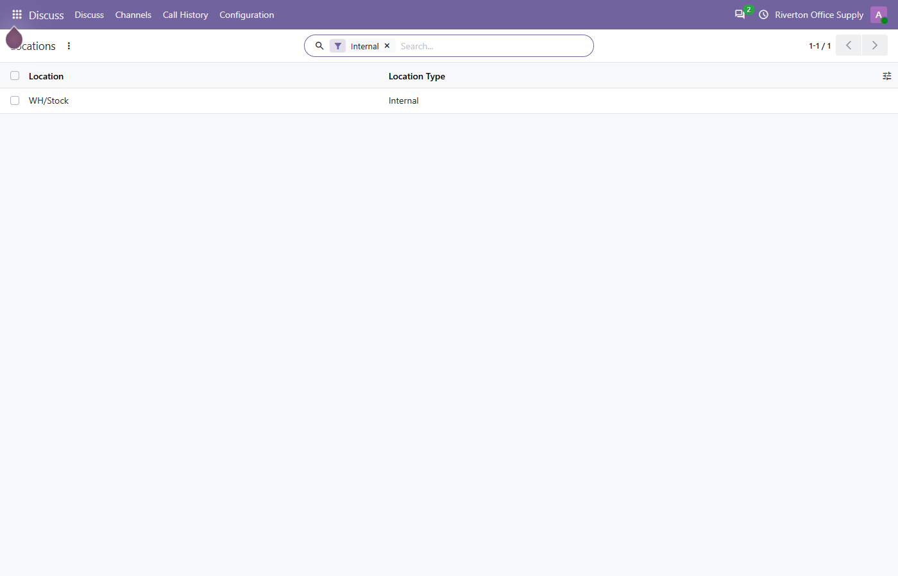

# 11. Scaffiali, Cassette e Nomi

Tom Beck lavorava nel magazzino di Riverton da diciannovi anni, e aveva una sola regola riguardo ai computer, che annunciò la mattina del quarto giorno, in piedi nella soglia della piccola stanza con le braccia conserte.

"Non digiterò undicimila prodotti."

"Nessuno te lo chiede," disse Maggie. "Dobbiamo digitare quaranta."

Tom sciolse le braccia conserte, che era il massimo entusiasimo che gli fosse mai scatto prima del pranzo.

---

## Perché quaranta e non undicimila

Il catalogo di un grossista non è la stessa cosa del suo *assortimento*. Riverton elencava undicimila referenze perché, in oltre trent'anni, aveva comprato qualsiasi cosa i clienti gli chiedessero, e la lista era cresciuta come cresce una siepe. Di quelle undicimila, quattrocento avevano venduto più di dieci unità nell'ultimo anno. Quattrocento sono comunque troppe per essere digitate in una settimana, e la maggior parte condividono una forma: un marchio, una taglia, un colore, una quantità di confezione.

Il piano non era quindi copiare il catalogo. Il piano era modellare correttamente le *famiglie* e lasciare che le varianti facessero il lavoro.

La lavagna bianca nell'ufficio del magazzino finì con quattro righe scritte sopra:

| Famiglia | Varianti | Unità di vendita | Unità di acquisto |
|---|---|---|---|
| Faldoni | 2 taglie × 3 colori | ogni singolo | cassa da 20 |
| Lavagnette bianche | 4 colori | pacchetto da 4 | cassa da 12 pacchetti |
| Carta A4 | 1 | rima | pallet di 40 rime |
| Penne a sfera | 2 colori | cassa da 50 | cassa da 50 |

Quattro famiglie, tra cui poche decine di varianti. È questo che un ERP moderno chiama lista di prodotti: non la lista di tutto ciò che hai mai comprato, ma un modello delle cose che vendi, con le differenze espresse come varianti anziché come voci separate.

La differenza non è estetica. Se "Faldone A4 blu" e "Faldone A4 rosso" sono due prodotti, il sistema non può rispondere a "quanti faldoni A4 abbiamo venduto?" senza che qualcuno sappia che i due sono correlati. Se sono un unico prodotto con una variante di colore, la domanda è banale—e la domanda è tutto il punto.

## Le categorie, e perché un report ne ha bisogno

Una categoria di prodotto è una cartella, e le cartelle sono noiose finché qualcuno non fa una domanda.

In Odoo una categoria fa tre cose: raggruppa i prodotti per la rendicontazione, può contenere conti predefiniti (in modo che ogni prodotto della categoria registri le proprie vendite sullo stesso conto di ricavo), e può contenere un'unità di misura e un metodo di costo predefiniti.

Le categorie di Riverton finirono per essere sei: *Carta*, *Faldoni e organizzazione documenti*, *Strumenti di scrittura*, *Inchiostri e toner*, *Mobili*, e *Servizi*. Sei sono sufficienti per rispondere alla domanda *quale parte dell'azienda ha guadagnato questo mese?* e poche abbastanza che a nessuno viene da discutere su dove un prodotto appartenga.

L'alternativa—una sola categoria chiamata *Tutti i prodotti*—è ciò che un'azienda ottiene se non decide, e significa che ogni report sui margini è un report sull'intera azienda. È un buon report, ma non è quello di cui un grossista ha bisogno, perché il profitto di un grossista si guadagna e si perde nel mix tra le categorie, non nel totale.

C'è un secondo motivo per cui vale la pena curare questo aspetto, ed è contabile. Se la categoria contiene il conto di ricavo, un nuovo prodotto viene registrato correttamente per predefinizione, e chi lo crea non deve sapere nulla dello schema dei conti. Se non lo fa, ogni nuovo prodotto è una piccola decisione contabile assunta da qualcuno che sta pensando alla cancelleria.

## Le unità di misura, e l'aritmetica del magazzino

La seconda cosa da impostare correttamente è l'unità.

Riverton compra i faldoni in casse da venti e li vende singolarmente. Se il sistema non sa che una cassa contiene venti unità, ogni ricevuta, ogni conteggio e ogni consegna diventeranno oggetto di discussione, e qualcuno finirà per convertire a mente nel momento sbagliato.

Odoo gestisce questo con due unità per prodotto: l'unità di misura usata per acquistare e scovrire (la cassa), e l'unità de vendita (il singolo), con un fattore di conversione. Il magazzino conta le casse; il cliente ordina i singoli; la fattura è in singoli; le scorte sono in casse. Un unico numero, tre visioni.

C'è una trappola qui che è costata alle aziende più denaro di qualsiasi altra impostazione singola: **l'unità di misura su un prodotto esistente non può essere cambiata dopo che ha movimentato.** Una volta registrate cento ricevute in "singoli", dire al sistema che il prodotto è effettivamente comprato in "casse da venti" non converge la storia; la corrompe. Il momento per impostare questo correttamente è prima della prima ricevuta, ed è per questo che Tom ci impiegò un'ora e per cui quell'ora valse più delle due giornate che avrebbe impiegato in seguito a riconciliare un conteggio di scorte.

## Il magazzino in sé

Un ERP non ha "il magazzino". Ha *diazioni*, e una posizione è qualsiasi luogo dove lo stock può trovarsi.

Odoo ne installa due per predefinizione: una posizione virtuale chiamata *Partner* (dove le merci provengono e dove vanno, perché un fornitore non è uno scaffale) e *Stock*, il magazzino fisico. Da lì un'azienda aggiunge ciò che effettivamente possiede: *Stock/Scaffale A*, *Stock/Scaffale B*, *Stock/Resi*, *Stock/Danneggiato*.

Riverton ne aggiunse quattro: due scaffali, una area per i resi e una area di quarantena per le merci danneggiati. L'ultima conta più di quanto sembri. Senza di essa, le scorte danneggiate restano nella posizione principale e vengono conteggiate come vendibili, e l'azienda scopre il problema quando un cliente apre una cassa di faldoni schiacciati. Con essa, il danno è un *spostamento*—un documento, con una data e una causa—e il report di scorte dice la verità.

## I primi prodotti

I prodotti furono digitati in un pomeriggio, da Priya e Tom insieme, che è l'unico modo in cui funziona: il commesso sa come lo chiama il cliente, il magazzino sa come lo chiama il fornitore, e la scheda del prodotto ha bisogno di entrambe le cose.

Sei campi su quel form decidono quasi tutto ciò che accade in seguito.

**Tipo di prodotto.** *Merce* per le cose che puoi mettere su uno scaffale; *Servizio* per le cose che non puoi. Un servizio non ha scorte né consegna; una merce ha entrambe le cose. Sbagliare questo rende un prodotto permanentemente non consegnabile o permanentemente non conteggiabile.

**Prezzo di vendita e prezzo di acquisto.** Le predefinite. Il prezzo reale per un dato cliente può essere diverso—è per questo che servono le liste di prezzo—ma la predefinizione è ciò che il commesso vede quando è di fretta.

**Imposta.** Il tasso che si applica a questo prodotto. Come diceva il capitolo dieci: configurato qui, una volta, e ereditato da ogni documento.

**Unità di misura.** Come sopra.

**Referenza interna.** Il codice che usa il magazzino. È il campo che fa la differenza tra un sistema che gli esseri umani possono usare e uno che non possono, perché è ciò che le persone dicono ad alta voce quando sono davanti a uno scaffale.

**Codice a barre.** Opzionale, e trasformativo se hai uno scanner: una consegna può essere verificata facendosi "beep" su ogni cassa anziché leggendo una lista.

## La prima scorta

Un sistema che crede che il magazzino sia vuoto rifiuterà di consegnare qualsiasi cosa, il che è corretto e scomodo. Quindi la prima scorta deve essere digitata, e ci sono due modi onesti per farlo.

Il primo è un *inventario iniziale*: tu dici al sistema quanti prodotti hai di ogni tipo, a una data specifica, e lui crea la corrispondente scorta. È ciò che Riverton fece, in due serate, con una tavoletta e una torcia elettrica.

Il secondo è un *conteggio di scorte*: il sistema ti chiede di contare, e tu inserisci ciò che trovi, e lui registra la differenza tra ciò che credeva e ciò che è vero. È ciò che Riverton fa ogni trimestre ora, ed è un'operazione diversa con uno scopo diverso.

Entrambe sono documenti. Nessuna è un numero digitato in un campo. È questa la disciplina che fa funzionare tutto il resto: **la scorta non è mai un numero che imposti; è la somma degli spostamenti che hai registrato.** Se questo sembra pedante, considera ciò che accade quando un numero può essere impostato: qualcuno lo imposta, qualcun altro lo riporta al valore precedente, e il magazzino e i conti litigano per sempre.

## Le cose che non sono cose

C'è una categoria di prodotto che causa più confusione di qualsiasi altra, e vale una pagina intera: i prodotti che non sono fisici.

Riverton ne ha tre, e ogni grossista ha le stesse tre.

**Spese di trasporto.** La carica che il cliente paga per la consegna. Non ha scorte, non viene mai ricevuta, e deve essere fatturata. In Odoo è un prodotto di tipo *Servizio*, con un tasso di imposta e un prezzo, e l'unica cosa che lo distingue da una cassa di penne è che non compare mai in una consegna.

**Lo sconto.** Non un prodotto a tutti gli effetti, nella maggior parte dei sistemi: una riga negativa sull'ordine, o una regola della lista di prezzo. Ma un'azienda che emette note di credito per ribassi su volume ha bisogno di un prodotto da mettere sulla nota di credito, e di solito si chiama qualcosa come *Ribasso su volume* e viene digitato come servizio.

**Il campione.** Un prodotto regalato. Ha scorte, lascia il magazzino, e non deve essere fatturato. Se è modellato come un prodotto normale con prezzo zero, i report sui margini mostreranno una perdita del cento per cento su cento unità; se è modellato come servizio, la scorte non uscirà mai. Il modo pulito è una *consegna* del prodotto senza un ordine alle spalle, con una causa, che è anche l'unico modo in cui il costo finisce nel posto giusto.

Nessuna di queste è difficile. Tutte sono invisibili il primo giorno e producono numeri strani il trentesimo, ed è per questo che chi imposta il sistema dovrebbe sedersi con chi fattura e fare una domanda semplice: *cosa mettiamo su una fattura che non è su uno scaffale?*

## Le quattrocento prodotti che nessuno compra

Ogni grossista li ha: il catalogo di cose che sono state comprate una volta per un cliente che le aveva chieste, e poi mai più. Le undicimila referenze di Riverton contenevano, secondo l'estimazione di Tom, circa quattrocento di quelle.

La tentazione è pulirli nella prima settimana, ed è il primo movimento sbagliato per due motivi. La pulizia richiede settimane, e insegna all'ufficio che il nuovo sistema è un compito prima di aver loro insegnato che il nuovo sistema è utile.

Il movimento giusto è portare dentro le quattrocento righe che contano—quelle con attività nell'ultimo anno—e lasciare le altre nel vecchio sistema, archiviate, per quanto richiede la legge. Un prodotto che non si è mosso dal 2019 non ha bisogno di una scheda nel nuovo sistema il primo giorno; ha bisogno di una decisione, e la decisione può aspettare finché qualcuno avrà tempo.

C'è un secondo beneficio nell'aspettare. Dopo tre mesi di nuovo sistema, il report *prodotti senza movimento nell'ultimo anno* è una lista esattamente dei candidati al ritiro, prodotta in un secondo, con il valore di scorte allegato. La pulizia diventa una decisione con numeri, anziché una settimana di digitazione.

## La regola di riordino

L'ultima cosa che Tom impostò fu la regola di riordino, ed è il primo punto in cui il sistema inizia a essere utile piuttosto che semplicemente accurato.

Per ogni prodotto impostò due numeri: un *minimo* (sotto questo, siamo a rischio) e un *massimo* (ordina fino a questo). Odoo osserva la scorta, e quando un prodotto scende sotto il minimo propone un ordine di acquisto per la differenza. Non lo invia. Lo propone, in una lista, e una persona decide.

Quella distinzione—proporre, non agire—è la stessa distinzione che avrà un'importanza enorme quando l'assistente arriverà nel Parte III. Una macchina che propone è un collega. Una macchina che agisce senza chiedere è un rischio con una spina.

---

Il venerdì di quella settimana, Tom fece qualcosa che non faceva da diciannovi anni: stampò un report di scorte e lo lesse nel furgone, sulla strada per una consegna.

"Quattrocentododici righe," disse, quando tornò. "Le conosco tutte. Ma non le ho mai viste su una pagina prima. Le ho viste nella mia testa, una alla volta, quando qualcuno me le chiedeva."

Mise il report sulla desk di Maggie.

"Guarda la carta," disse. "Abbiamo undicentocinquanta rime e vendiamo circa novanta a settimana. Sono tre mesi di carta. Non è esattamente sbagliato, ma è un sacco di soldi fermati su uno scaffale."

Lo era, ed era la prima volta che chiunque a Riverton poteva dirlo con un numero allegato. La scorta era sempre stata lì; il *fatto* sulla scorta era nella testa di Tom, e la testa di Tom era in un furgone.

Questo è ciò che diventa un quando viene modellato correttamente: non un luogo dove le cose sono, ma un luogo dove le cose sono *conosciute*. E la conoscenza, una volta esistente, inizia immediatamente a fare domande che nessuno aveva pensato di fare—sulla carta, sui soldi liquidi, sulle undicentocinquanta rime che avrebbero potuto essere quattrocento.

Maggie scrisse il numero sul retro del report di scorte e lo mise nel cassetto con il fazzoletto e la carta di Gerald. Il cassetto stava diventando pieno. Quello, decise, era un buon segno.
