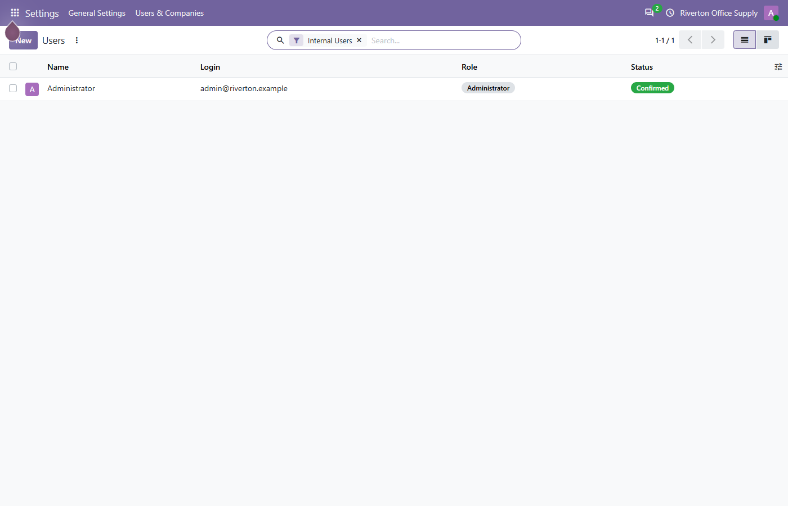

# 12. La chiave che apre una sola porta

L'ultimo pezzo di configurazione prima che l'assistente potesse essere lasciato libero era il meno interessante e il più importante: la chiave.

Sam la spiegò sulla lavagna, nel modo in cui spiegava tutto, con un diagramma che richiedeva trenta secondi e che chiudeva un dibattito che di solito richiede una settimana.

"Ogni serratura di questo edificio ha una chiave," disse, disegnando un rettangolo per l'ERP. "La domanda non è se l'assistente riceve una chiave. La domanda è quale porta apre, e cosa può fare una volta entrata."

---

## Cosa è una chiave API

Una chiave API è una password che un programma usa al posto di una persona. È una lunga sequenza di caratteri, viene mostrata una sola volta, e appartiene a un *utente*—non al programma, e non alla macchina.

Quell'ultimo punto è tutto il disegno. Quando l'assistente si collega a Odoo, non si collega come superuser con una porta di servizio speciale. Si collega come account utente chiamato, nel caso di Riverton, *Agent*, con una password e una chiave, e con un insieme di permessi che una persona avrebbe potuto dare a un nuovo dipendente nel primo giorno.

Che significa tre cose, e ciascuna di esse vale più della comodità che costa.

**Le regole dell'ERP si applicano all'assistente.** Se l'utente *Agent* non può eliminare fatture, l'assistente non può eliminare fatture—non perché gli è stato detto di non farlo, ma perché l'ERP rifiuterà la richiesta. L'intelligenza è nuova; le regole sono vecchie; la cosa nuova funziona dentro la cosa vecchia.

**L'assistente compare nella traccia di controllo.** Ogni record che crea dice *Agent* nel campo "creato da", e ogni modifica che fa è registrata. Se una fattura compare alle quattro del mattino con uno sconto strano, il sistema non dirà "la macchina l'ha fatta"; dirà quale utente, a che ora, e con quali valori.

**La chiave può essere revocata senza cambiare nient'altro.** Se la chiave trapela, o l'assistente viene sostituito, o qualcuno se ne va, la chiave viene edita e l'assistente si ferma. L'ERP non cambia, gli utenti non cambiano, e non c'è nulla da reinstallare.

## Dove vive la chiave

L'installatore generò la chiave durante l'installazione e la scrisse nella configurazione del connettore, nella cartella dell'assistente stesso. Non è nel libro, non è in una email, e non è in un documento che viene inoltrato. È in un file, su una macchina, con i permessi di file dell'utente che l'ha installato.

La stessa chiave può essere creata a mano, e ogni utente può crearne una per sé: si trova nel menu utente, *Il mio profilo*, *Sicurezza dell'account*, *Nuova chiave API*. L'ERP la mostra una volta, in una casella, con un avvertimento che non verrà mai più mostrata—che non è una minaccia, ma un fatto su come le chiavi sono conservate: il sistema conserva un hash, non la chiave, quindi non può ricordartela dopo.

## Cosa era permesso all'assistente

L'utente *Agent* di Riverton ricevette un ruolo, e il ruolo fu scelto con una regola che vale la pena ripetere: **dai all'assistente i diritti del dipendente meno potente che potesse fare il lavoro.**

Per Riverton, ciò significava:

| Area | Diritti | Perché |
|---|---|---|
| Clienti | leggere, creare, modificare | prende ordini e aggiunge contatti |
| Prodotti | leggere | fa preventivi; non inventa prodotti |
| Vendite | leggere, creare, confermare | scrive preventivi e conferma ordini |
| Fatture | leggere, creare, registrare | fattura; la registrazione è l'atto che crea il bilancio |
| Pagamenti | leggere, creare | registra ciò che dice la banca |
| Acquisti | leggere, creare, confermare | riordina ciò che chiede il magazzino |
| Magazzino | leggere, aggiustare | sposta scorte e registra danni |
| Configurazione contabile | nessuno | la configurazione è un lavoro di una persona |
| Utenti e permessi | nessuno | mai, per nessuna circostanza |
| Eliminazione documenti | nessuno | se qualcosa è sbagliato, viene annullato, non cancellato |

Le ultime due righe sono quelle da difendere. Una macchina che può cambiare permessi può concedere a sé stessa qualsiasi cosa; una macchina che può eliminare può distruggere la traccia di controllo che proverbbe cosa ha fatto. Entrambe sono escluse non perché l'assistente sia inaffidabile in qualche senso drammatico, ma perché il costo di escluderle è zero e il costo di un errore non lo è.

## La conversazione sulla fiducia

Doreen, che era stata silenziosa per gran parte di tutto ciò, fece la domanda che contava.

"Cosa la ferma dal fare qualcosa di stupido?"

"Niente la ferma," disse Sam. "Quella è la risposta onesta. Può creare un cliente con un nome sciocco, o registrare una fattura alla persona sbagliata, o ordinare quattrocento scatole del carta sbagliata. Cosa fa sì che ciò non sia un disastro è che puoi vederlo, e annullarlo, e che non può fare le cose che non possono essere annullate."

"Non è molto rassicurante."

"No," convenne. "Ma è la stessa rassicurazione che hai con un nuovo dipendente. Non li fermi dal commettere un errore; dai loro un lavoro con un limite, controlli il lavoro del primo mese, e ti assicuri che gli errori siano del tipo che puoi correggere."

La differenza—e è la differenza che rende il sistema utilizzabile—è che gli errori dell'assistente sono *visibili in un modo in cui non lo sono quelli di una persona*. Una persona che sente male una quantità la scrive su un ordine e nessuno nota finché il cliente si lamenta. La versione dell'assistente dello stesso errore è un record con un timestamp, un utente, lo strumento che ha chiamato e gli argomenti che ha passato, e può essere trovata in un log da chiunque pensi di guardare.

È per questo che il log non è un dettaglio tecnico. È la cosa che rende un agente accettabile in un'azienda dove i soldi si muovono: non che non erro mai, ma che i suoi errori sono *trovabili*.

## Il primo test

Prima di lasciare che l'assistente facesse qualcosa, Sam gli chiese di non fare nulla.

"Controlla la connessione," digitò. "Dimmi quale versione di Odoo è in esecuzione."

La risposta tornò in un secondo: la versione, il nome del database, l'utente con cui era collegato, e la compagnia a cui era indirizzato. Quattro fatti, tutti corretti, tutti che una persona poteva controllare nell'ERP in circa lo stesso tempo.

"Bene," disse Sam. "Ora chiedile quanti clienti ci sono."

Non ce ne erano, perché nessuno aveva inserito ancora nulla. L'assistente disse zero, che era vero, e che è una risposta più interessante di quanto sembri: un sistema che può dire *zero* è un sistema che sta leggendo il database, non un sistema che inventa qualcosa. Un modello che indovinerebbe avrebbe prodotto un numero plausibile.

"Giusto," disse Sam, chiudendo il laptop. "È tuo. Dagli un lavoro."

## Il permesso che tutti dimenticano

C'è un permesso in ogni ERP che le aziende concedono senza pensare, ed è quello che annulla tutti gli altri: la capacità di cambiare la *configurazione*.

Un utente che può modificare lo schema dei conti può registrare qualsiasi dovunque. Un utente che può modificare i codici fiscali può far sparire una vendita. Un utente che può cambiare i diritti di accesso può concedere a sé stesso qualsiasi cosa gli manchi. Le regole che proteggono il bilancio sono essi stessi dati, e chiunque può cambiare i dati può cambiare le regole.

L'assistente è quindi escluso dalle impostazioni del tutto—non perché le abuserebbe, ma perché la competenza di un agente consiste precisamente nel *fare cose*, e la configurazione è l'unica area dove fare la cosa sbagliata è indistinguibile dal fare la cosa giusta finché l'auditor non arriva.

La regola si generalizza: **automatizza il lavoro, mai le regole.** Un'azienda che lascia che un assistente cambi i propri permessi ha, di fatto, zero permessi; ha una casella per i suggerimenti.

## Il primo controllo dopo aver creato una chiave

Nel momento in cui una chiave è creata, c'è un controllo vale la pena fare, e richiede dieci secondi.

Nell'assistente, chiedi: *controlla la connessione a Odoo e dimmi quale versione è in esecuzione.*

Un numero di versione e un nome di database significano che la chiave funziona, che l'indirizzo è giusto, e che l'utente può raggiungere l'ERP. Un errore significa che uno dei tre è sbagliato, e il messaggio di errore di solito dice quale.

Quel controllo vale la pena ripeterlo dopo qualsiasi cambiamento alla configurazione—una nuova chiave, una nuova porta, una nuova macchina—perché isola la connessione da tutto il resto. Quando qualcosa in seguito va sbagliato, la prima domanda è sempre *è la connessione o è la domanda?* e questa istruzione ci risponde in un secondo.

Doreen la scrisse su una scheda e la incollò al monitor. È l'istruzione meno interessante di questo libro e quella che ha fatto risparmiare più tempo.

## Quando la chiave trapela

Una chiave scritta in un file di configurazione su una macchina può trapela in tre modi, e tutti e tre sono accaduti a aziende che non erano imprudenti.

Può essere copiata in un backup che viene poi condiviso. Può essere incollata in un ticket di supporto da qualcuno che cerca di essere d'aiuto. E può essere letta da un altro programma sulla stessa macchina, che è il motivo per cui un computer condiviso da cinque persone non è un buon posto per una chiave che può fatturare.

La remedies non è di custodire la chiave con cerimonie. La remedies è che la chiave è *economica da sostituire*:

1. Nell'ERP, apri la pagina di sicurezza dell'account dell'utente ed elimina la chiave.
2. Creane una nuova e incollala nella configurazione del connettore.
3. Riavvia l'assistente.

Tre minuti, zero dati persi, zero reinstallazioni. La vecchia chiave cessa di funzionare nell'istante in cui viene editata, che è la proprietà che rende ciò sicuro: una chiave trapelata è un fastidio piuttosto che un incidente, purché qualcuno se ne accorga e la revochi.

La cosa che la rende un incidente è una chiave appartenente a un utente che può fare tutto. Ed è per questo che l'utente *Agent* ha un ruolo, e perché la chiave dell'amministratore non è mai quella data a un programma.

## Un agente alla volta

C'è un altro limite vale la pena conoscere, ed è per niente sui permessi.

L'assistente gira sulla stessa macchina di tutto il resto, e il modello linguistico—che sia un servizio in un altro edificio o un modello sulla tua scheda grafica—risponde a una richiesta alla volta. Un'azienda che avvia quattro agenti in quattro finestre non otterrà quattro volte il lavoro; otterrà quattro agenti che si alternano, e una macchina senza memoria rimasta.

L'installatore è costruito attorno a questo: un assistente, una finestra, un launcher che apre esattamente una. La tentazione di aprire una seconda, di fare qualcos'altro mentre la prima sta pensando, è il modo più comune in cui un'piccola installazione va in tilt—e la remedies non è tecnica. È aspettare, o chiedere meno in una volta.

Riverton lo imparò nella seconda settimana, quando Tom aprì una seconda finestra per chiedere del magazzino mentre la fattura di Priya stava sendo scritta. La macchina non si schiantò. Semplicemente divenne lenta, poi più lenta, e poi entrambe le finestre risposero insieme con due metà dello stesso lavoro, e Doreen passò venti minuti a capire quale fattura fosse reale.

La regola che ne uscì è sul muro della sala fatture, accanto al tovagliolo: *una domanda alla volta, e leggi la risposta.*

---

Quella sera Maggie sedette davanti alla finestra dell'assistente per un po' senza digitare nulla.

La finestra era semplice: un prompt, un posto per la risposta, e una piccola riga in fondo che diceva quale modello stesse usando. Sembrava le finestre del terminale che suo padre usava negli anni Novanta, che era o rassicurante o allarmante a seconda della tua visione degli anni Ninanta.

Digitò: *Cosa puoi fare?*

La risposta era una lista. Poteva leggere clienti, prodotti, ordini, fatture, magazzino; poteva creare e cambiare record; poteva chiamare le azioni che spostano un documento da uno stato all'altro; poteva raggruppare, sommare e contare. Non poteva cambiare le impostazioni dell'azienda, gestire utenti, o eliminare qualsiasi cosa.

La lesse due volte, e poi digitò la frase che era stata nella sua testa dalll lunedì di novembre quando aveva guidato una fattura attraverso la città.

*Mostrami ogni cliente che ci deve soldi e non ha ordinato nulla in sei mesi.*

La risposta richiese quattro secondi. Non c'erano ancora clienti, quindi la risposta era una frase educata che lo diceva—ma la frase includeva le due cose che aveva cercato e il luogo dove aveva cercato, che è ciò che fa un buon dipendente quando la risposta è "niente."

Maggie chiuse la finestra e tornò a casa.

Il mattino dopo, iniziò a inserire i clienti.
