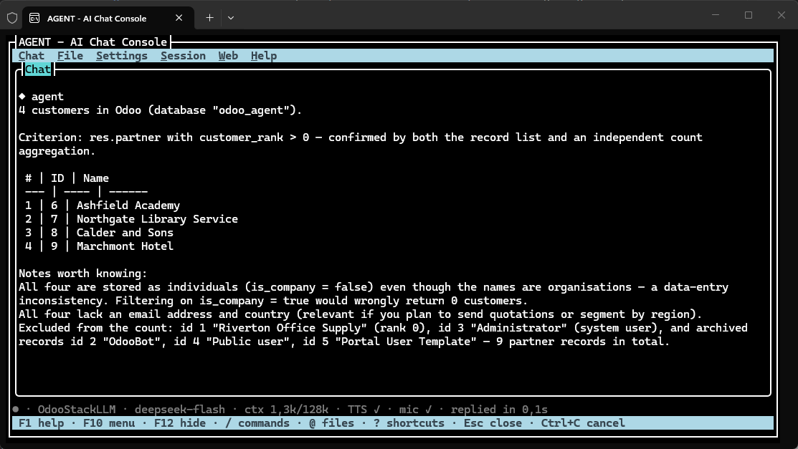

# 13. La prima conversazione

La prima volta che l'assistente è stato avviato, ha chiesto una chiave.

Non la chiave dell'ERP—quella era stata creata durante l'installazione e inserita nella configurazione del connettore. Era l'altra: la chiave che permette all'assistente di parlare con un modello linguistico, cioè la chiave che gli permette di pensare.

La finestra era quella dell'assistente stesso, aperta tramite l'icona di Odoo AI, e sembrava un terminale del 1995: una barra dei menu in cima, una vasta area vuota, e una riga in fondo con un cursore. Prima dell'avvio iniziale, c'era una breve serie di domande.

*Scegli un fornitore.*

L'elenco era il solito: i grandi servizi cloud, un paio di aggregatori, e l'opzione di un modello che gira sulla macchina stessa. Maggie ha scelto DeepSeek, perché era quello che Sam aveva raccomandato per il costo, e perché l'azienda aveva già un account per esso.

*Incolla la chiave.*

L'ha incollata. La finestra si è bloccata per un secondo, poi ha stampato un elenco di nomi di modelli—ed è questo il momento che vale la pena notare, perché è il momento in cui l'assistente *dimostra* che la chiave funziona. Non si era semplicemente limitato ad accettare ciò che aveva digitato: l'aveva usata per chiedere al fornitore cosa potesse fare, e il fornitore aveva risposto. Una chiave sbagliata produce un errore in quel momento, non tre giorni dopo in piena un fattura.

Ha scelto il modello, e la finestra si è pulita.

---

## La prima domanda

Ha digitato: *Cosa puoi fare?*

La risposta era un elenco, ed era più lungo di quanto si aspettasse. Poteva cercare clienti, prodotti, ordini, fatture e magazzino; poteva leggere e creare registrazioni; poteva chiamare le azioni che spostano un documento dalla bozza alla conferma; poteva raggruppare, sommare e contare. Non poteva cambiare le impostazioni dell'azienda, gestire gli utenti, o eliminare anything.

L'ha letta due volte. Poi ha digitato la domanda che portava da novembre.

*Quanti clienti abbiamo?*

La risposta è arrivata in circa un secondo: *Zero. Il database non ha ancora registrazioni di clienti.*

Un modello che indovinerebbe avrebbe detto qualcosa come "hai circa 40 clienti" o avrebbe prodotto un elenco di nomi plausibili, perché è ciò che fa un modello linguistico quando non ha fatti: produce il testo più probabile. Questo era stato costruito per *guardare*, e guardare un tavolo vuoto produce l'unica risposta onesta che esista.

La figura sopra è della stessa installazione, pochi giorni dopo, quando esistevano i quattro clienti di dimostrazione. Due cose in essa valgono la pena di essere lette due volte: la risposta nomina il criterio (*res.partner con customer_rank > 0*) e dice che è stata confermata da un secondo conteggio indipendente; e offre tre osservazioni che nessuno ha chiesto—che i quattro clienti sono registrati come singoli individui piuttosto che come aziende, che nessuno di loro ha un indirizzo email, e quali registrazioni sono state escluse dal conteggio e perché. Quello non è un report. È ciò che dice un collega attento quando ti porge un numero.

---

## Cosa succede tra la domanda e la risposta

Vale la pena rallentare il secondo, perché la velocità nasconde qualcosa che vale la pena capire.

Quando Maggie ha digitato *quanti clienti abbiamo?*, sono successe quattro cose.

**L'assistente ha letto la istruzioni** e ha deciso che tipo di cosa era: una domanda sul numero di registrazioni di un tipo, non un'azione. Quella decisione è fatta dal modello linguistico, ed è la parte genuinamente nuova: nessuno ha scritto una regola che dice "se la frase inizia con quanti, conta qualcosa."

**Ha scelto uno strumento.** Il connettore offre una dozzina di operazioni, ciascuna con un nome e una descrizione. L'assistente ha scelto *cerca*, sul modello *clienti*, con un filtro vuoto e un conteggio.

**Lo strumento è girato, in Odoo, come l'utente Agent.** Odoo ha controllato la chiave, ha controllato i permessi, ha eseguito la query contro il database, e ha restituito un numero.

**L'assistente ha scritto la frase.** Poteva scrivere un paragrafo sulla gestione dei clienti; invece ha scritto una sola riga, perché la domanda chiedeva un numero e il numero era zero.

L'intera sequenza ha richiesto circa un secondo, la cui maggior parte era il modello linguistico che pensava. La query sul database ha richiesto microsecondi.

## Il ciclo, e perché non è un chatbot

Un chatbot prende una domanda e produce testo. Questa cosa prende una istruzione e produce *lavoro*, e la differenza è un ciclo.

Il ciclo è: pensare, scegliere uno strumento, eseguirlo, leggere il risultato, pensare di nuovo, e either fermarsi o scegliere un altro strumento. Una domanda semplice è un giro del ciclo. Una istruzione complicata—*crea una offerta, confermala, consegnala e fatturala*—è otto o nove giri, ciascuno deciso dal modello in base a ciò che il precedente ha restituito.

Quel ciclo è ciò che permette all'assistente di fare cose che nessuno ha programmato per lui, ed è anche ciò per cui può sbagliarsi in modi che un programma non può. Un programma fa ciò per cui è stato scritto, ogni volta. Un ciclo decide cosa fare ogni volta, e una decisione può essere sbagliata.

La difesa è quella che questo libro ha descritto dall'inizio: gli strumenti sono stretti, i permessi sono quelli dell'ERP, e il risultato è visibile. L'assistente non può fare nulla che un utente non potesse fare, e tutto ciò che fa è registrato.

---

## La prima azione

La prima cosa che l'assistente *ha fatto*—piuttosto che risposto—era creare un cliente, e Maggie l'ha fatta lei stessa, al terminale, con l'apertura manuale.

*Crea un cliente chiamato Ashfield Academy, a Mill Lane, Ashfield, con termini di pagamento di trenta giorni, e rendi il contatto della fattura Carol Whitfield.*

L'assistente ha pensato per un momento—due secondi, che è più di una query—poi:

*Cliente "Ashfield Academy" creato (ID 7), indirizzo Mill Lane, Ashfield, termini di pagamento 30 giorni. Contatto Carol Whitfield aggiunto como contatto della fattura. Vuoi che controlli la presenza di duplicati prima di aggiungere il resto?*

L'ultima frase non è in alcun manuale. È il modello che decide, da solo, che la cosa successiva che farebbe una persona attenta è controllare la presenza di duplicati—perché la istruzione diceva *crea*, e creare senza controllare è così che le aziende finiscono con quattro versioni della stessa scuola.

Maggie ha digitato *sì*, e l'assistente ha cercato qualsiasi cosa simile. Non c'era niente, perché il database era vuoto. Ma l'abitudine era stata stabilita il primo giorno: la macchina propone un controllo, la persona lo accetta, e dopo una settimana la persona inizia a proporrlo anche lei.

## Il primo errore

Tre giorni dopo, l'assistente ha commesso il suo primo errore, ed è vale la pena registrarlo perché non era il tipo che chiunque si aspettava.

Maggie ha chiesto: *Quali prodotti non abbiamo mai venduto?*

L'assistente ha risposto con un elenco di quattro prodotti, e Maggie, che conosceva il catalogo, ha notato che uno di loro—la carta A4—era stata venduta quattrocento risme la settimana precedente.

La causa era una definizione. L'assistente aveva interpretato *mai venduto* come "nessuna riga di ordine di vendita confermata", e la carta era stata venduta attraverso una consegna creata direttamente, senza un ordine, perché Tom aveva soddisfatto una richiesta urgente da parte di un cliente che aveva telefonato.

Entrambe le cose erano vere. La domanda era ambigua, e l'assistente aveva scelto una delle due interpretazioni.

Il verdetto di Doreen, quando ne ha sentito parlare, è stata la frase che ha plasmato l'intero approccio dell'azienda verso la tecnologia.

"Hha risposto alla domanda che ho fatto. Ho fatto la domanda sbagliata."

Quello non è una difesa della macchina; è una descrizione del lavoro. L'abilità di usare un assistente è, in gran parte, l'abilità di chiedere precisamente—e l'abilità di controllare, quando la risposta conta, facendo una seconda domanda che avrebbe dovuto concordare.

*Quali prodotti non hanno righe di ordine di vendita e nessuna consegna diretta nell'ultimo anno?*

Quella versione ha prodotto l'elenco giusto, ed ha richiesto quattro secondi.

---

## La prima domanda di Doreen

Doreen aveva osservato la prima settimana a distanza, nel modo in cui qualcuno con trentuno anni di esperienza osserva un nuovo collega: cortesemente, e con un elenco di cose che probabilmente sarebbero andate storte.

Il venerdì si è seduta e ha digitato una sola cosa.

*Quali fatture dell'ultimo mese non sono state pagate?*

La risposta era un elenco di quattro, con importi e giorni di ritardo, e un totale. L'ha guardato per un po', poi ha aperto il vecchio programma di contabilità, ha eseguito lo stesso report a mano, e ha confrontato.

Concordavano.

"Bene," ha detto. "È lo stesso report. Mi ha preso venti minuti e ha preso quella cosa un secondo, ed è lo stesso report."

Poi ha fatto la domanda che contava.

*Perché Marchmont Hotel è in ritardo?*

L'assistente non lo sapeva, e l'ha detto: non aveva registrazione di una telefonata, nessuna nota di una richiesta, nessun motivo. Ciò che aveva era la fattura, la scadenza, e il fatto che Marchmont aveva pagato ogni fattura precedente dentro i dieci giorni.

*Hanno pagato in tempo ogni mese per due anni,* ha aggiunto. *Questa è la prima fattura in ritardo.*

Quella frase non è nel database. È una conclusione tratta dal database—uno schema, notato e dichiarato—ed è la cosa che ha fatto fermare Doreen a cessare di essere sospettosa. Ha telefonato a Marchmont, e ha scoperto che la fattura era andata a un indirizzo dei conti che era stato chiuso quando l'hotel ha cambiato proprietario in ottobre, e che a Riverton nessuno aveva informato.

"La macchina non sapeva il perché," ha detto in seguito. "Ma sapeva che era strano. Quella è la parte che non mi aspettavo. Sapeva che era strano."

## La regola della prima settimana

Verso la fine della prima settimana, l'ufficio aveva una sola regola, ed era scritta sulla lavagna bianca con lettere abbastanza grandi da leggere dalla porta.

*Chiedigli qualcosa per cui già conosci la risposta.*

La regola sembra uno spreco di tempo ed è l'opposto. Una domanda la cui risposta conosci è un test della macchina: se concorda, hai imparato che la connessione, la chiave, le definizioni e il modello stanno tutti funzionando, e ogni risposta successiva può essere affidata un po' di più. Se non concorda, hai trovato un problema mentre i rischi erano zero.

Doreen l'ha usata per due settimane. Ha chiesto il conteggio di clienti, il totale di una settimana di fatture, il saldo sul conto bancario—tutte cose che poteva controllare nel vecchio sistema in dieci minuti. Due volte le risposte differivano, e entrambe le volte la differenza era una definizione: una volta un cliente conteggiato come a causa di due contatti, una volta una fattura esclusa perché era una nota di credito.

Queste due correzioni valevano più di qualsiasi sessione di formazione, perché insegnavano all'ufficio come la macchina *pensa*—e insegnavano alla macchina, in piccolo, cosa significa l'ufficio. Le definizioni erano fissate nelle istruzioni e nei dati, e non sono state sbagliate da allora.

## Cosa aspettarsi dalla prima settimana

Tre cose sorprendono le persone nella prima settimana, e tutte e tre valgono la pena di essere sapute in anticipo.

**È più lento di quanto vuoi, e più veloce di quanto ti aspetti.** Una domanda richiede da due a otto secondi, a seconda del modello e del numero di passaggi. Questo sembra lento accanto a una casella di ricerca e istantaneo accanto all'apertura di quattro schermi. La tentazione è chiedere più domande insieme, il che rende tutto più lento e produce risposte intrecciate—il modo più comune di far sentire male un buon sistema.

**È letterale in un modo che sembra pedanteria.** *Mostrami gli ordini* produrrà una domanda su quali ordini. Quello non è un fallimento; è lo stesso comportamento che ha un nuovo dipendente attento, ed è il comportamento che rende il sistema sicuro. La cura è una istruzione migliore, non un sistema più indulgente.

**È migliore negli spazzamenti che nelle conversazioni.** Chiedigli ogni fattura oltre i trenta giorni e ti darà un elenco completo e accurato. Chiedigli cosa dovresti fare a proposito di esse e ti darà un paragrafo attento e generico, perché la risposta dipende from cose che non conosce. La prima vale la pena di essere pagata; la seconda no.

## Le quattro domande che l'assistente fa a se stesso

Quando arriva una istruzione, l'assistente passa attraverso quattro domande, e capirle è il modo più veloce di scrivere istruzioni migliori.

**Che tipo di cosa sta sendo chiesta?** Una domanda, un'azione, o una conversazione. Questo è deciso dal modello, dalla forma della frase, ed è perché *quanti clienti abbiamo* e *crea un cliente* producono comportamenti così diversi.

**Quali strumenti potrebbero farlo?** Il connettore descrive ogni operazione in una frase, e l'assistente sceglie quelli che corrispondono. Una richiesta che non corrisponde a nessuno strumento produrrà un rifiuto cortese, che è meglio di un'indovinello.

**Quali sono gli argomenti?** Il nome del cliente, il prodotto, la data. È qui che l'ambiguità morde: *i binders blu* non corrispondono a un prodotto, e l'assistente chiederà piuttosto che inventare.

**Il risultato è ciò che è stato chiesto?** Dopo che lo strumento restituisce, l'assistente legge il risultato e decide se la istruzione è stata soddisfatta o se è necessario un altro passo. Quel ciclo è ciò che rende possibile una catena di operazioni, ed è anche ciò che rende possibile un errore—il ciclo può soddisfarsi con qualcosa che non è ciò che intendevi.

## Come si è sentita la prima settimana

L'appunto di Maggie, scritto il venerdì della prima settimana, è il miglior riassunto di questo capitolo che esista, ed è lungo quattro righe.

*Giorno 1: mi ha detto che non avevamo clienti. Corretto, e leggermente maleducato.*
*Giorno 2: ha creato un cliente e ha chiesto se volevo controllare la presenza di duplicati. L'ho fatto.*
*Giorno 3: ha risposto a una domanda che ho fatto male, e Doreen aveva ragione sul perché.*
*Giorno 4: ho cessato di essere impressionato e ho iniziato a essere infastidito quando era lento, il che credo significhi che sta funzionando.*

Quell'ultima righe è quella da tenere. La misura di uno strumento che è diventato parte di un'azienda non è l'ammirazione; è l'impazienza. Nessuno è impressionato dal telefono. Le persone sono infastidite quando non funziona.

Verso la fine della prima settimana, l'assistente aveva cessato di essere una dimostrazione ed era diventato un collega con un'irritante abitudine di essere letterale—che, come chiunque abbia gestito un junior molto diligente sa, è un problema con cui si può lavorare.
