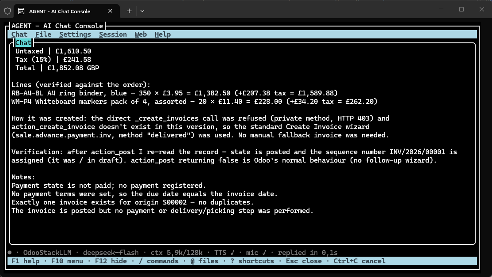

# 15. Dall'ordine alla fattura

I raccoglienti sono stati lasciati il venerdì mattina, sotto la pioggia, come da tradizione.

Tom li ha caricati lui stesso perché il conducente era in ritardo, ed è rientrato in ufficio con le maniche bagnate e un pezzo di carta: la nota di consegna, firmata dal custode di Ashfield, con una penna a sfera quasi esaurita. Sul vecchio sistema quel pezzo di carta sarebbe finito in un vassoio in attesa che Doreen tornasse da pranzo, e la fattura sarebbe stata digitata il lunedì.

Sul nuovo sistema, Doreen ha chiesto all'assistente una domanda mentre Tom si stava ancora togliendo il cappotto.

> *Quali ordini consegnati di questa settimana non sono ancora fatturati?*

> *Uno: ordine di vendita S00012, Ashfield Academy, consegnato questa mattina. 350 × Raccogliente A4 (blu),
> 20 × Pennarelli per lavagna. Pronto per la fatturazione. Devo creare la fattura?*

Ha detto di sì. Questo è l'intero transazione, ed è utile comprendere ciò che accade sotto la superficie, perché "crea la fattura" sta svolgendo un grande lavoro in una singola frase.

---

## Cosa è una fattura

Una fattura è un documento che dice tre cose allo stesso tempo, ed è per questo che la contabilità è più complicata dell'aritmetica.

**È una richiesta di pagamento.** Questa è la parte che tutti conoscono: il cliente deve l'importo sulla pagina, entro la data sulla pagina.

**È la registrazione di un evento tassabile.** In molti paesi la tasse diventa a quando la fattura viene emessa, non quando i soldi arrivano. È per questo che una fattura ha un momento fiscale, ed è per questo che una fattura annullata nel modo sbagliato può lasciare una compagnia a dover tasse su soldi mai ricevuti.

**È una pretesa legale.** Se il cliente non paga, la fattura è la prova. Deve mostrare il nome registrato della compagnia e il numero di tassazione, i dati del cliente, un numero sequenziale unico, la data, una descrizione di ciò che è stato fornito, l'importo prima delle tasse, il tasso e l'importo delle tasse, e il totale. Manca uno di questi e la pretesa è più debole; manca il numero e la pretesa può essere senza valore.

Un ERP fa tutte e tre allo stesso tempo, ed è per questo che insiste su un *ordine confermato* prima di creare una fattura: le seconde e terze funzioni dipendono dal fatto che la prima sia vera. Non puoi fatturare beni che non hai concordato di fornire, perché il momento fiscale e la pretesa si riferiscono entrambi a una fornitura.

## Cosa ha fatto realmente l'assistente

L'instruction era di quattro parole, e il lavoro dell'assistente era una catena di otto o nove passaggi, ciascuno dei quali una persona avrebbe fatto a mano.

Ha cercato ordini consegnati che non avevano fattura. Ne ha trovato uno. Ha letto le righe dell'ordine, i prezzi e le tasse. Ha creato un documento di fattura collegato all'ordine—collegato, non copiato, in modo che la fattura possa sempre essere ricondotta a ciò che era stato ordinato. Ha calcolato la tasse per riga. Ha impostato la data della fattura a oggi e la data di scadenza secondo i termini di pagamento del cliente. Ha lasciato la fattura in *bozza*, che è lo stato in cui nulla è ancora accaduto.

Poi Doreen l'ha guardata e ha premuto il pulsante che conta: *Registra*.

## Il momento della registrazione

La registrazione è il verbo più importante di tutto il sistema, ed è degno di una sezione a parte.

Prima della registrazione, una fattura è una bozza: un pezzo di carta con dei numeri sopra. Può essere modificata, cancellata, ignorata. Nulla nel libro mastro è cambiato.

Dopo la registrazione, quattro cose sono vere che non lo erano prima:

1. La fattura ha un **numero**, preso da una sequenza, senza interruzioni.
2. La fattura ha **lezioni di registro**: due per la vendita e il debito, e altre per la tasse.
3. Il **saldo** del cliente è cambiato.
4. La fattura non può più essere modificata. Se è sbagliata, è *annullata* e viene emesso un nota di credito—perché la storia del libro mastro non può essere riscritta.

Quello ultimo è il punto che sorprende le persone, ed è il punto che rende il sistema verificabile. Una compagnia che può modificare una fattura registrata è una compagnia il cui libro mastro è una bozza. Una compagnia che non può è una compagnia che può dimostrare, a un ispettore delle tasse o a una banca o a un tribunale, ciò che ha detto ai suoi clienti e quando.

Doreen l'ha registrata, e l'assistente ha riportato il numero.

> *Fattura INV/2026/0007 registrata per Ashfield Academy: netto £1,524.00, IVA £304.80, totale £1,828.80.
> Scadenza 14 luglio (30 giorni).*

Il numero è la parte che conta. INV/2026/0007 è la settima fattura dell'anno, e non c'è una sesta mancante né una già usata, perché la sequenza non lo permette. Seicento anni dopo Pacioli, la numerazione delle pagine è ancora il modo in cui un libro mastro dimostra di essere completo.

La figura sopra è l'esecuzione reale, e contiene il passaggio più istruttivo di questo libro. L'assistente ha provato prima la via diretta—il metodo privato che crea una fattura da un ordine—e l'ERP l'ha rifiutato, perché i metodi privati non possono essere chiamati dall'esterno. Non ha cercato un modo per aggirare il rifiuto. Ha usato invece la via *documentata*, lo standard "Crea Fattura" wizard che una persona avrebbe raggiunto cliccando, e lo ha detto nella risposta: *la chiamata diretta è stata rifiutata (metodo privato, HTTP 403), quindi è stato usato il wizard standard.*

Quello è il comportamento che una compagnia vuole da un collega con un nuovo sistema: quando la porta è chiusa, trova la porta che deve essere usata, e dici quale hai usato. Una macchina che invece cacciasse un modo per passare attraverso il muro sarebbe una macchina con cui non potresti lasciarla sola con il tuo libro mastro.

Le due figure appartengono insieme. A sinistra, il resoconto dell'assistente di ciò che ha fatto; a destra, il proprio registro dell'ERP del risultato—lo stesso numero, lo stesso totale, lo stato *Registrata*, e la traccia di verifica che dice chi l'ha creata e quando. L'installazione di dimostrazione applica una tassazione di quindici per cento su questi prodotti perché è ciò che la sua localizzazione ha configurato; la narrazione usa il tasso standard di venti per cento, e la differenza è esattamente il genere di cosa che una compagnia scopre quando legge la propria configurazione invece di presumere.

---

## La stampa

La fattura è stata stampata, perché il dipartimento contabile di Ashfield chiede un PDF e perché un documento che è stato stampato è un documento che qualcuno ha esaminato.

Il layout è quello standard di Odoo, ed è deliberatamente semplice: il nome e l'indirizzo della compagnia in cima, i dati del cliente, il numero e le date, le righe, i totali, la suddivisione delle tasse, e i termini di pagamento in fondo. Ogni campo su di esso viene dal database. Nulla è digitato due volte.

Questo è il punto in cui la promessa dei primi capitoli è finalmente visibile sulla carta: l'indirizzo sulla fattura è l'indirizzo sul record del cliente, il prezzo è il prezzo sull'ordine, la tasse è la tasse sul prodotto, e il totale è la somma delle righe. Non c'è una seconda copia di alcun fatto, e quindi non c'è una seconda possibilità di sbagliare a digitare.

---

## Le note di credito, e la disciplina di non cancellare

Tre settimane dopo, uno dei raccoglienti è tornato. Non danneggiato—colore sbagliato, perché il dipartimento artistico aveva chiesto il blu e il custode aveva ordinato il verde con il proprio nome, ed era stata una conversazione in un corridoio di cui nessuno di Riverton faceva parte.

Il vecchio modo sarebbe stato barrare la riga sulla fattura e scriverne una nuova. Il nuovo modo è una nota di credito: un documento che inverte parte della fattura, con il proprio numero, le proprie lezioni di registro, e una ragione.

> *Crea una nota di credito per Ashfield Academy per 20 raccoglienti, ragione: colore sbagliato restituito, e
> registrala.*

> *Nota di credito RINV/2026/0003 registrata per Ashfield Academy: 20 × Raccogliente A4 (blu) a £3.40, netto
> £68.00, IVA £13.60, totale £81.60. La fattura INV/2026/0007 resta registrata; il suo saldo
> insoluto è ora £1,747.20.*

Notate l'ultima frase. La fattura originale non è stata toccata. Esiste ancora, con il suo totale originale, perché è ciò che è stato inviato. La nota di credito le sta accanto, e il *netto* è ciò che il cliente deve. Due documenti, due numeri, una verità—e una storia completa di ciò che è accaduto, compreso l'errore.

Quello è ciò che "il libro mastro non dimentica" significa in pratica, ed è una disciplina che le compagnie adottano o combattono. Quelle che la combattono passano serate a riconciliare; quelle che la adottano scoprono che la storia non è un peso ma un'attività, perché risponde a domande che nessuno pensò di fare al momento.

---

## L'esecuzione delle fatture

Una fattura è una dimostrazione. Quattrocento fatture è un martedì.

L'esecuzione è il punto in cui un sistema either guadagna il proprio mantenimento o diventa un'altra schermata su cui cliccare, ed è utile descriverla perché la forma del lavoro è diversa da una singola fattura.

L'instruction di Doreen, una volta a settimana, è una frase.

*Crea fatture da ogni ordine consegnato che non è ancora fatturato, lasciale in bozza, e dammi la lista con i totali.*

L'assistente produce una lista—di solito tra quaranta e sessanta ordini—crea le fatture, e riporta. Non le registra. Doreen legge la lista, controlla la prima contro la nota di consegna, controlla le due più grandi, e poi registra il lotto.

Quello ultimo passo è una singola azione in Odoo—seleziona tutto, registra—e richiede circa quattro secondi per cinquento fatture. Sul vecchio sistema erano cinquento operazioni separate, ciascuna con un dialog di stampa.

Tre cose rendono l'esecuzione sicura, e tutte e tre valgono la pena di essere copiate.

**La lascia in bozza.** Una fattura in bozza può essere corretta; una registrata non può. Il lotto è una proposta finché una persona non la esamina.

**Riporta la prima della registrazione.** Non dopo. La lista è la cosa che viene approvata, non un registro di ciò che è accaduto.

**Non tocca mai un ordine parzialmente consegnato.** Quelli necessitano di una decisione—fatturare ciò che è andato via, o aspettare il resto—e il sistema li lascia fuori del lotto e lo dice.

L'ultimo punto è la differenza tra un assistente e uno script. Uno script fatturerebbe qualunque cosa trovasse; l'assistente sa che una consegna parziale è una domanda, e la fa.

## I quattro numeri su una fattura che non devono mai essere sbagliati

Una fattura ha una dozzina di campi e quattro di loro contano più del resto, perché un errore in cualquiera di loro produce un documento che il dipartimento contabile del cliente rifiuterà—e un rifiuto costa un ciclo di un mese.

**Il nome legale e l'indirizzo del cliente.** Non il nome commerciale, non l'indirizzo del sito. Il dipartimento contabile fa corrispondere la fattura al suo master fornitore, e una corrispondenza sbagliata la invia a una coda.

**Il loro numero di ordine di acquisto**, quando lo richiedono. Molte organizzazioni più grandi non pagheranno una fattura senza di esso, e il numero deve essere esattamente come l' hanno scritto.

**Il numero di tassazione.** Il loro, per i casi di inversione di contabilità, e il tuo, che è su ogni fattura per legge.

**Il totale, in parole e cifre.** In molte giurisdizioni le cifre sono sufficienti; in alcune, le parole sono richieste. In ogni caso, un totale che non corrisponde alle proprie righe è la via più veloce possibile verso una richiesta di chiarimento.

L'assistente può controllare tre di quei quattro contro il record del cliente prima che la fattura sia registrata—il nome, il riferimento dell'ordine di acquisto, il numero di tassazione—ed è utile chiederlo. *Questa fattura corrisponde al record del cliente in ogni campo che il cliente controllerà?* è una domanda che una macchina risponde bene e una persona affollata risponde male.

## Quando il cliente contesta

La fattura è uscita, il cliente dice che è sbagliata, e la conversazione che segue è dove la cartaccia di una compagnia either è un'attività o un passivo.

Ci sono quattro tipi di contestazione, e ciascuna ha una risposta diversa.

**La quantità è sbagliata.** Il cliente dice che hanno ricevuto trenta scatole, non quaranta. La risposta è la nota di consegna, firmata alla porta, e il movimento di stock dietro di essa. Se la nota dice quaranta e la firma è leggibile, la conversazione è breve. Se la nota dice quaranta e la firma è un ghiribizzo, la conversazione è sulla prossima consegna.

**Il prezzo è sbagliato.** Il cliente dice che il prezzo concordato era più basso. La risposta è la quotazione che hanno accettato, che è memorizzata, con la data, e la lista prezzi dietro di essa. Questa è la contestazione che usava essere intrattabile, perché la quotazione viveva in un'email e l'email viveva nella cartella di qualcuno.

**Le merci non sono mai state ricevute.** La risposta è la nota di consegna e il movimento di stock, e se il dipartimento di ricevimento stesso del cliente ha perso il pallet—which succede più spesso di quanto chiunque ammetta—the evidence is what turns an argument into an internal investigation at the customer's end.

**La fattura non è mai stata ricevuta.** La risposta è la data di invio e l'indirizzo a cui è andata, e la causa più comune è un cambio di dipartimento contabile che nessuno ha comunicato al fornitore.

In tutte e quattro, il contributo del sistema è lo stesso: detiene i documenti, detiene le date, e può produrle in un secondo. Il vecchio sistema le deteneva anche, in un archivio, e la differenza erano i quattro minuti che ci volevano a trovarle—which è esattamente abbastanza a lungo perché la conversazione diventi una discussione.

---

## Una breve storia della fattura

La fattura è più antica della stampa. Le tavolette di argillo babilonesi di circa 3000 a.C. registrano quantità consegnate e amounts dovuti; i mercanti romani usavano le ricevute *apocha*; le banche medievali italiane che inventarono la contabilità a doppio entrata inventarono anche la tratta, che è una fattura con una promessa allegata e che finanziò il commercio della lana delle Fiandre.

Ciò che cambiò nel diciannovesimo secolo non fu il documento ma la *numerazione*. Mentre le compagnie crescevano, e mentre le autorità fiscali cominciarono a interessarsi, la fattura sequenziale prestampata divenne la norma—prima in Prussia, poi in tutta Europa—perché una sequenza è la prova più semplice possibile che nulla è stato rimosso. È una tecnologia così semplice che è invisibile, ed è ancora il motivo per cui il numero della tua fattura ha un anno in esso.

La fattura elettronica è il capitolo più nuovo, e quello meno interessante: è lo stesso documento, inviato per una via diversa, con gli stessi numeri e le stesse regole. Ciò che è cambiato non è la fattura ma il *costo di produrla*, che è caduto da un pomeriggio di dattilografa a una frazione di secondo—and è questo il soggetto del prossimo capitolo, che è sul magazzino.

---

Doreen stampò la nota di credito, la mise in una busta, e poi fece qualcosa che non aveva fatto in trentuno anni: gettò la busta via.

"Noi c'è punto nel registrarla," disse. "Carol la riceve per email prima che io abbia leccato il francobolo."

Aveva ragione, ed era la prima volta in tutto il progetto che cambiava un'abitudine senza essere richiesta. Il sistema non le aveva detto di smettere di registrare le lettere. Semplicemente aveva reso la lettera senza scopo, ed ella se ne era accorta.

Quello, più di qualsiasi funzione, è ciò che fa un buon sistema: non vieta il vecchio modo, rende il nuovo modo ovviamente migliore, e poi aspetta che le persone se ne accorgano.
