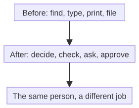

# 27. Cosa cambia in ufficio

Sei mesi dopo l'installazione, Doreen Pratt fece qualcosa che non aveva mai fatto in trentuno anni: si prese una vacanza a metà mese.

Non perché il sistema lo permettesse—anche se lo permetteva—ma perché non si rompeva nulla. Le fatture venivano inviate. Le relazioni mensili venivano inviate. La riconciliazione di fine mese attendeva, pazientemente, nel modo in cui attende il software, e quando tornò le fece un pomeriggio invece di una settimana.

Lo disse a Maggie il suo primo giorno di ritorno, in piedi nella soglia della sala fatture, e poi disse qualcosa che Maggie annotò.

"La cosa strana è che sono più occupata di prima. Ma è una occupazione diversa. Non cerco più le cose. Guardo *le* cose."

Questo capitolo parla di quella differenza, perché è la parte dell'automazione che nessuno annuncia e che tutti sperimentano. Le brochure promettono che la macchina farà il lavoro. La verità è più interessante: la macchina fa l'*amministrazione* del lavoro, e alla persona resta il lavoro stesso—che si rivela essere la parte che ha sempre avuto bisogno di una persona.

---

Siamo precisi su cosa cambiò a Riverton, perché la vaghezza è il nemico di un argomento utile.

**Cosa cessò.** Qualcuno un tempo digitava l'ordine del cliente nel programma di contabilità. Quello cessò. Qualcuno un tempo stampava le fatture una alla volta, le verificava una per una contro la nota di consegna, e le metteva nelle buste. Quello cessò, per lo più. Qualcuno un tempo compilava il report mensile delle vendite esportando tre fogli di calcolo e riconciliandoli a mano. Quello cessò. Qualcuno un tempo camminava verso il magazzino per chiedere a Tom se un prodotto fosse in stock. Quello cessò, perché la risposta era una domanda che si poteva fare in una frase e ricevere in un secondo.

**Cosa iniziò.** Doreen iniziò a verificare i prezzi contro il libro degli acquisti ogni venerdì, perché aveva tempo e perché aveva sempre sospettato che il fornitore si permettesse piccoli aumenti. Priya iniziò a inviare un breve elenco di clienti che avevano cessato di ordinare, con una ragione suggerita per ciascuno, al team di vendita ogni lunedì. Tom iniziò a rivedere le rettifiche di stock settimanalmente invece che annualmente, ed è così che l'azienda scoprì che un prodotto era stato inserito con l'unità di misura sbagliata dal 2022 e che la "perdita" per cui tutti avevano dato la colpa al turno notturno era un errore di calcolo.

Nessuna di queste cose è drammatica. Insieme fanno la differenza tra un'azienda che reagisce e un'azienda che si accorge delle cose.

**Cosa non cambiò affatto.** La relazione con Ashfield Academy, che ha nineteen anni e si basa sul fatto che Carol si fiede di Maggie per rispondere al telefono. Il giudizio su quale cliente concedere credito. La decisione di smettere di tenere in stock una linea di prodotti. La conversazione con un fornitore che ha aumentato i prezzi per la terza volta. La scusa quando qualcosa va sbagliata.

Questa è la forma onesta del cambiamento, ed è utile enunciarlo come regola, perché la regola vale in ogni azienda in cui è stata provata: **l'automazione rimuove l'amministrazione di un lavoro e lascia il lavoro.**

---

C'è un parallelo storico più confortante di qualsiasi statistica.

Nel 1979, due uomini a Harvard—Dan Bricklin e Bob Frankston—lanciarono un programma chiamato VisiCalc. Era il primo foglio di calcolo: una griglia sullo schermo del computer in cui una modifica in una cella ricalcolava tutto ciò che da essa dipendeva. Prima di VisiCalc, un modello finanziario era un foglio di carta, una penna e una calcolatrice, e modificare un'ipotesi significava ricalcolare a mano, il che significava che la maggior parte dei modelli veniva calcolata una volta e poi difesa.

VisiCalc, e i fogli di calcolo che seguirono, fecero all'aritmetica del contabile ciò che la lavatrice fece al bucato. E la previsione di quel momento era che i contabili sarebbero scomparsi.

Non scomparvero. Ci sono, se mai, più di loro. Cosa scomparve fu il lavoro della persona che sommareva colonne di numeri con una penna, e cosa apparve fu il lavoro della persona che decide quali numeri sommare, verifica se il modello ha senso, e spiega al consiglio perché i numeri sono ciò che sono. Lo strumento non sostituì il giudizio. Cambiò il *prezzo* del giudizio, rimuendo l'aritmetica che era stata posta davanti a esso.

La stessa cosa sta accadendo ora, e sta accadendo più in fretta, e sta accadendo a uno strato diverso del lavoro. Il foglio di calcolo rimuò l'aritmetica. L'agente rimuò la *retrieval*—la parte del lavoro che consiste nel capire ciò che è vero.

Chiedete a Doreen cosa facesse nel 2019 e avrebbe detto: tengo la documentazione. Chiedetele cosa fa adesso e dice: verifico le cose. La seconda risposta vale più per l'azienda, ed è anche la risposta di qualcuno che fa un lavoro piuttosto al servizio di un sistema.

---

Nessuno di questo accade da sé, ed è qui che la maggior parte delle aziende sbaglia.

La modalità di fallimento è ben nota a chiunque abbia visto un ufficio adottare un nuovo strumento. Lo strumento viene installato. Un formatore viene per un giorno. Le persone entusiastiche lo usano; gli altri conservano il loro foglio di calcolo, perché il foglio di calcolo è più veloce *oggi*, e lo strumento è più veloce *solo dopo aver inserito i tuoi dati al suo interno*. Sei mesi dopo l'azienda ha due sistemi, uno dei quali è la verità e uno dei quali è l'abitudine, e l'argomento su quale sia quale consuma più tempo di quanto ne abbia risparmiato ciascuno.

Ci sono tre cose che impediscono questo, e non sono tecniche.

**La prima è che il lavoro deve arrivare attraverso la nuova porta.** Se un ordine può ancora essere ricevuto al telefono e scritto su un blocco, lo sarà. Se la fattura può ancora essere prodotta nel vecchio programma, lo sarà. Il nuovo sistema diventa la verità il giorno in cui diventa la *unica* via, e non un giorno prima. È per questo che l'installazione in questo libro si conclude con le scorciatoie vecchie rimosse, non con una sessione di formazione.

**La seconda è che qualcuno deve essere autorizzato a essere curioso.** Il nuovo lavoro di Doreen—verificare, accorgersi, chiedere perché—esiste solo se l'azienda lo tratta come lavoro. In troppe imprese, nel momento in cui l'amministrazione viene automatizzata, la persona riceve più amministrazione, perché l'amministrazione è misurabile e l'accorgersi delle cose no. Le imprese che ottengono il beneficio sono quelle che scrivono "accorgersi delle cose" nella settimana di qualcuno.

**La terza è che la macchina deve ricevere un nome e un limite.** Non una personalità—un nome nel senso di una responsabilità. Qualcuno deve essere responsabile di ciò che l'assistente fa, deve leggere il suo log, deve essere autorizzato a spegnerla. Un'assistente che nessuno possiede è un'assistente che nessuno verifica, e un'assistente che nessuno verifica è un pettegolezzo con una tastiera.

## La nuova descrizione del lavoro

Vale la pena annotare cosa divenne il lavoro di Doreen, perché le descrizioni del lavoro sono dove questo tipo di cambiamento viene o reso reale o tranquillamente abbandonato.

Prima, nel linguaggio dell'ufficio: tenere i libri, emettere le fatture, inseguire i soldi, archiviare la documentazione, rispondere al telefono quando si tratta di soldi.

Dopo, nello stesso linguaggio: **tenere vero il modello, decidere cosa è una eccezione, e rispondere alle domande che i numeri sollevano.**

Tre doveri, e ciascuno di loro è nuovo in un modo specifico.

**Tenere vero il modello** significa le piccole discipline che rendono il sistema affidabile: un prodotto con l'unità di misura giusta, un cliente con le condizioni di pagamento giuste, una consegna validata il giorno in cui è avvenuta, una rettifica di stock con una ragione. Nel vecchio mondo anche queste erano suo lavoro, ma erano invisibili—nessuno poteva vedere il costo del sbagliarle fino alla fine dell'anno. Ora sono la differenza tra una risposta e un'ipotesi, e hanno una conseguenza quotidiana visibile, il che le rende più facili a difendere e più difficili a saltare.

**Decidere cosa è una eccezione** significa leggere gli elenchi. Le fatture scadute, lo stock sotto il minimo, i prodotti senza prezzo, la consegna senza fattura. Il sistema produce l'elenco; la persona decide quali elementi sono rumore e quali sono un problema. Quello è un'abilità genuina, ed è quella che migliora con la pratica—dopo tre mesi, Doreen poteva guardare un elenco di dodici fatture scadute e dirti quali quattro erano reali.

**Rispondere alle domande che i numeri sollevano** è la parte che nessuno prevedeva. Un sistema che può rispondere a domande produce *più domande*: perché il trasporto è salito, perché questo cliente è diventato silenzioso, perché il margine di questo prodotto è diverso rispetto al mese scorso. Qualcuno deve inseguire quelle, e la persona che le inseguisce è quella che ora ha il tempo.

## Cosa non cambiò, e perché conta

Tre cose non cambiarono affatto, ed è utile dirlo perché la letteratura sull'automazione è per lo più sul cambiamento.

**Il telefono viene ancora risposto da una persona.** Carol a Ashfield chiama perché vuole parlare con Maggie, non perché vuole una transazione. La relazione è il business, e nessun sistema l'ha mai migliorata.

**Il giudizio sulle persone viene ancora fatto dalle persone.** A chi dare credito, a chi inseguire con forza, a chi lasciare andare. Il sistema fornisce i fatti—storico di pagamento, modello d'ordine, importi scaduti—e i fatti rendono il giudizio meglio informato, ma non lo fanno.

**La scusa è ancora di una persona.** Quando qualcosa va sbagliata, un cliente vuole sentire un essere umano dire scusa. Una scusa automatizzata è peggiore di nessuna, perché conferma che nessuno stava dando attenzione.

Queste tre sono il cuore del business, ed è per questo che questo libro continua a insistere sul fatto che la macchina prende la *pazienza* e la persona tiene il *giudizio*. Un'azienda che automatizza il telefono, la decisione di credito o la scusa ha automatizzato la cosa sbagliata, e lo scoprirà nel modo in cui le aziende scoprono sempre: lentamente, e poi improvvisamente.

## L'ora nel diario

Il cambiamento più importante a Riverton non era una funzione del software. Era un'ora nel diario di Doreen, ogni venerdì, etichettata *sistemi ed eccezioni*, che nessuno era autorizzato a prenotare sopra.

Quell'ora è dove accade l'accorgersi delle cose: la verifica del prezzo, la lettura del log, l'elenco di cose che sembrano strane. Senza di essa, il tempo risparmiato dall'automazione sarebbe stato riempito da più amministrazione—che è ciò che accade nella maggior parte delle aziende, ed è perché la maggior parte delle aziende riportano che l'automazione "non ha davvero risparmiato nulla".

Un'alla settimana sono cinquanta ore all'anno, che sono una frazione di ciò che il sistema risparmia. È anche la differenza tra un sistema che migliora e uno che decade. La linea di Sam—*il software non fallisce, le abitudini sì*—è l'intero dell'argomento, e l'ora nel diario è come una abitudine viene protetta.

---

Maggie fu chiesta, a una cena della camera di commercio in primavera, se avesse "sostituito lo personale con l'intelligenza artificiale."

Aveva pensato alla domanda in anticipo, perché sapeva che sarebbe arrivata, e aveva deciso di rispondervi onestamente piuttosto che diplomaticamente.

"No," disse. "Abbiamo sostituito un sistema di archiviazione. Lo personale è ancora qui, e sta facendo il lavoro che il sistema di archiviazione impediva loro di fare."

La donna che aveva chiesto era scettica. "Ma devi aver bisogno di meno persone."

"Abbiamo bisogno dello stesso numero di persone e di più della loro attenzione," disse Maggie. "Che, se gestisci un business, è lo stesso che aver bisogno di più persone."

Quello è la verità di esso, ed è utile metterlo in termini il più possibile semplici, perché la conversazione pubblica sull'intelligenza artificiale è dominata da due storie che sono entrambe sbagliate: che la macchina farà tutto, e che la macchina prenderà tutto. Ciò che realmente accade, in un'azienda piccola ben gestita, è che la macchina prende la parte del lavoro che nessuno voleva, e le persone scoprono di aver fatto quella parte per così tanto tempo da aver dimenticato cosa fosse il resto del lavoro.

Doreen, il suo primo giorno di ritorno da quella vacanza, aveva trovato una fattura di fornitore con un prezzo che era salito di quattro per cento senza avviso. L'aveva davanti a sé dentro un minuto dal sedersi, perché l'assistente l'aveva segnalata mentre era via. Nel 2019 sarebbe stata archiviata, pagato, e scoperta alla fine dell'anno, se mai.

Non disse "la macchina ha trovato questo." Disse: "Guardate questo. Quattro per cento, a marzo, e nessuno ci ha avvisato."

Quella è la frase che questo libro ha stato lavorando verso. La macchina ha fatto la scoperta. La persona ha fatto l'accorgersi delle cose. L'azienda ha ottenuto il beneficio.
