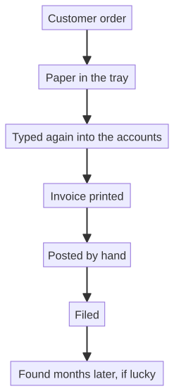

# 1. Комната, где живёт бумага

В этой комнате не было таблички с названием на двери. Все в «Ривертон Офис Супплай» называли её счетоводческой, хотя счета составляли лишь малую долю того, что там хранилось: заказы на покупку, накладные, платёжные поручения, кредит-ноты, тонкие розовые листы, которые поставщики отправляли, когда хотели получить оплату быстрее, и более толстые кремовые, которые отправляли клиенты, когда хотели заплатить позже.

Мэгги Элли унаследовала комнату вместе с компанией от своего отца. Она управляла «Риветоном» уже одиннадцать лет, но всё ещё начинала каждый понедельник в этой комнате, стоя в дверном проёме с чашкой кофе, остывающей в руке, и смотрела на три серых офисных шкафа так, будто отвечала за то, чтобы их накормить.

Шкафы назывались по языку офиса: «Старые годы», «Средние годы» и «Текущий год». В «Старых годах» был замок, ключ от которого никто не мог найти. В «Средних годах» ящик открывался только если слегка его приподнять — так, как поднимают чемодан, защёлка которого сдала. «Текущий год» был тем, что имел значение, и одновременно тем, что не мог закрыться, потому что папки внутри него раздулись от бумаги, поступавшей быстрее, чем кто-либо успевал её раскладывать.

Дорин Пратт вела эти шкафы уже тридцать один год. Ей было шесть тридцать, она носила кардиган в любой сезон, и у неё была память такого рода, что делает компанию безопаснее, чем она есть на самом деле. Если вы попросили бы Дорин найти накладную с мартовской отправки в школьный округ Эшфилд, она бы не смотрела на шкафы. Она смотрела бы в потолок, слегка двигала губами и сказала: «Это была неделя, когда у Трева сломался генератор в фургоне. Третья папка сзади, второй ящик, за розовыми поручениями.» Она была права достаточно часто, что никто никогда не задумывался записать, как именно она это делает.

Это первая вещь, которую нужно понять о таком бизнесе, как «Риветон», и это та самая вещь, о которой почти никто не пишет в книгах об управлении. Компания не работала на своём программном обеспечении. Она работала на Дорин.

---

В восемь двадцать в этот понедельник телефон на столе Мэгги зазвонил с той особой звонкостью, которую имеет клиент, собирающийся быть разочарованным.

Это была Академия Эшфилда, школьный округ, покупавший у «Риветона» уже девятнадцать лет: ручки тысячами, тетради паллетами, хорошие белые маркеры для доски, которые действительно стираются. Их менеджер по закупкам была терпеливой женщиной по имени Карол, которая тем утром получила доставку четырёхсот переплётных папок и ни одного счёта.

«Маргарет» — сказала Карол, и Мэгги поняла по употреблению полного имени, что дело серьёзно, — «мы не можем оплатить счёт, которого не получили, и мы не можем закрыть квартал без него. И ваш водитель оставил папки на парковке, а не у погрузочной площадки.»

Мэгги сказала то, что говорят в таких случаях. Она лично разберётся. Она сожалеет. Она перезвонит в течение часа.

Она положила трубку и сделала то, что делала десять тысяч раз: прошла в счетоводческую комнату и спросила у Дорин, где документация.

Дорин посмотрела в потолок. Она двигала губами. Затем сказала: «Папки ушли в четверг. Счёт должен был уйти вместе с накладной. Если не…» — и здесь она сделала паузу, потому что достигла края своей памяти и могла почувствовать обрыв за ней — «если не ушёл в лоток, и Трев забрал его с возвратными.»

В счетоводческой комнате было четыре лотка. Они были подписаны: *Входящее*, *Исходящее*, *Позже* и, почерком, не принадлежавшим никому, кто ещё работал в «Риветоне», *Трев*. Трева больше не было. Трева не существовало уже шесть лет. Лоток остался, и бумага всё ещё попадала в него, потому что лоток с именем на нём — это своего рода инструкция.

Мэгги нашла счёт в лотке Трева, под семенным каталогом и напоминанием про огнетушители. Он был напечатан в четверг, подписан в четверг и никогда не отправлен. В строгом смысле он был полным и правильным документом. Он просто не смог отправиться.

Она отвезла его в Эшфилд сама, потому что водитель уже ушёл домой, и потому что она хотела двадцать минут в машине, чтобы разгневаться наедине. По пути назад она остановилась у круговой развязки у торгового парка и просидела там дольше, чем того требовал трафик, глядя, как работают дворники, и подумала: *мы не плохи в этом. Мы не ленивы. Мы не глупы. Почему же кажется, что компания держится на нитках?*

---

Вотfact, которая удивила Мэгги, когда она прочитала её вечером, и которая, вероятно, удивит и вас.

В июне 1975 года журнал *Business Week* опубликовал длинную статью под названием «Офис будущего». Он описал с большой уверенностью мир, в котором рутинная бумажная работа бизнеса — ведение записей, бухгалтерский учёт, архивирование — будет выполняться машинами, и бумага станет редкостью, как стала редкостью лошадь после автомобиля. Предсказание повторялось столь часто в следующие десятилетия, что приобрело собственное имя: офис без бумаги.

Между 1980 и 2000 годами мировое использование офисной бумаги удвоилось более чем вдвое.

Это не небольшая ирония; это большая ирония, и у неё есть причина, имеющая значение для всего в этой книге. Бумага выжила не потому, что офисы были отсталыми. Бумага выжила потому, что была чрезвычайно хороша в одной работе: она была единственной вещью в здании, которую мог прочесть каждый. Бухгал мог прочесть заказ на покупку. Склад мог прочесть накладную. Продавец мог прочесть прайс-лист. Налоговый инспектор мог прочесть все их. Компьютер в 1985 году не мог поговорить с компьютером в соседней комнате, не то что с отделом счетов школьного округа, поэтому компьютер печатал бумагу, и бумага говорила.

Мы не не смогли стать безбумажными. Мы автоматизировали *производство* бумаги. Мы сделали печать документа дешевле, чем дойти до шкафа, затем напечатали всё, затем купили больше шкафов.

---

Понедельник «Риветона» не был необычным, и именно поэтому его стоит рассказать. Та же сцена разворачивается в тысяче вариантов в каждом городе: поставщик сантехники, типография этикеток, семейная фирма, устанавливающая коммерческие кухни. Детали меняются; форма не меняется.

Клиент задаёт вопрос, требующий трёх фактов из трёх мест. Кто-то обещает ответ. Ответ требует четвёртого факта, живущего в голове человека, который в отпуске. К тому времени, когда четвёртый факт найден, клиент позвонил снова, и обещание стало маленькой частичкой ущерба. Ущ修复 ремонтируется извинением и скидкой, и скидка нигде не записана, потому что скидки, даваемые для ремонта ущерба, — это не тот вид вещей, которые кто-то хочет записывать.

Умножьте это на пятьдесят две недели и на каждый отдел, и вы придёте к истинной цене того, как работают большинство малых компаний. Не кража. Не расточительство в смысле, который вкладывает аудитор. Налог на запоминание: бесконечный, невидимый сбор за удержание фактов в человеческих головах и бумажных лотках, и за перемещение этих фактов из одной головы в другую по телефону.

Существует диаграмма, делающая это видимым, и её стоит взглянуть на минуту, потому что это карта проблемы, о которой эта книга.

Шесть шагов, и на каждой стрелке факт копируется человеком из одного носителя в другой. Каждая копия — это шанс ввести ошибку, и каждая ошибка стоит дороже найти, чем стоило сделать. Счёт, который не отправился, не был аномалией. Он был нормальным поведением системы, чья память распределена по лоткам, головам и ящикам, без единого места, где хранится истина.

Стоит поставить на это число, потому что число — это то, что меняет умы людей.

Эшфилдский счёт занял у Мэгги сорок минут: двадцать по телефону, двадцать в машине. Прибавьте десять минут Дорин на разглядывание, пять минут водителя и пятнадцать минут бухгалтера на следующей неделе, когда платёж не пришёл и его пришлось выгонять. Час полтора времени четырёх людей, чтобы доставить один кусок бумаги, который уже был произведён правильно. Счёт стоил восемьсот тридцать фунтов. Компания потратила, возможно, шестьдесят фунтов заработной платы на его доставку, и никто никогда не увидит эти шестьдесят фунтов ни в каком отчёте, потому что это не расход. Это просто день, который был чуть короче, чем должен был быть.

Умножьте шестьдесят фунтов на число документов, которые оптовик производит за год — заказы, накладные, счета, кредит-ноты, выписки, платёжные поручения — и невидимый налог станет крупнейшей единой статьей расходов в бизнесе, больше аренды, больше фургонов, больше зарплат, из которых он выплачивается. Он невидим, потому что это не строка в учёте. Это отсутствие строки.

---

У отца Мэгбы была фраза для бизнеса. Он говорил, стоя в складе с руками за спиной: «Мы продаём канцелярию, Маргарет. Мы не продаём путаницу.» Он имел её в виду как хвастливую похвалу качеству обслуживания, и это было верно: обслуживание «Риветона» было хорошим. Оно было хорошим в том смысле, в каком хорошим бывает ресторан с блестящим шеф-поваром и без книги бронирований. Оно работало, пока шеф-повар был на кухне.

То, что Мэгги начала подозревать в этот понедельник вечером, когда кофе остыл, а счёт был безопасно доставлен, заключалось в том, что компания достигла предела того, что хорошие люди могут удержать в своих головах. «Риветон» вырос из четырёхсот товарных позиций до одиннадцати тысяч. Он прошёл путь от одного фургона до шести. У него были клиенты, заказывающие через интернет-магазин, которому никто не доверял полностью, и поставщики в трёх странах, отправляющие счета в двух валютах. Память Дорин, какой бы невероятной она ни была, стала единственной точкой отказа в кардигане.

Она не хотела покупать программное обеспечение. Она уже купила программное обеспечение. Была программа учёта, производящая прекрасные отчёты, которых никто не читает, и система запасов, установленная человеком, который с тех эмигрировал, и общая папка в офисной сети, содержащая seventeen версий прайс-листа, из которых четырнадцать неверны.

То, чего она хотела, хотя у неё ещё не было слов для этого, — это бизнес, который помнит. Одно место, где клиент, продукт, заказ, счёт и платёж были одним и тем же фактом, видимым с разных сторон. Одно место, которое могло ответить на вопрос «что верно сейчас?» без телефонного звонка.

Оставшаяся часть этой книги о том, как компания получает это место, и что происходит, когда искусственному интеллекту позволено работать внутри него.

---

Примечание о том, что вы собираетесь прочитать.

Это не книга для программистов. В ней нет кода, нет команд для ввода в чёрное окно, нет запросов к базе данных. Если вы можете пользоваться веб-обозревателем и отвечать на электронную почту, у вас есть все навыки, которые требует эта книга. Технические части описаны так, как вы описали бы их коллеге за обедом: что делает вещь, почему она делает её именно так, и что вы должны ожидать увидеть на экране.

Это также не книга теории. Каждая сцена, которая следует — каждый экран установки, каждый разговор с ассистентом, каждый счёт, который он создаёт, каждый отказ, который он получает от системы — была выполнена на реальном компьютере, на реальной установке и сфотографирована в момент её совершения. Когда что-то шло не так, а шло не так, то и отказ есть в книге тоже, потому что руководство, которое показывает только успешный путь, не является руководством; это реклама.

Компания на этих страницах называется «Риветон Офис Супплай». Это реальная установка с вымышленным именем, организованная для написания этой книги: оптовик канцелярных товаров с клиентами, продуктами, складом, банковским счётом и налоговой инспекцией, которую нужно удовлетворить. Вы можете пройти те же шаги с именем вашей собственной компании, и к концу у вас будет та же вещь, которую хотела Мэгги в тот понедельник вечером — бизнес, который знает, что верно, и ассистент, который может действовать на основании этого.

Мэгги, со своей стороны, не знала об этом ещё ничего. Она знала лишь то, что проехала сорок минут, чтобы доставить кусок бумаги, который машина должна была отправить, и что ощущение в её груди больше не было гневом. Это было начало решения.

Она вернулась в офис, включила свет в счетоводческой комнате и долго смотрела на три шкафа.

«Ладно» — сказала она, никому в частности. «Давайте разберёмся, как это должно работать.»
