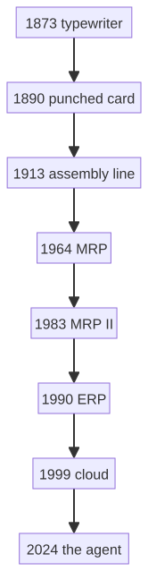

# 2. Краткая история повторного выполнения задач

Канцелярский шкаф (архивный ящик) был изобретён потому, что человек устал искать письмо.

Это не шутка, и это не упрощение. До вертикального архивного шкафа офисы хранили бумаги в ячейках для писем, в связках, перевязанных лентой, в коробках с надписями с именем клиента и годом. Чтобы найти что-либо, приходилось помнить, куда это было положено, а это означало, что офис, как и Riverton, работал на памяти своих клерков. Вертикальный архивный шкаф, появившийся в последние годы XIX века и распространившийся по офисам с поразительной скоростью, изменил условия задачи: он сделал документ доступным для поиска по *категории*, а не по *напоминанию*. Клерк, никогда не видевший клиента, мог открыть ящик, помеченный А–Б, и найти нужный файл.

Это была, в своё время, искусственный интеллект. Он хранил информацию вне человеческого мозга, отвечал на вопросы по требованию и никогда не уходил в отпуск. Мы забываем об этом потому, что технология сделана из стали и пахнет пылью, но замысел был ровно таким же, как замысел машины, о которой будет рассказано в этой книге: вынести факты из человека, положить их туда, где их можно найти, и дать человеку выполнять работу, которая требует человека.

Мэгги провела неделю после счёта из Ashfield в чтениях об этом, тем способом, каким читают люди, управляющие небольшими компаниями—поздно вечером, с ноутбуком на кухонном столе и блокнотом рядом, следуя от одной ссылки к другой, пока муж не спросил, идёт ли она спать.

То, что она нашла, было не историей равномерного прогресса. Это была история одной и той же идеи, открываемой снова и снова, разными людьми, в разных материалах.

---

**1873.** Печатная машина достигает офиса. Это не вычислительная машина, и она ничего не хранит, но она делает то, что оказывается более важным: она делает письмо единообразным. Рукописный заказ—это документ с характером; напечатанный заказ—это документ с форматом. Форматы можно сравнивать, считать и архивировать. В течение поколения печатная машинистка стала хранительницей ворот офиса, а офис стал местом, где информация *производится* по расписанию, а не тогда, когда кто-то дойдёт до этого.

**1890.** Перепись населения Соединённых Штатов подсчитывается с помощью перфорированных карточек и электромеханической табуляционной машины, построенной Германом Холлеритом. Перепись 1880 года заняла восемь лет на обработку. Перепись 1890 года, с большей численностью населения и большим количеством вопросов, заняла около одного года. Машина, которая это сделала, стала через слияние в 1911 году и переименование в 1924 году компанией, которую мы знаем как IBM. Перфорированные карточки оставались стандартным способом общения с компьютером следующие семьдесят лет, и причина этого поучительна: карточка—это запись, которую вы можете удержать, рассортировать, бросить и перепропустить. Это бумага, которую машина может прочесть.

**1913.** Движущаяся сборочная линия Генри Форда в Highland Park превращает производство автомобиля в последовательность отмеренных по времени шагов. Урок, который бизнес-мир из него извлекает, на самом деле не об автомобилях. Это то, что процесс можно *спроектировать*—записать, измерить, а затем улучшить—вместо того, чтобы оставлять его на откуп привычкам людей, выполняющих его. Фредерик Уинслоу Тейлор доказывал то же самое с 1890-х годов со своим секундомером и своим «научным управлением», и сочетание секундомера Тейлора и линии Форда породило убеждение, которое доминировало в веке: если вы можете описать бизнес как ряд шагов, вы можете механизировать эти шаги.

**1951.** Компьютер используется для расчёта заработной платы компании. Машина огромна, программа написана на машинных инструкциях, и расчёт занимает меньше времени, чем подготовка перфорированных карточек, которые она читает. Но принцип установлен: скучная, повторяющаяся, склонная к ошибкам арифметика офиса—это ровно то, в чём компьютер хорош.

**1964.** Человек по имени Джозеф Орлик, работающий с производственной промышленностью, разрабатывает способ вычисления того, что фабрике нужно купить и когда, исходя из того, что она намеревается произвести. Это называется Планированием потребностей в материалах (Material Requirements Planning), и в том же году компания Black & Decker устанавливает первую систему, которая его использует, с руководителем проекта по имени Дик Албан. Орлик публикует книгу в 1975 году—*Material Requirements Planning: The New Way of Life in Production and Inventory Management*—и к тому времени около семи сотен компаний запускают ту или иную версию этой идеи. К 1981 году их примерно восемь тысяч.

**1983.** Оливер Райт расширяет эту идею от материалов ко всей фабрике: расписания, мощности, прогнозы продаж, финансы. Результат называется Планированием производственных ресурсов (Manufacturing Resource Planning), или MRP II, и это первое программное обеспечение для бизнеса, которое делает вид, что знает состояние всей компании.

**1990.** Аналитическая фирма по имени Gartner нуждается в названии для следующей вещи—программного обеспечения, которое не просто планирует фабрику, но управляет всей предприятием: продажи, закупки, запасы, счета, люди. Они называют его Планированием ресурсов предприятия (Enterprise Resource Planning). ERP. Название—это случайность маркетинга, которая прижилась, и с тех пор его растягивали, чтобы охватить почти всё, что компания делает с базой данных.

**1992.** SAP, немецкая компания, основанная в 1972 году пятью инженерами, покинувшими IBM, выпускает R/3, систему, которая работает на клиент-серверной архитектуре, которая тогда становилась доступной. Она становится стандартом, по которому измеряется любая более поздняя ERP, и причина не в изяществе. В том, что R/3 кодирует процессы компании таким образом, который распознают аудиторы, банки и регулирующие органы.

**1999.** Компания по имени NetLedger начинает продавать программное обеспечение для учёта, работающее в браузере, на чужом компьютере, за месячную плату. Начинается облачная эра программного обеспечения для бизнеса. На то, чтобы идея стала нормальной, уйдёт ещё пятнадцать лет, и ещё пять, чтобы она стала умолчанием.

**2013.** Gartner выдумывает «постмодернистскую ERP»: вместо одной огромной системы компания будет запускать набор меньших систем, которые разговаривают друг с другом. Прогноз верен по духу и неверен в деталях—на самом деле произошло то, что малые системы умножились, а разговор стал сложной частью.

Мэгги переписала даты в свой блокнот, провела под ними черту и написала предложение, которое заставило бы её отца засмеяться: *Каждый из этих попыток был попыткой перестать делать вещи дважды.*

## Повторяющийся узор

Посмотрите снова на даты, и появится ритм: примерно каждые двадцать лет новая технология обещает положить конец копированию, и каждый раз обещание выполняется частично и нарушается частично.

Печатная машина положила конец рукописному дубликату и созвала пул печатных машинисток. Ксерокс положил конец копировальной бумаге и созвал кризис архивации. Персональный компьютер положил конец бухгалтерской книге и созвал расползание таблиц. Каждая из них устранила конкретную стоимость и добавила общую: стоимость *знать, какая копия верна*.

ERP была первой технологией в этой серии, которая нападала на общую стоимость напрямую, настаивая на том, что должна быть одна копия. На это ушло тридцать лет, и это сработало—внутри четырёх стен компании. То, чего она никогда не решила, это граница: система клиента, поставщика, налоговой инспекции, у каждой из которых своя копия тех же фактов.

Агент—это первая технология в этой серии, которая может работать через эту границу, потому что он может прочесть то, что написал человек, и написать то, что понимает система. То, сохранит ли он обещание, является предметом остальной части этой книги.

---

На офисной стене была фотография, которую она смотрела тысячу раз, не видя её. На ней были изображены четыре женщины за четырьмя столами в 1978 году, в комнате, которая теперь была счётной комнатой, у каждой печатная машина и стопка тонкой бумаги. Её мать была второй слева.

«Копировальная бумага»,— сказала Дорин, когда Мэгги спросила об этом. «Вы печатали счёт, и копия проступала снизу, на тонком розовом листе. Три копии, если вам повезёт и ваша лента была новой. Затем вы их разделяли и отправляли одну клиенту, одну в архив, одну в бухгалтерскую книгу.»

«А если вы допускали ошибку?»

«Вы перепечатали её снова. Всю. А затем у вас было две копии ошибки, одна из которых была в архиве, так что вам приходилось идти и искать её.»

Riverton купил ксерокс в 1983 году, и некоторое время компания верила, что решила проблему копий. Она решила проблему *изготовления* копий. То, чего она не решила—то, чего никто не решил,—это проблема знания, какая копия является истинной. К 1991 году копии счетов существовали в трёх местах в здании, и человеком, который знал, какую именно получил клиент, была Дорин, которая была здесь с 1987 года.

Это узор, который повторяется на протяжении всей истории офиса, и его стоит назвать, прежде чем мы пойдём дальше. Каждая технология, которая делает легче произвести документ, делает также легче произвести *другой* документ, и стоимость второго падает быстрее, чем стоимость решения того, какой из них важен. Ксерокс умножил бумагу. Электронная почта снова умножила документы. Общая папка умножила версии. Каждое изобретение сдержало своё обещание—дешевле, быстрее, больше—и каждое оставило тот же неоплаченный счёт: работу по решению того, что является истиной.

ERP—это первая технология в этой серии, чьё обещание не «больше документов», а «один факт». Вот почему она ощущается иначе в руке, и почему её установка больше похожа на юридическое урегулирование, чем на покупку машины.

Есть небольшой тест, который говорит вам, сделала ли компания эту перемену, и его применение ничего не стоит. Спросите двух людей, в разных отделах, один и тот же вопрос об одном и том же клиенте: сколько они нам должны? Если ответы различаются, у компании всё ещё есть копии. Если ответы совпадают, и оба человека могут сказать вам, из каких документов построен ответ, у компания имеет модель. Всё остальное—программное обеспечение, серверы, искусственный интеллект—это строительные леса вокруг этого одного достижения.

---

Потому что это нить. От архивного шкафа до облака каждое изобретение в истории офиса было направлено на тот же расточительный расход: второй раз, когда факт записан.

Клиент даёт свой адрес. Он записан на заказе. Он записан снова на накладной, снова на счёте, снова в учёте, снова на этикетке, и снова отделом учёта клиента, когда счёт прибывает. пять копий факта, который был один раз заявлен. Каждая копия—это шанс неправильно напечатать почтовый индекс, а почтовый индекс—это то, как посылка находит школу.

ERP есть, по своей сути, обещание: что адрес будет записан один раз, в одном месте, и что каждый документ, который в нём нуждается, будет *искать его*, вместо того, чтобы получать свежую копию. Это обещание звучит скромно. Оно не таковым является. Чтобы сдержать его, система должна знать, что такое клиент, что такое заказ, что такое продукт, и как они связаны; она должна решить, кому разрешено менять адрес, а кому нет; она должна помнить, каким был адрес в прошлом месяце, потому что счёт, который был отправлен в марте, всё ещё должен показывать адрес, на который он был отправлен. Обещание превращает стопку бумаги в модель компании.

А модель, как только она существует, может быть *действованием* чего-то, кроме человека.

---

В блокноте Мэгги была ещё одна вещь, написанная на последней странице той недели, почерком, наклонным больше обычного, потому что было поздно.

*Почему всё это работало?*

Она читала о компаниях, которые тратили миллионы на системы ERP и в итоге оказывались в худшем положении; истории было непросто найти, и они сделали её осторожной. Система, которая моделирует компанию, полезна только если модель *истинна*, а модель истинна только если люди, которые знают факты, вносят их. Это парадокс в центре всей отрасли: программное обеспечение существует, чтобы освободить людей от администрации, и оно работает только если люди делают админстрацию его наполнения.

Поколение систем, пришедших после 1990 года, решило это силой. Они сделали программное обеспечение единственным способом делать работу: вы не можете отправить посылку без накладной, вы не можете напечатать счёт без заказа, вы не можете закрыть месяц без банковского согласования. Модель остаётся истинной потому, что нет альтернативного пути мимо неё. Вот почему ERPs ощущаются как тюрьмы для людей, которые их используют, и почему они всё равно работают.

Мэг понимала сделку. То, чего она ещё не понимала—то, чего почти никто не понимал до совсем недавнего времени,—это то, что сделка вот-вот изменится, потому что машина научилась читать.

Машина чтения не является архивным шкафом и не является ERP. Это вещь, которая, в последние несколько лет, начала появляться в офисах под неопределённым названием искусственный интеллект: программа, которой можно дать предложение на обычном языке и которая может отвечать или действовать без того, чтобы кто-либо писал правило для этого конкретного предложения.

Если такую программу можно было бы дать модель компании—клиентов, продуктов, заказов, бухгалтерской книги—то бремя наполнения системы легло бы не на людей, а на машину, которая читает то, что говорят люди.

Это вся идея этой книги, и на то, чтобы сделать её реальной, ушёл остаток года.
