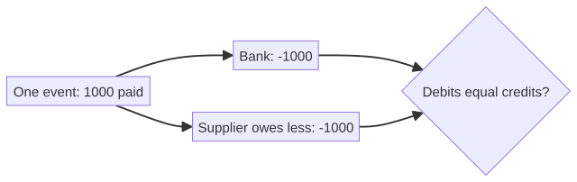

# 3. Монах, записавший правила

Бухгалтер Мэсси был человеком по имени Джералд Прайс, у которого была над аптекой, и была привычка отвечать на вопросы в порядке, в котором они его интересовали, а не в порядке, в котором их задавали.

Она пришла к нему в четверг с папкой с распечатками и вопросом, в котором она была слегка стыдлива: *зачем вообще вести учет?* Не про налоги, сказала она — она понимала налоги. Двойная запись. Дебиты и кредиты, пробный баланс, вся эта изысканная симметрия, которую Дорин выполняла каждый месяц за кухонным столом в офисе с калькулятором и чайником чая.

Джералд снял очки, что было хорошим знаком, и сказал: «Потому что купец в Венеции хотел знать, богат ли он».

---

Речь шла о Луке Пачоли, а важная дата — 1494 год.

Пачоли был францисканским монахом, математиком и учителем значительной славы в свое время. Он работал в Венеции, в Флоренции, в Милане и некоторое время в доме герцога. Он был другом Леонардо да Винчи — Леонардо сделал иллюстрации к одной из его книг, и Пачоли обучал его математике — и он был, по характеру, тем sortsом человека, который верит, что все, что стоит делать, стоит правильно записать.

В 1494 году в Венеции он опубликовал учебник математики под названием *Summa de arithmetica, geometria, proportioni et proportionalità*: резюме арифметики, геометрии, пропорций и пропорциональности. Это была огромная книга, написанная на итальянском, а не на латыни, чтобы купцы могли ее читать, и она охватывала все, что могло понадобиться практичному человеку бизнеса: как умножать, как рассчитывать проценты, как обменивать валюты, как измерять бочку.

Одна глава описывала то, что итальянские купцы делали уже как минимум двести лет, и что никто никогда не объяснял в печати: метод ведения учета по двойной записи.

Идея почти оскорбительно проста, и это причина того, что любая система учета в мире, включая ту, которую Ривертон собирался установить, выглядит именно так.

Каждая операция записывается дважды, в двух разных местах, с двух разных точек зрения. Если компания плат поставщику тысячу фунтов, то деньги в банке уменьшились на тысячу, и сумма, должная поставщику, уменьшилась на тысячу. Два факта, одно событие. Если компания продает стол школе, то клиент должен деньги, и компания получила выручку: два факта, одно событие. Эти две записи называются дебитом и кредитом, и они всегда должны быть равны и противоположны, потому что описывают одну и ту же вещь с обеих сторон стола.

Следствием этого является самодиагностическая система. Сложите все дебиты в книгах и все кредиты, и если два итога не сходятся, что-то неправильно. Не «что-то может быть неправильно» — неправильно. Книги вам это скажут. Это единственная часть управления бизнесом, в которую встроен математический гарант, и она пережила шесть веков войн, валют, империй и программного обеспечения именно благодаря этому гаранту.

Джералд нарисовал это на обороте конверта, так и велся учет с 1494 года.

«Теперь, — сказал Джералд, кладя ручку, — вот что ваш отец никогда не понимал, и что большинство людей никогда не понимают. Двойная запись — это не правило, выдуманное, чтобы сделать вашу жизнь трудной. Это *описание реальности*. У каждой операции две стороны, потому что у каждой операции две стороны. Книги — это не налоговая форма. Это модель того, что на самом деле произошло.»

---

Чтобы понять, почему симметрия важна, полезно понаблюдать, как кто-то ее использует.

Раз в месяц Дорин брала выписку из банка, распечатанный список всего, что на самом деле ушло и поступило на счет компании, и клали рядом с книгами. Они никогда не сходились. Они никогда не сходятся ни в одной компании; вопрос лишь в том, на сколько, и почему.

Однажды разница составила триста двенадцать фунтов. Дорин не начала искать триста двенадцать фунтов. Она начала с верха выписки и спустилась вниз, отмечая каждую строку против книг, и нашла, что банк взял комисцию в двенадцать фунтов, которую Ривертон не записал, и что клиент оплатил счет на триста фунтов, который книги все еще показывали как неоплаченный.

Двадцать и триста. Разница была суммой двух вещей, которые произошли в реальном мире и еще не произошли в модели. Внутри десяти минут она записала две записи — одну для банковской комиссии, одну для получения — и две колонки сошлись до цента.

В этом весь весь искусство, и стоит заметить, что оно *не* из себя. Это не арифметика; калькулятор мог бы найти разницу. Это не память; выписка — это память. Это дисциплина модели, у которой две стороны, чтобы каждая реальная операция имела место, чтобы быть записанной дважды, и пробел, который можно *локализовать*. Без второй стороны разница в триста двенадцать фунтов — просто число, которое неправильно, и вы ищете его, читая все. Со второй стороной число указывает, куда смотреть.

Когда ERP проводит счет, он выполняет десять минут Дорин автоматически, в момент создания счета, и выполняет его для каждой операции в компании. Это не удобство. Это разница между компанией, которая обнаруживает свои ошибки ежемесячно, пакетом, и компанией, которая обнаруживает их немедленно, одну за раз, пока человек, который их вызвал, все еще в комнате.

---

История стоит еще одного момента, потому что она объясняет что-то о современном программном обеспечении, которое иначе выглядит произвольно.

Раннее из сохранившихся доказательств полной двойной записи — это бухгалтерская книга 1299–1300 годов, велась флорентийским купцом по имени Аматино Мануччи для компании Фарольфи, которая торговала из Нима на юге Франции. Есть намеки на практику еще раньше, в записях флорентийских менял на ярмарке в Болонье в 1211 году. Система распространилась по торговым маршрутам: в Шампанские ярмарки, в Венецию, в Лион, в Антверпен. К пятнадцатому веку купец, который хотел вести бизнес на великих международных ярмарках, должен был вести свои счета этим способом, потому что его партнеры и его банкиры делали это, и потому что кредит невозможен без общего способа счета.

Ражанский купец по имени Бенедетто Котругли написал описание метода в 1458 году, в книге под названием *Della mercatura e del mercante perfetto* — о торговле и идеальном купце. Это не было напечатано до 1573 года, восемьдесят лет после книги Пачоли, и принтер сократил его. Так Пачоли получил кредит, и фразу «отец учета», которую он, вероятно, нашел бы неловкой, потому что он был вполне ясен, что описывает то, что другие люди уже делали.

То, что Пачоли сделал, было важнее изобретения его: он сделал его *переносимым*. Купец в Неаполе, который прочитал *Сумму*, мог вести книги, которые принял бы банк в Брюгге. Метод, который живет в голове семьи, умирает с семьей; метод, который живет в напечатанной книге, принадлежит всем. Это та же причина, почему мы записываем рецепты.

Шестьсот лет спустя, когда вы открываете счет в системе ERP и видите слова *Журнальные записи* под ней, вы смотрите на главу Пачоли, переведенную в программное обеспечение. У счетов теперь есть имена — Дебиторы, Кредиторы, Продажи, Запасы — и записи делаются автоматически, когда вы нажимаете кнопку с надписью *Провести*. Но симметрия не изменена, и гарант все еще действует: если записи не сходятся, система не позволит вам провести документ. Это единственное место в программном обеспечении бизнеса, где машина может сказать вам с уверенностью, что вы сделали ошибку.

За этим человеком прикреплена приятная любопытность. В 1496 году Пачоли переместился в Милан, в суд Людовико Сфорца, и там он встретил художника и инженера, который тогда работал над бронзовой лошадью, которая так и не была отлита. Два человека стали друзьями; Пачоли обучал его математике, и художник сделал иллюстрации к одной из поздних книг Пачоли, о божественной пропорции. Художником был Леонардо да Винчи. Так что правила, которые управляют книгой оптовика канцелярских товаров в рыночном городе, были, буквально, нарисованы той же рукой, которая нарисовала *Тайную Вечерю* — и стоит помнить, когда учет кажется работой, что он когда-то стоял в той же комнате, что и самый любопытный ум его эпохи, и считался достойным предметом для него.

## Почему он выжил

Есть вопрос, который стоит задать о любой шестисотлетней практике: почему именно эта выжила, когда так много другое не выжило?

Ответ не в традиции. Двойная запись выжила, потому что она *фальсифицируема*. Набор книг может быть проверен кем-то, кто их не писал, не более чем арифметикой. Это редкое свойство в управлении: контракт, отчет, план — ни один из них не может быть проверен таким способом. Книга может.

Вторая причина в том, что она *переносимая*. Правила Пачоли не зависят от валюты, страны или технологии. Они пережили флорин, фунт, евро; они пережили почерк, печатную машинку, электронную таблицу и базу данных. Купец из 1500 года мог прочитать современную пробный баланс и узнать его, что больше, чем можно сказать о современном читателе, сталкивающемся с книгой 1500 года.

Третья в том, что она *ограничивает*. Система, которая только записывает то, что произошло, это дневник; система, которая отказывается записывать операцию с одной стороной, это контроль. Этот отказ — почему ERP кажется строгой, и почему строгость стоит усилий.

---

Мэсси задала вопрос, который ее беспокоил. «Если книги — это модель реальности, почему реальность все время расходится с ними?»

Джералд засмеялся, а потом стал серьезным, потому что это был хороший вопрос.

«Потому что модель только настолько хороша, насколько хороши ее содержимое, — сказал он. «Книги говорят, что склад держит две сотни переплетателей. Склад говорит, что держит сто восемьдесят. Одна из них неправильно, и книги не скажут вам, какая, потому что книги знают только то, что кто-то напечатал в них. Вот почему существуют инвентаризации. Вот почему существуют аудиторы. Математика идеальна; данные человеческие.»

В эту трещину исчезает большая часть денег в маленькой компании. Не мошенничество; мошенничество редко и обычно очевидно. Обычные потери: запасы, которые система считает существующими и не существующими, счета, которые никогда не были отправлены, платежи, которые никогда не были сопоставлены со счетом, который они оплачивали, скидки, данные устно и записанные нигде, и бесконечные маленькие задержки в просьбе о факте, который машина могла бы ответить.

ERP — это попытка закрыть трещину, не делая математику лучше — математика была хороша с 1494 года — но делая *данные* прибывающими к модели автоматически, в момент события, от человека, который их вызвал.

Вот почему установка такой системы не является по-настоящему ИТ-проектом. Это решение о том, где живет истина.

---

Был еще один вещь, которую сказал Джералд, когда Мэсси надевала пальто, и она записала ее в машине, потому что не хотела ее потерять.

«Ваш отец вел этот бизнес на доверии, — сказал он. «Доверие к Дорин, доверие к водителям, доверие к клиентам, чтобы платить, когда они говорили, что будут платить. Это не плохой способ вести компанию. Это как каждая компания в этой стране велась две сотни лет, и некоторые из них были очень успешными. Но доверие не масштабируется. Оно работает, пока все знают всех. В момент, когда у вас шесть фур, одиннадцать тысяч продуктов и клиент в другой стране, доверие должно быть записано, или оно станет историей, которую люди рассказывают друг другу о том, что они думают, что происходит.»

Он надел свои очки обратно, что означало, что разговор окончен.

«Запишите его, — сказал он. «Тогда вы сможете доверять письму.»

---

Вечером Мэсси открыла программу учета, которую Ривертон использовал с 2014 года. Это была вполне уважаемая программа. Она производила отчет о прибылях и убытках, баланс, декларацию НДС. У нее было, где-то внутри, приз Пачоли, потому что вся учетная программа делает.

Но она не могла сказать ей, сколько переплетателей в складе. Она не могла сказать ей, что счет школьного округа был напечатан и не отправлен. Она не могла сказать ей, какой из одиннадцати тысяч продуктов не продал ни одного единицы за два года, или какой клиент тихо перестал заказывать, или сколько стоили шесть фур за доставку в прошлом месяце. Она знала о деньгах. Она не знала о бизнесе.

Разница между этими двумя вещами — это предмет следующей главы, и у нее есть имя, которое используется с 1990 года: Планирование ресурсов предприятия. Система, которая знает о бизнесе, не только о деньгах. И, как и любая великая идея в истории управления, она началась с завода, который не мог найти свои собственные детали.
