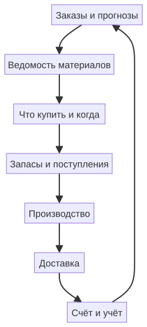

# 4. Машина, которая съела склад

Артур Элли был дядей Мэсси, младшим братом её отца, и он тридцать четыре года проработал планировщиком производства на заводе, который делал промышленные насосы. Ему было восемьдесят восемь, он держал пчёл, и он был единственным человеком, которого знала Мэсси, мог объяснить, что такое ERP, не употребляя слова «решение».

В воскресенье в октябре она приехала к его дому с коробкой хороших печенья и спросила, каким было всё до этого.

«До чего?» — сказал он.

«До всего. До компьютеров.»

Он рассмеялся ей тем образом, каким смеются старые люди над молодыми, а затем зашёл в заднюю комнату и вернулся с книгой. Это был переплёт на кольцах, скреплённый скотчем, и он был толщиной в четыре дюйма.

«Вот, — сказал он, — это спецификация. Вот из чего сделан насос. Каждая деталь, каждая поддеталь, каждый винт. И на каждой странице — количество, которое нам нужно было, чтобы сделать один насос, и поставщик, и сколько это занимало времени по доставке.»

Мэсси открыла её. Страницы были напечатаны на машине, с рукописными пометками трёх разных цветов, и всё это пахло пылью и сигаретами.

«Кто поддерживал её в актуальном состоянии?»

«Я. И когда я был в отпуске, никто не поддерживал.»

---

Проблема, которую пытался решить переплёт Артура, — одна из самых старых в производстве, и её удивительно трудно сформулировать ясно.

У вас есть заказы на насосы. Чтобы сделать насос, нужны детали. Чтобы иметь детали, их нужно заказать, и они прибывают через недели. Чтобы знать, сколько заказывать, нужно знать, сколько насосов вы будете делать, что зависит от заказов, которые у вас есть, и заказов, которых вы ожидаете. Но сами детали состоят из поддеталей, некоторые из которых делаются на том же заводе, и у каждой своё время по доставке, и некоторые из них делят машину, которая может делать только одну работу за раз. Если вы заказываете слишком много, вы замываете деньги на полках. Если вы заказываете слишком мало, завод останавливается, а остановленный завод — самый дорогой объект в здании.

Вручную компетентный планировщик мог бы сделать это для нескольких сотен деталей. За этим пределом арифметика обгоняла человека. Вы не могли удержать всю паутину зависимостей в голове, поэтому вы делали то, что делал Артур: вы вели переплёт, вы обновляли его карандашом, и вы молились, чтобы никто не спросил вас о детали, которую вы не проверяли с весны.

---

В начале 1950-х два производителя авиадвигателей, Rolls-Royce и General Electric, начали класть эту арифметику на компьютеры. Это не был коммерческий продукт; это был внутренний инструмент для проблемы настолько дорогой, что даже компьютер размером с комнату стоил того. Авиадвигатели имеют десятки тысяч деталей, и ошибка в плане стоит не задержку, она стоит самолёт.

Идея стала продуктом в 1964 году, когда человек по имени Джозеф Орлик выдумал практический метод расчёта потребностей, и компания под названием Black & Decker установила первую систему, чтобы использовать её. Руководителем проекта был назван Дик Албан, что является тем видом деталей, которые история обычно теряет и которые делают историю настоящей: это была не комиссия, это был человек с проблемой.

Орлик опубликовал метод в виде книги в 1975 году, с названием, которое ни один современный издатель не позволил бы: *Планирование потребностей в материалах: Новый способ жизни в производственном и складском управлении*. К тому времени о идее использовали около семи сотен компаний. К 1981 году восемь тысяч были.

Метод называется MRP, и он делает ровно одну вещь: он берёт то, что вы намерены сделать, проходит по спецификации, вычитает то, что у вас уже есть на складе, и говорит вам, что купить и когда, принимая во внимание время по доставке. Если это звучит очевидно, то потому что оно работало. Оно стало тем, как думают заводы.

В 1983 году человек по имени Оливер Райт расширил идею за пределы материалов. Если система уже знает, что завод будет делать, почему бы не позволить ей планировать людей, машины, деньги и прогноз продаж тоже? Результат назвали Планированием производственных ресурсов—MRP II—и это был первое программное обеспечение, которое претендовало на знание состояния всей компании.

К 1989 году программное обеспечение MRP II было около трети продаж индустрии программного обеспечения американскому производству, примерно 1,2 миллиарда долларов. Что-то изменилось: завод больше не работал на переплёте планировщика. Он работал на модели, и модель была в компьютере.

Завод Артура купил одну из таких систем в 1988 году, и первая попытка провалилась.

«Программное обеспечение было хорошим, — сказал он. «Оно было лучше, чем хорошее. Оно могло делать вещи, которые я делал карандашом двадцать лет, за секунду. Но оно хотело знать время по доставке для каждой детали, и никто никогда не записывал время по доставке. Они были в головах покупателей, и покупатели давали нам числа, которые они думали, что мы хотим услышать, потому что не хотели выглядеть медленными. Так что система планировала фикцией, и завод работал на плане, и три месяца спустя у нас был полный склад неправильных деталей и управляющий директор, спрашивающий, кто ответственен.»

«Кто был?»

«Все. Никто. Покупатели не лгали; они искренне не знали, потому что никто никогда не измерял. Это и есть вещь о модели: она не просто обнажает ошибки, которые вы сделали. Она обнажает вещи, о которых вы никогда не знали, что не знаете.»

Вторая попытка удалась, и причина её успеха ничего не имела общего с программным обеспечением. Завод потратил четыре месяца на измерение времени по доставке, подсчёт склада и запись правил, которым он всегда следовал по привычке. К тому времени, когда система была включена, модель уже была истинной, и единственная работа компьютера была в том, чтобы поддерживать её истинной быстрее, чем человек мог.

Артур гордился этим тем образом, каким мужчины его поколения гордились негламурными вещами. «Мы не устанавливали компьютер, — сказал он. «Мы записали, как работает завод. Компьютер был лёгкой частью.»

---

В 1990 году аналитическая фирма под названием Gartner нуждалась в имени для следующего шага. У заводов было MRP II. У финансового отдела были его собственные системы. У отдела продаж была ещё одна. У складов была ещё одна. Что если одна система делала всё это—not только завод, но и всё предприятие?

Они назвали его Планированием ресурсов предприятия. ERP.

Имя неточно, и каждый в индустрии знает это. Оно не планирует ресурсы в каком-либо глубоком смысле, и «предприятие» — слово, которое означает «большой», пока оно не означает «дорогой». Но имена липкие, и это имя прилипло к реальной вещи: единая база данных, в которой клиент, продукт, заказ, склад, счёт-факция и бухгалтерская книга все связаны, так что факт, введённый один раз, виден везде.

Компания, которая сделала её стандартом, была SAP, основанной в 1972 году пятью инженерами, которые ушли из IBM. В 1992 году они выпустили R/3, который работал на клиент-серверной архитектуре, которая становилась доступной, и которая кодировала процессы компании в способе, который аудиторы, банки и регуляторы распознавали. Если вы работали на R/3, вы могли проходить аудит так, как проходит аудит большая компания. Для растущего бизнеса, который хотел продавать большим клиентам, это было дороже любого свойства.

Две другие вещи произошли в 1990-х, и обе важны для истории этой книги.

Первой был год 2000. Великое множество компаний заменили их старые системы в конце 1990-х, потому что эти системы хранили годы двумя цифрами и могли, как боялись, спутать 2000 с 1900. Часть страха была переборщена. Но замена произошла, и она переместила ERP из завода в каждый вид организации: больницы, университеты, благотворительные организации, правительства.

Второй был облако. В 1999 году компания под названием NetLedger начала продавать программное обеспечение для учёта, которое работало в браузере, на чужом компьютере, за месячную плату. Потребовалось fifteen лет, чтобы идея стала нормальной. Теперь это значение по умолчанию, и причина не в технической элегантности. Это в том, что маленькая компания может арендовать систему, которую она никогда не могла бы позволить себе купить и запустить.

---

Артур убрал переплёт и заварил чай, и Мэсси задала вопрос, к которому она подходила.

«Так почему все ненавидят эти системы?»

Он подумал об этом некоторое время. «Потому что они заставляют вас делать работу их способом, — сказал он. «И потому что люди, которые продают их, лгут о том, сколько работы это стоит.»

Это честная версия истории, и её стоит сказать прямо, потому что остальная часть этой книги зависит от неё.

ERP — это модель компании, и у модели есть правила. Вы не можете опубликовать счёт-факцию без клиента, потому что счёту-факции нужен адрес и налоговый номер и бухгалтерский счёт. Вы не можете отправить товары, которых нет на складе, если только система не позволяет отрицательный склад, что большинство компаний выключает. Вы не можете удалить опубликованную запись журнала, потому что гарантия Пачиоли зависит от того, что история цела. Каждая из этих правил существует по хорошей причине, и каждая из них — это спор с кем-то, у кого есть клиент по телефону и которому нужна вещь *сейчас*.

Умножьте этот спор на каждый процесс в компании, и вы получите причину, почему проекты ERP знамениты тем, что идут неправильно. Программное обеспечение обычно не является проблемой. Проблема в том, что установка ERP — это не ИТ-проект: это соглашение о том, как работает компания, извлечённое из голов людей, которые там работают, записанное, а затем принудительно выполняемое машиной. Компании, которые не могут провести тот разговор—потому что владелец не хочет, или отделы не согласны, или консультант оплачивается по часам и ему всё равно—в итоге получают дорогую систему, которой никто не доверяет, и они возвращаются к лоткам.

Этот цикл — это вся производственная компания, и вся оптовая компания тоже, с «производством», заменённым на «отбор». Каждая ERP в мире — это машина для поддержания этого цикла истинным.

## Что заводской пол научил офис

Легко забыть, читая историю ERP, что идеи пришли из заводов и позже были применены к офисам—not другим образом.

Спецификация, время по доставке, точка повторного заказа, трёхстороннее соответствие, план мощности: все они были изобретены, чтобы остановить производственную линию, и все они оказались описывающими офис столь же хорошо. Котировка имеет время по доставке. Счёт-факция имеет спецификацию, если вы считаете доставку и заказ её компонентами. Месячный конец имеет план мощности.

Перенос удался потому, что бизнес — это бизнес, делает ли он насосы или продаёт переплёты. Словарь изменился, а арифметика нет. Что изменилось, когда идеи достигли офиса, была *стоимость арифетики*: завод мог обосновать компьютер в 1964 году, потому что остановленная линия стоила дороже машины; офис мог обосновать её только когда машина стоила меньше зарплаты клерка.

Это вся история последних шестидесяти лет в одном предложении, и она объясняет, почему те же идеи продолжают прибывать в меньшие компании, позже, в более дешёвых пакетах.

---

Мэсси поехала домой в темноте, думая о переплёте её дяди.

Больше всего её поразило не технология. Это было *обслуживание*. Кто-то должен был поддерживать переплёт в актуальном состоянии, и когда тот кто-то был в отпуске, истина разлагалась. Каждая система, о которой она читала в последнем месяце, имела ту же слабость в своём центре: модель хороша только настолько, насколько человек, который её питает, и люди заняты, и люди забывают, и люди уходят.

Мечта ERP была в том, что питание будет происходить автоматически, как побочный продукт работы. Продайте что-то и склад двигается; двигайте склад и бухгалтерская книга двигается; отправьте счёт-факцию и баланс клиента меняется. В основном та мечта сбылась. Что не сбылось, так это часть, где кто-то должен *просить* систему о вещах.

Та часть осталась ручной тридцать лет. Вы хотели знать, какие клиенты опаздывают с оплатой? Вы открывали отчёт, или вы спрашивали отдел учёта, или вы экспортировали в таблицу и прищуривались на неё. Вы хотели создать соро счетов-факций из соро счетов-факций? Вы нажимали соро раз, или вы платили кому-то, чтобы он нажал соро раз.

Модель существовала. Машина, которая могла *использовать* модель, не существовала.

Затем, внезапно, она появилась.

---

У Артура было ещё одно дело, которое нужно сказать, у двери, с печеньем, законченным, и пчёлами, засыпающими.

«Вы знаете, что была самой сложной частью моей работы?» — сказал он. «Не арифетика. Арифетику я мог делать. Это было то, что никто никогда не говорил мне, когда что-то менялось. Поставщик меняет время по доставке, клиент меняет заказ, инженер меняет деталь—и я узнаю через три недели, когда завод останавливается. Переплёт всегда был на месяц отстал, и я всегда был последним, кто знал.»

Он посмотрел на тёмный сад.

«Если вы можете построить вещь, которая знает, когда что-то меняется, и сообщает кому-то до того, как это имеет значение, — сказал он, «то вы построили вещь, которую стоит иметь.»

Мэсси думала об этом весь путь домой. Это было, как она поняла позже, лучшим описанием искусственного интеллекта в бизнесе, которое она когда-либо слышала, и оно пришло от человека восемьдесят восьми лет с переплётом и коробкой печенья.
