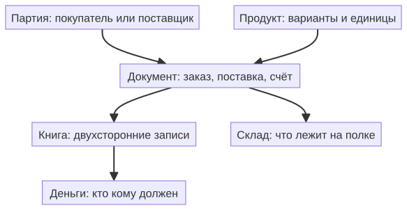

# 5. Что такое бизнес на самом деле

Встреча, которая изменила Ривертон, состоялась во вторник утром в маленькой комнате с ксероксом, потому что большая комната была забита запасами.

Мэгги пригласовала трёх человек: Прию Раман, которая вела продажи; Том Бек, который вёл склад; и Дорин, которая вела, как она это делала, всё остальное. На белой доске она написала одно слово.

**ЗАКАЗ**

"Что ж, — сказала она. — Скажите мне, что означает для вас это слово."

Перой заговорила Прия, потому что она всегда говорила первой. "Заказ — это то, что хочет клиент. Наименование, количество, цена, срок поставки. Я принимаю его по телефону или через интернет-магазин, и вношу в систему."

Том сказал: "Заказ — это то, что мне нужно собрать. Он приходит ко мне в виде списка позиций на полках. При этом в половине случаев это товарная накладная, а в половине — письмо от Прии с фотографией рукописной записки."

Дорин сказала: "Заказ — это то, что я инкассирую. Когда товар ушёл, я превращаю заказ в счёт. При этом иногда товар уходит двумя частями, и я выставляю счёт двумя частями, и тогда это уже не один заказ, а два счёта и один заказ, и кредит-нота на ту часть, которая вернулась."

На мгновение повисла тишина того рода, что следует за высказанной вслух истиной.

"Что ж, — сказала Мэгги, — у нас есть три разные вещи, все которые называются заказом."

"Четыре, — сказала Прия. — Есть ещё заказ поставщику, который мы отправляем."

Пять, если считать собственный номер заказа клиента, который появлялся на их бумагах и его следовало указывать в счёте, иначе его не оплатили бы. Шесть, если считать «безотзывный приказ» (постоянный платёжный поручение), который Академия Эшфилда оформляла каждый сентябрь, и который вообще не был заказом, а соглашением о заказе.

Это тот момент, когда большинство малых компаний обнаруживают настоящую причину, по которой их системы не работают. У них нет проблемы с данными. У них проблема с *языком*. Шесть разных вещей делят одно слово, и три разных слова делят одну вещь, а единственный словарь — это память людей в комнате.

Прайс-лист доказал это часом позже.

Прия озвучила коробку хороших маркеров для белой доски в одиннадцать фунтов сорок. Том сказал, что в девять девяносто пять. Оба были уверены. На общем диске, как оказалось, было семнадцать файлов, называемых прайс-листом, с датами между 2019 и этим вторником, и четыре из них были отредактированы за последний месяц. Правильный ответ зависел от клиента: у Эшфилда была контрактная цена с января, которую Прия держала в собственной таблице, а у Тома была распечатанная таблица из марта, в которой не было контрактных цен, потому что они были «коммерческими».

Никто не лгал. Никто даже не был небрежен. У компании не было места, где цена продукта для клиента была *фактом*; у неё была привычка к соглашению, возобновляемому по телефону, зафиксированному в семнадцати местах, из которых одно было верным в любой данный день, и никто не знал, какое именно.

Дорин, которая долгое время ничего не говорила, сказала: "Вот почему я храню счета. Потому что счёт — это единственный лист бумаги, где мы все согласовали одновременно."

Она описывала, не зная слова для этого, ровно то, что хранит ERP: не прайс-лист, а цену *которая применялась к тому документу*. Различие — это вся пятая глава любого бухгалтерского стандарта, и это причина, по которой документ в реальной системе хранит свою собственную копию фактов, а не указывает на список, который изменится завтра.

---

ERP — это, прежде всего, словарь с прикреплёнными правилами.

Она говорит: есть вещь под названием Заказ продажи. У неё есть клиент, дата и список строк; каждая строка имеет продукт, количество, цену и налог. У неё есть состояние: черновик, подтверждён, готово, отменено. Она не та же вещь, что Поставка, которая покидает склад, и не та же вещь, что Счёт, который запрашивает деньги. Когда вам нужен номер заказа покупателя клиента, это поле в Sale Order, а не пометка на полях.

Как только эти определения существуют, шесть значений схлопываются в одно, и споры прекращаются. Не потому, что все согласны, а потому, что спор перемещается из «что ты имеешь в виду под заказом?» в «о какой из этих вещей мы говорим?», и второй спор можно уладить за минуту.

Так что позвольте дать вам словарь. Он невелик. четыре вида вещей, и всё остальное в этой книге — следствие из них.

---

**Первый вид вещей — это сторона (участник).**

Клиент — это сторона. Поставщик — это сторона. Ваша собственная компания — это сторона. Банк — это сторона. Налоговая — это сторона. Все они одной формы: имя, адрес, налоговый номер, валюта, условия оплаты, контакт.

Это не технический приём; это кусок глубокого здравого смысла, который индустрия программного обеспечения принимала годами. В старой системе клиенты жили в одном файле, а поставщики — в другом, и компания, которая была одновременно обеими — что постоянно случается в оптовой торговле, потому что магазин, которому вы продаёте, также продаёт вам вещи — появлялась дважды, с двумя балансами, и приведение их в соответствие было ежемесячным мучением. В современной ERP есть один список сторон, и быть клиентом или поставщиком — это *роль*, которую играет сторона.

Следствие немедленно практично. Когда Академия Эшфилда одновременно покупает папки у Ривертона и продаёт Ривертону свою старую мебель, есть один счёт, один адрес, один кредитный лимит и один чистый баланс. Бумага проще, потому что модель точнее.

**Второй вид вещей — это продукт.**

Продукт — это вещь, которую вы покупаете или продаёте: коробка ручек, паллет бумаги, услуга, плата за доставку. У него есть имя, код ссылки, единица измерения (штука, коробка, паллет, килограмм, час), закупочная цена, продажная цена, налог и — если вы ведёте учёт запасов — количество в наличии в каждой точке.

Две тонкости стоят того, чтобы о них знать, потому что они вызывают большую часть путаницы в реальных компаниях.

Первая — это *вариант*. Рубашка бывает четырёх размеров и трёх цветов: это один продукт с двенадцатью вариантами, а не двенадцать продуктов. Если вы моделируете её как двенадцать продуктов, то ваши отчёты о продажах не смогут сказать вам, что синий продаётся вдвое лучше зелёного, потому что система считает их несвязанными объектами. Если вы моделируете её как один продукт с вариантами, отчёт тривиален, а запас точен.

Вторая — это *единица измерения*. Вы покупаете бумагу паллетами, а продаёте резами. Если система не знает, что паллет — это сорок рез, то каждое измерение запаса — это спор, и кому-то приходится конвертировать вручную, и кто-то в конечном итоге конвертирует неправильно. Единица измерения — это не украшение; это арифметика, которая делает склад честным.

**Третий вид вещей — это документ.**

Заказ, поставка, счёт, платёж, корректировка запаса, запрос на покупку: это все документы, и у всех одинаковая анатомия. Дата, сторона, список строк, итог и состояние.

Состояние — это та часть, которую недооценивают. Документ — это не лист бумаги; это вещь, движущаяся во времени. Котировка — это черновик, который может стать заказом. Подтверждённый заказ может быть поставлен частично. Счёт может быть проведён, а затем оплачен частично. Каждое из этих состояний — это факт о мире, и работа системы состоит в том, чтобы знать, в каком состоянии находится каждый документ, и отказываться от переходов, которые не имеют смысла. Вы не можете поставить товары, которые никогда не заказывали. Вы не можете оплатить счёт, который никогда не был проведён. Вы не можете отменить поставку, которая уже покинула здание, если только вы не возвращаете её.

Вот почему ERP кажется строгой. Она строга в том смысле, в каком строг железнодорожный сигнал. Строгость — это безопасность.

Есть ещё одно свойство документов, которое легко упустить и которое огромно важно: **документ помнит свои собственные факты.** Когда вы подтверждаете заказ на сто папок по четыре фунта каждая, заказ хранит цену. Если цена изменится завтра, заказ всё ещё говорит о четырёх фунтах, потому что это то, с чем согласился клиент. Если адрес клиента изменится в следующем месяце, вчерашний счёт всё ещё показывает старый адрес, потому что туда он был отправлен. Система хранит историю фактов, а не только текущую картину. Без этого вы никогда не смогли бы что-либо кому-либо доказать.

**Четвёртый вид вещей — это деньги.**

Каждый документ, имеющий финансовые последствия, порождает проводки: двухсторонние утверждения, которые Пачоли описал в 1494 году. Продайте что-то, и система запишет выручку и задолженность клиента. Купите что-то, и она запишет расход и задолженность поставщику. Оплатите поставщику, и она запишет уход денег из банка и исчезновение задолжности.

Никто в Ривертоне никогда не введёт проводку вручную, и в этом суть. Проводки — это побочный продукт документов. Работа бухгалтера перестаёт быть «записать, что произошло», и становится «проверить, что записанное верно», что куда лучшее использование бухгалтера.

---

Мэгги нарисовала эту диаграмму на белой доске, и Том, который почти ничего не говорил двадцать минут, смотрел на неё долгое время.

"Всё?" — сказал он. "Всё?"

"Всё," — сказала Мэгги. "Всё остальное — детали."

Том постучал по коробке, помеченной как Запас. "Так что если я сниму паллет с полки и положу его на фургон, система должна знать."

"Да."

"И если фургон вернётся, потому что ворота школы были заперты, система должна знать и об этом тоже."

"Да."

"И если паллет повреждёт дождём, пока он стоит на погрузочной площадке, и мне придётся его списать—"

"Тогда это тоже документ," — сказала Мэгги. "Корректировка запаса. С причиной."

Том медленно кивнул. "У нас никогда не было этого," — сказал он. "У нас была тетрадь. И когда тетрадь расходится с учётом, учёт побеждает, потому что учёт — это то, что видит налоговая. Но учёт неверен, потому что именно я знаю, что реально находится на полке."

Это самое распространённое жалоба на бизнес-программное обеспечение, и её стоит назвать точно, потому что остальная часть этой книги о её исправлении. Том знал истину и не мог её внести. Учёт содержал истину и не мог быть исправлен. Разрыв между ними заполнялся ежемесяльным ритутом инвентаризации, во время которого компания обнаруживала, насколько она была ошибочна, списывала разницу и начинала заново.

Разрыв существует потому, что внесение фактов в компьютер всегда было отдельной работой от выполнения самой работы. Кто-то должен сесть и напечатать. Этот кто-то обычно занят, и печать обычно является наименее интересной вещей, которую он сделает в тот день. Так что модель уходит от реальности, немного за раз, а затем сильно.

Обещание системы, которую Мэгги собиралась установить, не в том, что уход исчезает. В том, что исчезает печать. Том не будет печатать, что он переместил паллет. Он скажет ассистенту на английском, что паллет лёг на фургон, и ассистент сделает документ. Модель остаётся верной, потому что стоимость её сохранения упала почти к нулю.

В этом и есть изменение. Всё остальное — скриншоты, установки, диаграммы — служит тому одному предложению.

---

Дорин была тиха, что было необычно. Когда Мэгги спросила её, что она думает, она сказала: "Я думаю, что тридцать один год выполняла работу базы данных, и никто никогда не спрашивал меня, хочу ли я этого."

Никто не засмеялся, потому что это не была шутка.

"Что бы ты сделала," — спросила Мэгги, — "если бы тебе не пришлось помнить, где всё находится?"

Дорин подумала об этом. Затем она сказала: "Я бы проверяла вещи. Я бы замечала, когда цена кажется неверной, или когда клиент заказывает то, чего никогда раньше не заказывал. У меня было бы время быть любопытной."

В языке управления это называется *обработкой исключений*, и это наиболее ценная работа в любом офисе. Это также работа, которая никогда не выполняется, потому что люди, которые могли бы её делать, заняты тем, что являются базами данных.

Мэгги написала «быть любопытной» на белой доске под четырьмя коробками и нарисовала вокруг неё круг.

"Что ж," — сказала она. — Давай пойдём и купим словарь."
