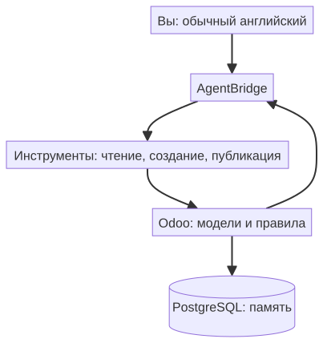

# 6. Три машины в одной комнате

Сэм Окафор устанавливал бизнес-системы для малых компаний, и у него было правило: он не продавал никому систему, пока не видел их склад.

— Он очень настаивает на складе, — сказала Прия, когда представляла его. — Заставил меня обойти наш двадцать минут, а потом заявил, что у нас триста сорок паллет, о которых система ничего не знает.

— Триста сорок один, — сказал Сэм, когда пришёл в офис. — Одна была за дверью.

Ему было за пятьдесят, он носил холщовую сумку вместо портфеля и отказывался от кофе под предлогом, что пьёт его слишком много. В маленькой комнате с копировальным аппаратом он взял лист бумаги из принтера и нарисовал на нём три квадрата.

— Ладно, — сказал он. — Всё, что я тебе сейчас расскажу, поместится на эту салфетку. Остальное — детали.

---

**Первый квадрат — это память.**

Бизнес-система должна что-то помнить. Клиентов, товары, заказы, счета, запасы, цены, платежи. Не в архивном шкафу и не в электронной таблице, а в базе данных: программе, единственная задача которой — хранить факты и точно их возвращать, даже если электричество отключится посреди записи одной из них.

База данных, которую будет использовать Ривертон, называется PostgreSQL, и это один из тихих чудес современного мира. Она появилась в Калифорнийском университете в Беркли в 1980-х годах в рамках научного проекта, которым руководил человек по имени Майстон Стонбрейкер, и с тех пор развивается открыто: никто её не владеет, любой может прочитать её инструкции, и она обслуживает удивительно большую долю всего — банков, правительств, веб-сайтов и, скоро, оптовика канцелярских товаров на рыночном городке.

Что делает базу данных отличной от электронной таблицы, так это не размер. Это обещания.

Электронная таблица позволит вам напечатать слово в столбце с числами, и она не возразит. Электронная таблица позволит двум людям открыть один и тот же файл и перезаписать работу друг друга. Электронная таблица позволит сохранить незаконченное изменение. База данных даёт три обещания вместо этого: что изменение либо происходит целиком, либо не происходит вовсе; что данные всегда соответствуют объявленным правилам; и что два человека, изменяющих данные одновременно, не смогут тихо уничтожить работу друг друга.

Эти обещания имеют негламурное имя — *транзакции* — и именно поэтому компания может доверять числу на экране. Когда помощник создаёт счёт, либо существуют сам счёт, его строки, проводки в бухгалтерской книге и его связь с заказом, либо не существует ничего из этого. Не бывает состояния, при котором счёт существует, а бухгалтерской книги нет.

**Второй квадрат — это модель.**

Над памятью находится то, что знает, что факты *означают*: что у счёта должен быть клиент, что поставка должна идти со склада, что ставка налога применяется к товару, а не к странице заметок. Это ERP-система, и для Ривертона это система под названием Odoo.

У Odoo есть история, которую стоит знать, потому что она объясняет, почему малая компания может себе её позволить. Она началась в 2005 году как проект под названием TinyERP, написанный бельгийцем по имени Фабиен Пинкьер. В 2008 году её переименовали в OpenERP, а в 2014 году она получила своё нынешнее название. Это открытый исходный код — сообщественная версия находится под лицензией, позволяющей любому использовать, изучать и изменять её — и одновременно это компания, которая продаёт более насыщенную версию и поддержку. Именно такая комбинация — открытый ядро с коммерческим отделением — как финансируется большая часть современного программного обеспечения для бизнеса.

Сообщественная версия бесплатна, и это не демо-версия. Она содержит продажи, закупки, инвентаризацию, бухгалтерский учёт, выставление счетов, проекты, производство, веб-сайт и интернет-магазин. Odoo 20, версия, используемая в этой книге, появилась в сентябре 2026 года. Компания отчитывается о миллионах пользователей; точное число менее важно, чем тот факт, что программное обеспечение используется на многих языках компаниями любого размера, и что вопрос о нём обычно уже задавался и на него уже кто-то ответил.

Важное для наших целей в Odoo то, что она *строга к своей модели*. Она не позволит вам опубликовать счёт без строк. Она не позволит отправить товары, которых у вас нет, если вы не скажете ей разрешить это. Она сохраняет историю. Эта строчность — не порок характера; это вся причина, по которой системой может доверять бухгалтер.

**Третий квадрат — это суждение.**

Это новое, и именно об этом книге на самом деле.

База данных не имеет мнений. Модель не имеет инициативы. Ни одна из них никогда не заметит, что клиент перестал заказывать, что цены поставщика поползли вверх, или что счёт для школьного округа был напечатан и никогда не отправлен. Они отвечают на вопросы; они не задают их.

Третья машина — это агент: программа, которой можно дать инструкцию на обычном языке, выяснить, какие факты ей нужны, получить их, решить, что делать, сделать это и отчитаться. В Ривертоне она называется AgentBridge, и она работает на том же компьютере, что и всё остальное — что важнее, чем кажется, и мы к этому вернёмся.

Агент — это не чат-бот. Чат-бот берёт вопрос и производит текст. Агент берёт инструкцию и производит *эффекты*: созданная запись, опубликованный документ, отправленное письмо. Чтобы делать это безопасно, ему нужны две вещи: набор инструментов, которые ему разрешено использовать, и набор ограничений, которые он не может пересечь.

Инструменты, в случае Ривертона, — это операции самой ERP: поиск клиентов, чтение товара, создание заказа, его подтверждение, публикация счёта, вопрос к бухгалтерской книге. Каждый инструмент — небольшое, чётко определённое действие с именем и описанием, и агент выбирает среди них так же, как новый сотрудник выбирает среди кнопок на экране — читая, что они делают.

Ограничения — это собственные ограничения Odoo. Это та часть, которую Мэдди долго не могла понять, и её стоит изложить медленно.

Агент не имеет главного ключа. Он подключается к Odoo как *пользователь* — реальный учётная запись с паролем и набором разрешений, созданным для него установщиком. Когда он просит создать счёт, запрос отправляется в Odoo, и Odoo проверяет, разрешено ли этому пользователю создавать счета, в этой компании, с этими налогами. Если ответ «нет», то ответ «нет». Агент не может спорить, потому что агент — не авторитет. Odoo — авторитет.

Это самое важное архитектурное решение во всей системе, и именно поэтому книга может рекомендовать её компании, которая никогда раньше не использовала искусственный интеллект. Интеллект нов и немного непредсказуем; правила стары и полностью предсказуемы. Новое разрешено действовать только внутри правил старого.

## Почему три, а не одна

Разумный вопрос, и у Эма был ответ, который занял десять секунд и остался с Мэдди с тех пор.

— Потому что они выходят из строя по-разному, — сказал он. — Если база данных останавливается, вы узнаете немедленно: ничего не работает. Если модель неверна, вы узнаете медленно: числа выглядят странно. Если помощник ошибается, вы узнаете поздно: кому-то доверились ответу. Три машины означают три вида отказа, и три вида отказа можно различить.

Одна программа, выполняющая всё три, была бы проще в установке и невозможна в диагностике. Когда она ведёт себя неправильно, вопрос *это данные, правила или суждение?* не имел бы ответа, и единственным средством была бы переустановка и надежда.

Разделение даёт вторую выгоду, которая проявляется позже: каждую машину можно заменить отдельно. Компания, которая переросла базу данных, переходит на более крупную; компания, которая переросла модель, переходит на другую ERP, сохраняя данные; компания, которая переросла помощника, меняет модель, с которой разговаривает. Ни одна из этих миграций не требует других, поэтому стек в этой книге останется разумным и через пять лет.

---

— Как они разговаривают друг с другом? — спросила Мэдди.

— Двумя способами, и оба скучные, что хорошо, — сказал Эм.

Агент разговаривает с Odoo через собственный внешний интерфейс Odoo — задокументированный способ, которым другая программа может попросить Odoo сделать что-то по сети. Odoo называет её JSON-2 API, что за имя мог бы полюбить только программист. Что оно означает: есть дверь, у неё есть замок, вам нужен ключ, и за дверью те же операции, которые используют веб-экраны. Ничего, что может сделать агент, не является тем, чего человек не мог бы сделать кликом; агент просто быстрее и не устаёт.

А сами инструменты описываются агенту с помощью соглашения под названием Model Context Protocol, или MCP. Оно был опубликовано Anthropic в ноябре 2024 года как открытый стандарт, и оно делает одну простую вещь: даёт программе стандартный способ сказать «вот список того, что я могу сделать, вот что нужно каждому из них, и вот что они возвращают». До него каждый помощник нуждался в собственном коннекторе для каждой системы, и коннекторы умножались. С ним инструмент, написанный однажды, может использоваться любым помощником, говорящим на этом протоколе — а теперь в мире тысячи таких инструментов.

ERP-инструмент Ривертона — один из них. Он называется OdooTool, это открытый исходный код, и его написали те же люди, кто написал помощника. Его задача — быть переводчиком: агент говорит «создай клиента под названием Ashfield Academy», инструмент превращает это в точную последовательность вызовов, которых ожидает Odoo, проверяет ответы и отчитывается на обычном языке.

---

На салфетке было ещё одно слово, в углу, почерком Эма — *комната*.

— Все трое из этих работают на вашем компьютере, — сказал он. — Не на сервере в другой стране. База данных, ERP и помощник. Это означает, что единственное, что покидает это здание, — это то, что вы решаете отправить языковой модели, и если вы запускаете модель локально, ничего не покидает вовсе.

Мэдди задала очевидный вопрос. — Это лучше?

— Это иначе, — сказал Эм. — Это лучше для контроля и конфиденциальности, и хуже для удобства, потому что о нём нужно заботиться. Нет линии поддержки, которую можно позвонить в одиннадцать вечера. Но нет и никого, кто мог бы вас выключить, поднять цену или прочитать ваш список клиентов. Для компании вроде вашей я бы выбрал этот компромисс.

Он добавил четвёртую строку на салфетку, под тремя квадратами, буквами настолько мелкими, что Мэдди пришлось наклоняться: *резервные копии*.

— С вами произойдут две вещи, — сказал он. — Первая в том, что машина сломается, или отключится электричество, или кто-то прольёт чай на не то. Вторая в том, что прибудет новая версия одной из этих программ и захочет быть установленной. Обе вещи обычны. Ни одна из них не является катастрофой, если у вас есть копия базы данных со вчера и запись о том, что вы изменили. Что превращает обычный отказ в катастрофу — это обнаружить в момент отказа, что единственная копия памяти вашей компании была на машине, что только что остановилась.

— Как часто? — спросила Мэдди.

— Ежедневно для базы данных. Еженедельно для всей папки. И раз в месяц открывать резерльную копию и проверять, что она содержит то, что вы думаете, что она содержит. Не проверенная резервная копия — это желание.

Он положил ручку. — Ещё одна вещь, и потом я перестану вас лектировать. Решите теперь, кто владеет этим. Не кто за это заплатил — кто *владеет* этим. Кто-то должен быть разрешено сказать «нет» изменению, настаивать на резервной копии, читать журнал, когда что-то выглядит странно. В малой компании этим человеком обычно является владелец, и режим отказа в том, что владелец слишком занят, и система тихо становится ничьей.

Мэдди взглянула на салфетку. Три квадрата для машин, одно слово для человека, который должен о них заботиться.

Он сложил салфетку и передал её ей.

— Сохраните это, — сказал он. — Когда что-то пойдёт не так — и что-то пойдёт не так — вернитесь к салфетке. Спросите себя, какой из трёх квадратов несчастлив. В девяти случаях из десяти ответ подскажет вам, что делать.

---

Вечером Мэдди прикокала салфетку к доске в комнате счетов, рядом с расписанием поставки из 2019 года, которое никто никогда не снимал.

Дорин взглянула на него некоторое время.

— Кто из нас я? — спросила она.

Мэдди подумала об этом. — Ты — та часть, что замечает, — сказала она. — На салфетке пока нет для этого квадрата.

— Тогда она не завершена, — сказала Дорин, и пошла обратно к своему столу.

Она была права, конечно. На салфетке были три квадрата для механизмов и нет квадрата для человека, который решает, что число выглядит неправильно. Каждая система, о которой Мэдди читала за последний месяц, делала то же упущение, и каждая из них терпела крах по той же причине: они относились к людям как к устройствам ввода.

Система, которую она собиралась установить, не сделает этой ошибки, по причине, которая была почти случайностью дизайна. Потому что помощник берёт инструкции на обычном языке, человек остаётся в разговоре. Дорин не будет заменена базой данных. Она будет той, кто говорит базе данных, на что обращать внимание.
