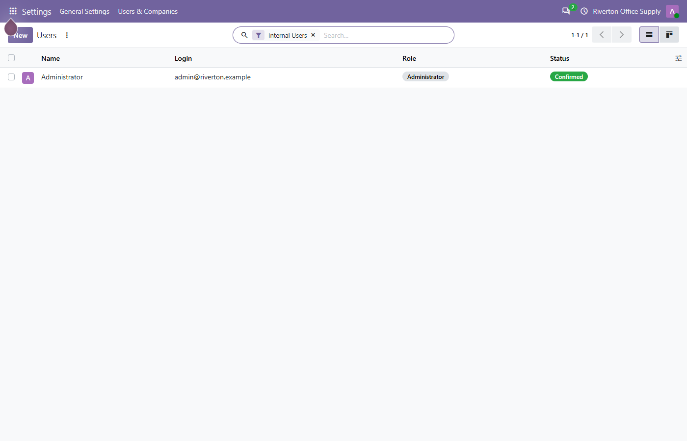

# 12. Ключ, открывающий только одну дверь

Последний элемент конфигурации перед тем, как можно было отпустить ассистента, был самым неинтересным и самым важным: ключ.

Сэм объяснил его на доске, так, как он объяснял всё, с схемой, занявшей тридцать секунд и разрешившей спор, который обычно занимает неделю.

"У каждого замка в этом здании есть ключ," — сказал он, рисуя прямоугольник для ERP. — "Вопрос не в том, получит ли ассистент ключ. Вопрос в том, какую дверь он открывает и что он может сделать, оказавшись внутри."

---

## Что такое API-ключ

API-ключ — это пароль, который использует программа вместо человека. Это длинная строка символов, она показывается один раз и принадлежит *пользователю* — не программе и не машине.

Это последнее утверждение — весь смысл дизайна. Когда ассистент подключается к Odoo, он подключается не как суперпользователь со специальным чёрным ходом. Он подключается как учётная запись пользователя, которая в случае Riverton называется *Agent* (Агент), с паролем и ключом и с набором прав, которые человек мог бы дать новому сотруднику в его первый день.

Что означает три вещи, и каждая из них дороже удобства, которое стоит.

**Правила ERP применяются к ассистенту.** Если пользователя *Агент* не разрешено удалять счета, ассистент не может удалять счета — не потому, что ему сказали не делать этого, а потому, что ERP отклонит запрос. Интеллект нов; правила стары; новое работает внутри старого.

**Ассистент появляется в журнале аудита.** Каждая запись, которую он создаёт, содержит *Агент* в поле "создал", и каждое его изменение регистрируется. Если счёт появляется в четыре утра со странным скидкой, система не скажет "это сделала машина"; она скажет, какой пользователь, в какое время и с какими значениями.

**Ключ можно отменить, не меняя ничего другого.** Если ключ утечёт, или ассистент заменяется, или кто-то уходит, ключ удаляется, и ассистент останавливается. ERP не меняется, пользователи не меняются, и ничего не нужно переустанавливать.

## Где живёт ключ

Установщик сгенерировал ключ во время установки и записал его в конфигурацию коннектора, в собственную папку ассистента. Его нет в книге, нет в письме и нет в документе, который пересылают. Он находится в одном файле, на одной машине, с правами файла пользователя, который его установил.

Тот же ключ можно создать вручную, и каждый пользователь может создать себе один: он находится в меню пользователя, *Мой профиль*, *Безопасность учётной записи*, *Новый API-ключ*. ERP показывает его один раз, в окошке, с предупреждением, что он больше никогда не будет показан — что не является угрозой, а фактом о том, как ключи хранятся: система сохраняет хэш, а не ключ, поэтому она не сможет напомнить вам позже.

## Что ассистенту разрешено делать

Пользователю *Агент* в Riverton была дана роль, и роль была выбрана по правилу, которое стоит повторить: **дать ассистенту права наименее могучего сотрудника, который мог бы выполнить работу.**

Для Riverton это означало:

| Область | Права | Почему |
|---|---|---|
| Клиенты | чтение, создание, редактирование | он принимает заказы и добавляет контакты |
| Товары | чтение | он делает ценовые предложения; он не выдумывает товары |
| Продажи | чтение, создание, подтверждение | он пишет ценовые предложения и подтверждает заказы |
| Счета | чтение, создание, проводка | он выставляет счета; проводка — это действие, создающее бухгалтерскую книгу |
| Платежи | чтение, создание | он регистрирует то, что говорит банк |
| Закупки | чтение, создание, подтверждение | он повторяет заказ того, о чём просит склад |
| Склад | чтение, корректировка | он перемещает остатки и фиксирует повреждение |
| Настройки бухучёта | нет | конфигурация — работа человека |
| Пользователи и права | нет | никогда, ни при каких обстоятельствах |
| Удаление документов | нет | если что-то неправильно, это аннулируется, а не стирается |

Последние две строки — те, которые нужно отстаивать. Машина, которая может менять права, может дать себе всё что угодно; машина, которая может удалять, может уничтожить журнал аудита, который доказал бы, что она сделала. Обе они исключены не потому, что ассистент ненадёжен в каком-то драматическом смысле, а потому, что стоимость их исключения равна нулю, а стоимость ошибки — нет.

## Разговор о доверии

Дорин, которая была молчалива большую часть этого, задала вопрос, который имел значение.

"Что мешает ему сделать что-то глупое?"

"Ничего не мешает," — сказал Сэм. — "Это честный ответ. Он может создать клиента с глупым именем, или провести счёт неправильному человеку, или заказать четыреста коробок неправильной бумаги. Что мешает этому стать катастрофой, так это то, что вы можете это увидеть и отменить, и что он не может делать то, что нельзя отменить."

"Это не очень утешительно."

"Нет," — согласился он. — "Но это та же утешительность, что и с новым сотрудником. Вы не мешаете ему ошибаться; вы даёте ему работу с пределом, вы проверяете работу первого месяца и убеждаетесь, что ошибки — это те, которые вы можете исправить."

Различие — и это то различие, которое делает систему пригодной для использования — в том, что ошибки ассистента *видимы таким образом, каким не видимы ошибки человека*. Человек, который неправильно расслышал количество, записывает его в заказ, и никто не замечает этого, пока клиент не пожалуется. Вариант ассистента той же ошибки — это запись с меткой времени, пользователем, инструментом, который он вызвал, и аргументами, которые он передал, и её можно найти в журнале anybody, кто подумает о поиске.

Вот почему журнал — не техническая деталь. Это то, что делает агента приемлемым в бизнесе, где движется деньги: не в том, что он никогда не ошибается, а в том, что его ошибки *находимы*.

## Первый тест

Прежде чем позволить ассистенту что-либо делать, Сэм попросил его ничего не делать.

"Проверьте соединение," — напечатал он. — "Скажите мне, какая версия Odoo запущена."

Ответ пришёл через секунду: версия, имя базы данных, пользователь, под которым он подключён, и компания, на которую он направлен. четыре факта, все верные, все из которых человек мог бы проверить в ERP примерно за то же время.

"Хорошо," — сказал Сэм. — "Теперь спросите его, сколько клиентов."

Клиентов не было, потому что никто ещё ничего не ввёл. Ассистент сказал ноль, что было верно, и что является более интересным ответом, чем он выглядит: система, которая может сказать *ноль*, — это система, читающая базу данных, а не система, выдумывающая что-то. Модель, которая угадывает, произвела бы правдоподобное число.

"Верно," — сказал Сэм, закрывая ноутбук. — "Теперь ваш. Дайте ему работу."

## Право, которое все забывают

Есть одно право в каждой ERP, которое компании дают без размышлений, и это то, что отменяет все остальные: способность менять *конфигурацию*.

Пользователь, который может редактировать план счетов, может проводить что угодно где угодно. Пользователь, который может редактировать налоговые коды, может заставить продажу исчезнуть. Пользователь, который может менять права доступа, может дать себе всё, чего ему не хватает. Правила, защищающие бухгалтерскую книгу, сами являются данными, и тот, кто может менять данные, может менять правила.

Ассистент поэтому исключён из настроек целиком — не потому, что он бы их滥用, а потому, что компетентность агента именно в *выполнении дел*, а конфигурация — это единственная область, где выполнение неправильного дела неотличимо от выполнения правильного до прибытия аудитора.

Правило обобщается: **автоматизируйте работу, никогда не автоматизируйте правила.** Компания, которая позволяет ассистенту менять свои собственные права, по существу, не имеет никаких прав вообще; у неё есть ящик для предложений.

## Первая проверка после создания ключа

В момент создания ключа есть одна проверка, которую стоит сделать, и она занимает десять секунд.

В ассистенте спросите: *проверьте соединение с Odoo и скажите мне, какая версия запущена.*

Номер версии и имя базы данных означают, что ключ работает, адрес правилен, и пользователь может достичь ERP. Ошибка означает, что один из трёх элементов неправильный, и сообщение об ошибке обычно говорит, какой.

Эта проверка стоит повторения после любого изменения конфигурации — нового ключа, нового порта, новой машины — потому что она изолирует соединение от всего остального. Когда позже что-то пойдёт неправильно, первый вопрос всегда *это соединение или это вопрос?* — и эта инструкция отвечает на него за секунду.

Дорин записал её на карточку и приклеил к монитору. Это самая неинтересная инструкция в этой книге и та, которая сэкономила больше всего времени.

## Когда ключ утекает

Ключ, записанный в файл конфигурации на машине, может утечь тремя способами, и все три случались с компаниями, которые не были небрежны.

Его можно скопировать в резервную копию, которая затем передаётся. Его можно вставить в тикет поддержки кем-то, пытающимся быть полезным. И его можно прочитать другой программой на той же машине, что и причина, по которой машина, которой пользуются пять человек, — плохое место для ключа, который может проводить счета.

Средство лечения не в том, чтобы охранять ключ церемонией. Средство лечения в том, что ключ *дешёв для замены*:

1. В ERP откройте страницу безопасности учётной записи пользователя и удалите ключ.
2. Создайте новый и вставьте его в конфигурацию коннектора.
3. Перезапустите ассистента.

Три минуты, без потери данных, без переустановки. Старый ключ перестаёт работать в ту же секунду, когда он удалён, что и есть свойство, делающее это безопасным: утекший ключ — это досада, а не инцидент, при условии, что кто-то заметит и отменит его.

То, что делает его инцидентом, — это ключ, принадлежащий пользователю, который может всё. Вот почему у пользователя *Агент* есть роль, и почему ключ администратора никогда не тот, который даётся программе.

## По одному агенту за раз

Есть ещё один предел, который стоит знать, и он вовсе не о правах.

Ассистент работает на той же машине, что и всё остальное, а языковая модель — будь то сервис в другом здании или модель на вашей собственной видеокарте — отвечает на один запрос за раз. Компания, которая запустит четыре агента в четырёх окнах, не получит четыре раза больше работы; она получит четыре агента, работающих по очереди, и машину без оставшейся памяти.

Установщик построен вокруг этого: один ассистент, одно окно, лаунчер, который открывает ровно один. Соблазн открыть второе, чтобы сделать что-то ещё, пока первый думает, — это самый распространённый способ, которым небольшая установка падает, — и исправление не техническое. Это — подождать или попросить меньше сразу.

Riverton выучил это во вторую неделю, когда Том открыл второе окно, чтобы спросить о запасах, пока писался счёт Прии. Машина не зависла. Она просто стала медленной, затем ещё медленнее, а затем оба окна ответили сразу двумя половинами одной и той же работы, и Дорин потратила двадцать минут, разбираясь, какой счёт реален.

Правило, которое из этого вышло, находится на стене комнаты счетов, рядом с салфеткой: *один вопрос за раз, и прочитайте ответ.*

---

Вечером Мэджи сидела перед окном ассистента некоторое время, не печатая ничего.

Оно было простым: запрос, место для ответа и маленькая строка внизу, говорящая, с какой моделью оно разговаривает. Оно выглядело как окна терминала, которые использовал её отец в девяностых, что было либо утешительно, либо тревожно, в зависимости от вашего взгляда на девяностые.

Она напечатала: *Что ты можешь делать?*

Ответ был списком. Он мог читать клиентов, товары, заказы, счета, запасы; он мог создавать и изменять записи; он мог вызывать действия, перемещающие документ из одного состояния в другое; он мог группировать, суммировать и считать. Он не мог менять настройки компании, управлять пользователями или удалять что-либо.

Она прочитала это дважды, а затем напечатала предложение, которое было в её голове с понедельника в ноябре, когда она повезла счёт через город.

*Покажи мне каждого клиента, который должен нам деньги и не заказывал ничего шесть месяцев.*

Ответ занял четыре секунды. Клиентов ещё не было, поэтому ответом была вежливая фраза, говорящая об этом; но фраза включала две вещи, которые он искал, и место, где он искал, что и делает хороший сотрудник, когда ответ "ничего".

Мэджи закрыла окно и пошла домой.

Утром следующего дня она начала вводить клиентов.
