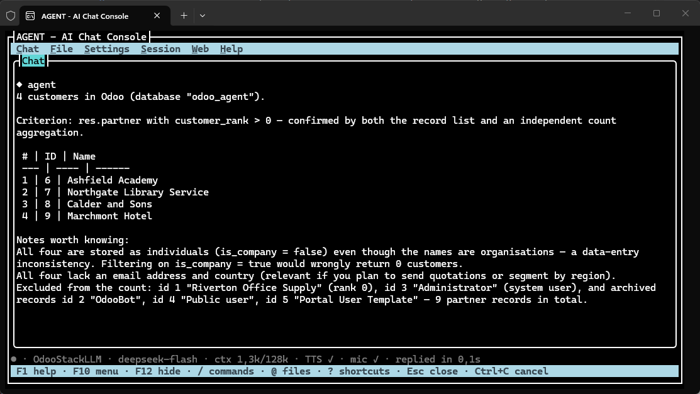

# 13. Первый разговор

Когда ассистента запустили впервые, он попросил ключ.

Не ключ ERP — тот был создан во время установки и записан в конфигурацию коннектора. Речь шла о другом: о ключе, который позволяет ассистенту общаться с языковой моделью, то есть о ключе, который позволяет ей мыслить.

Окном был собственный терминал ассистента, открытый значком Odoo для ИИ, и выглядел он как терминал из 1995 года: строка меню сверху, большая пустая область и строка внизу с курсором. А до первого запуска был короткий ряд вопросов.

*Выберите провайдера.*

Список был привычным: крупные облачные сервисы, пара агрегаторов и вариант модели, работающей непосредственно на машине. Мэгги выбрала DeepSeek, потому что именно его Сэм рекомендовал по стоимости и потому что у компании уже была учётная запись.

*Вставьте ключ.*

Она вставила его. Окно на секунду замерло, затем вывело список названий моделей — это момент, на который стоит обратить внимание, потому что именно в него ассистент *доказал*, что ключ работает. Он не просто принял то, что она напечатала; он использовал его, чтобы спросить у провайдера, что тот может сделать, и провайдер ответил. Неверный ключ выдаст ошибку именно в этот момент, а не через три дня посреди счёта.

Она выбрала модель, и окно очистилось.

---

## Первый вопрос

Она напечатала: *Что ты можешь делать?*

Ответ был списком, и он оказался длиннее, чем она ожидала. Можно искать по клиентам, товарам, заказам, счетам и остаткам; можно читать и создавать записи; можно вызывать действия, переводящие документ из черновика в подтверждённый; можно группировать, суммировать и считать. Нельзя менять настройки компании, управлять пользователями или что-либо удалять.

Она прочитала дважды. Затем напечатала вопрос, который носила с ноября.

*Сколько у нас клиентов?*

Ответ пришёл примерно через секунду: *Ноль. В базе данных пока нет записей о клиентах.*

Модель, которая просто догадывалась, сказала бы что-то вроде «у вас примерно 40 клиентов» или вывела бы таблицу правдоподобных имён, потому что именно языковая модель делает, когда у неё нет фактов: она выдаёт наиболее вероятный текст. Эта же была построена, чтобы *смотреть*, а взгляд на пустую таблицу даёт единственный честный ответ.

Приведённое выше число взято из той же установки, но через несколько дней, когда уже существовали четыре демонстрационных клиента. Две вещи в нём стоят того, чтобы прочитать дважды: в ответе назван критерий (*res.partner с customer_rank > 0*) и сказано, что он подтверждён вторым, независимым подсчётом; а также приведены три наблюдения, которых никто не просил — что четыре клиента записаны как физические лица, а не компании, что ни у кого из них нет адреса электронной почты и какие записи были исключены из подсчёта и почему. Это не отчёт. Это то, что говорит аккуратный коллега, передавая вам число.

---

## Что происходит между вопросом и ответом

Стоит замедлить вторую секунду, потому что скорость скрывает то, что стоит понять.

Когда Мэгси напечатала *сколько у нас клиентов*, произошло четыре вещи.

**Ассистент прочитал инструкцию** и определил, к какому типу вещей она относится: к вопросу о количестве записей какого-то типа, а не к действию. Это решение принимает языковая модель, и это та часть, которая по-настоящему нова: никто не писал правило вида «если предложение начинается с „сколько“, что-нибудь посчитай».

**Он выбрал инструмент.** Коннектор предлагает дюжину операций, у каждой есть имя и описание. Ассистент выбрал *search* по модели *customers* с пустым фильтром и подсчётом.

**Инструмент запустился, в Odoo, как агент-пользователь.** Odoo проверил ключ, проверил разрешения, выполнил запрос к базе данных и вернул число.

**Ассистент написал предложение.** Он мог бы написать абзац об управлении клиентами; вместо этого он написал одну строку, потому что инструкция просила число, а числом был ноль.

Вся последовательность заняла около секунды, большую часть из которой языковая модель мыслила. Запрос к базе данных занял микросекунды.

## Контур, и почему это не чат-бот

Чат-бот берёт вопрос и выдаёт текст. Эта же вещь берёт инструкцию и выдаёт *работу*, и разница — в контуре.

Контур таков: подумать, выбрать инструмент, запустить его, прочитать результат, подумать снова и либо остановиться, либо выбрать другой инструмент. Простой вопрос — это один оборот контура. Сложная инструкция — *создай котировку, подтверди её, доставь и выстави счёт* — это восемь-девять оборотов, каждый из которых модель решает на основе того, что вернул предыдущий.

Именно этот контур позволяет ассистенту делать то, что никто не программировал для него, и именно поэтому он может ошибаться так, как не может программа. Программа делает то, для чего написана, каждый раз. Контур же решает, что делать дальше, каждый раз, а решение может быть неверным.

Защита — та самая, которую эта книга описывает с самого начала: инструменты узкие, разрешения — из ERP, а результат виден. Ассистент не может ничего такого, чего не мог бы пользователь, и всё, что он делает, записывается.

---

## Первое действие

Первое, что ассистент *сделал* — а не ответил, — это создать клиента, и Мэгси сделала это сама, в терминале, через ручное открытие.

*Создай клиента Ashfield Academy на Mill Lane, Ashfield, с условиями оплаты тридцать дней и сделай контактным лицом по счёту Кэрол Уитфилд.*

Ассистент на минуту задумался — две секунды, то есть дольше, чем запрос, — затем:

*Клиент "Ashfield Academy" создан (ID 7), адрес Mill Lane, Ashfield, условия оплаты 30 дней. Контактное лицо по счёту — Кэрол Уитфилд. Хотите, я проверю дубликаты перед тем, как добавить остальных?*

Последнее предложение не найдёте ни в одной инструкции. Это модель сама решила, что следующим шагом аккуратного человека будет проверка на дубликаты — потому что инструкция говорила *создай*, а создание без проверки — это то, как компании получают четыре версии одной и той же школы.

Мэгси напечатала *да*, и ассистент поискал что-то похожее. Ничего не нашлось, потому что база была пуста. Но привычка была заложена с первого дня: машина предлагает проверку, человек её принимает, а через неделю человек начинает предлагать её сам.

## Первая ошибка

Через три дня ассистент допустил первую ошибку, и её стоит записать, потому что она была не того рода, которого кто-либо ожидал.

Мэгси спросила: *Какие товары мы никогда не продавали?*

Ассистент ответил списком из четырёх товаров, и Мэгси, знавшая каталог, заметила, что один из них — бумага А4 — была продана четырьмястамиream'ами на прошлой неделе.

Причина была в определении. Ассистент понял *never sold* как «нет подтверждённой строки заказа», а бумага была продана через поставку, созданную напрямую, без заказа, потому что Том заполнил срочный запрос клиента, позвонившего по телефону.

Оба факта были верны. Вопрос был неоднозначен, и ассистент выбрал одно прочтение.

Вердикт Дорин, когда она об этом узнала, был тем самым предложением, которое сформировало весь подход компании к этой технологии.

*Он ответил на заданный мной вопрос. Я задал неправильный вопрос.*

Это не защита машины; это описание работы. Навык работы с ассистентом в большой степени является навыком задавать точно — и навыком проверять, когда ответ важен, задав второй вопрос, который обязан совпасть.

*Какие товары не имеют строки заказа и прямой поставки за последний год?*

Такая версия выдала правильный список и заняла четыре секунды.

---

## Первый вопрос Дорин

Дорин наблюдала за первой неделей издалека, тем способом, каким человек с тридцатью одним годом опыта наблюдает за новым коллегой: вежливо и со списком того, что, вероятно, пойдёт неправильно.

В пятницу она села и напечатала одну вещь.

*Какие счета за прошлый месяц не оплачены?*

Ответ был списком из четырёх, со суммами и днями просрочки, и с итогом. Она подолгу на него смотрела, затем открыла старую бухгалтерскую программу, выполнила тот же отчёт вручную и сравнила.

Они совпали.

«Что ж, — сказала она. — Тот же отчёт. У меня ушло двадцать минут, у этой штуки — секунда, и тот же отчёт.»

Затем она задала вопрос, который имел значение.

*Почему Marchmont Hotel опаздывает?*

Ассистент не знал и сказал об этом: у него не было записи о телефонном звонке, не было примечания о запросе, не было причины. Зато у него были счёт, срок оплаты и тот факт, что Marchmont оплачивал каждый предыдущий счёт внутри десяти дней.

*Они платили вовремя каждый месяц в течение двух лет, — добавил он. — Это первый опоздавший счёт.*

Это предложение не находится в базе данных. Это заключение, выведенное из базы данных — закономерность, замеченная и сформулированная — и именно оно заставило Дорин перестать быть подозрительной. Она позвонила в Marchmont и выяснила, что счёт ушёл на адрес бухгалтерии, который был закрыт, когда отель сменил владельца в октябре, и что никому не сообщили об этом в Riverton.

*Машина не знала почему, — сказала она позже. — Но она знала, что это странно. Вот этого я не ожидала. Она знала, что это странно.*

## Правило первой недели

К концу первой недели в офисе было одно правило, и оно было написано на белой доске буквами, достаточно большими, чтобы читать с двери.

*Спросите его о том, что вы уже знаете.*

Правило звучит как потеря времени, а на деле оно противоположно этому. Вопрос, чей ответ вы знаете, — это проверка машины: если она согласна, вы узнали, что соединение, ключ, определения и модель работают все вместе, и каждый последующий ответ можно доверять чуть больше. Если не согласна — вы нашли проблему, пока ставки равны нулю.

Дорин пользовалась им две недели. Она просила подсчёт клиентов, сумму счетов за неделю, остаток на банковском счёте — всё то, что могла проверить в старой системе за десять минут. Дважды ответы расходились, и оба раза расхождение было в определении: однажды клиент считался за двоих, потому что у него было два контакта, однажды счёт был исключён, потому что это была кредит-нота.

Эти две поправки были дороже любого учебного занятия, потому что они показали офису, как машина *мыслит* — и они в небольшой степени показали машине, что означает офис. Определения были зафиксированы в инструкциях и в данных, и с тех пор они не были неверны.

## Чего ожидать от первой недели

Три вещи удивляют людей в первую неделю, и все три стоит знать заранее.

**Он медленнее, чем вам хочется, и быстрее, чем вы ожидаете.** Вопрос занимает от двух до восьми секунд в зависимости от модели и числа шагов. Это кажется медленным рядом с полем поиска и мгновенным рядом с открытием четырёх экранов. Соблазн — задать несколько вопросов сразу, что делает всё медленнее и выдаёт переплетённые ответы — самый распространённый способ заставить хорошую систему выглядеть плохо.

**Он буквоедствует так, что это похоже на педантичность.** *Покажи мне заказы* вызовет вопрос о том, какие именно заказы. Это не сбой; это то же поведение, которое проявляет аккуратный новый сотрудник, и именно это поведение делает систему безопасной. Лечение — лучше инструкция, а не более снисходительная система.

**Он лучше справляется со сборами, чем с разговорами.** Попросите его обо всех счетах старше тридцати дней — и он даст полный, точный список. Попросите его, что с ними делать, — и он даст аккуратный, общий абзац, потому что ответ зависит от того, чего он не знает. Первое стоит денег; второе — нет.

## Четыре вопроса, которые задаёт себе ассистент

Когда приходит инструкция, ассистент проходит через четыре вопроса, и их понимание — самый быстрый способ писать лучшие инструкции.

**К какому типу вещей это относится?** К вопросу, к действию или к разговору. Это решает модель по форме предложения, и поэтому *сколько у нас клиентов* и *создай клиента* дают столь разное поведение.

**Какими инструментами это можно сделать?** Коннектор описывает каждую операцию предложением, и ассистент выбирает подходящие. Запрос, не соответствующий ни одному инструменту, вызовет вежливый отказ — что лучше догадки.

**Какие аргументы?** Имя клиента, товар, дата. Здесь и кроется неоднозначность: *синие папки* не соответствуют товару, и ассистент спросит, а не выдумает.

**Является ли результатом то, что просили?** После того как инструмент вернёт результат, ассистент читает его и решает, выполнена ли инструкция или нужен ещё один шаг. Именно этот контур делает возможной цепочку операций, и именно он делает возможной ошибку — контур может удовлетвориться тем, что не есть то, что вы имели в виду.

## Как проходила первая неделя

Записка Мэгси, написанная в пятницу первой недели, — лучшее резюме этой главы из существующих, и она длиной в четыре строки.

*День 1: он сказал, что у нас нет клиентов. Верно и слегка грубо.*
*День 2: он создал клиента и спросил, хочу ли я проверить дубликаты. Хочу.*
*День 3: он ответил на вопрос, который я задала плохо, и Дорин была права насчёт причины.*
*День 4: я перестала восхищаться и начала раздражаться, когда он медлил, что, думаю, означает, что он работает.*

Последняя строка — та, которую стоит сохранить. Мера инструмента, ставшего частью бизнеса, — не восхищение; это нетерпение. Никого не восхищает телефон. людей раздражает, когда он не работает.

К концу первой недели ассистент перестал быть демонстрацией и стал коллегой с раздражающей привычкой быть буквоедом — что, как знает anybody, управлявший очень добросовестным младшим сотрудником, — это проблема, с которой можно работать.
