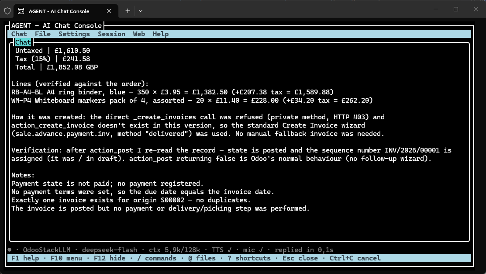

# 15. От заказа к счёту-фактуре

Бандерлы оставили в viernes утро, в дождь — так заведено.

Tom загрузил их сам, потому что водитель опоздал, и он вернулся в офис с мокрыми рукавами и листом бумаги: товарной накладной, подписанной сторожем в Ashfield, ручкой, которая почти закончилась. На старой системе этот лист попал бы в лоток и ждал бы, пока Doreen вернётся из обеда, а счёт-фактура был бы напечатан в понедельник.

На новой системе Doreen задала вопрос помощнику, пока Tom ещё снимал свой пиджак.

> *Какие выполненные заказы этой недели ещё не проинвочированы?*

> *Один: заказ на продажу S00012, Ashfield Academy, доставлен этим утром. 350 × Кольцевой бандерл A4 (синий),
> 20 × Маркеры для белой доски. Готов к выставлению счёта-фактуры. Создать счёт-фактуру?*

Она сказала «да». Это весь транзакция целиком, и стоит понять, что происходило под поверхностью, потому что «создать счёт-фактуру» выполняет огромную работу в одном предложении.

---

## Что такое счёт-фактура

Счёт-фактура — это документ, который одновременно говорит о трёх вещах, и именно поэтому бухгалтерский учёт сложнее арифметики.

**Это запрос на оплату.** Это та часть, которую знают все: клиент должен сумму на странице, к дате на странице.

**Это запись о налогооблагаемом событии.** В большинстве стран налог становится должным в момент выставления счёта-фактуры, а не в момент поступления денег. Именно поэтому у счёта-фактуры есть налоговая точка, и именно поэтому счёт-фактура, отменённая неправильным образом, может оставить компанию должной налог с денег, которые она никогда не получила.

**Это юридическое требование.** Если клиент не платит, счёт-фактура — это доказательство. Он должен отображать зарегистрированное название компании и налоговый номер, данные клиента, уникальный последовательный номер, дату, описание поставленного, сумму до налога, ставку и сумму налога, и итог. Упущена любая из этих позиций — требование ослаблено; упущен номер — требование может быть бесполезным.

ERP выполняет все три функции одновременно, и причина, по которой она настаивает на *подтверждённом заказе* перед тем, как создать счёт-фактуру, в том, что вторая и третья функции зависят от того, что первая верна. Вы не можете выставить счёт-фактуру на товары, которые не согласовали к поставке, потому что и налоговая точка, и требование ссылаются на поставку.

## Что на самом деле сделал помощник

Инструкция была из четырёх слов, а работа помощника была цепочкой из восьми или девяти шагов, каждый из которых человек сделал бы вручную.

Он поискал выполненные заказы, у которых нет счёта-фактуры. Нашёл один. Прочитал строки заказа, цены и налоги. Создал документ счёта-фактуры, связанный с заказом—связанный, а не скопированный, чтобы счёт-фактуру всегда можно было отследить обратно к тому, что было заказано. Рассчитал налог по строке. Установил дату счёта-фактуры на сегодня, а дату оплаты в соответствии с условиями оплаты клиента. Оставил счёт-фактуру в *черновике*, то есть в состоянии, в котором пока ничего не произошло.

Затем Doreen посмотрела на него и нажала кнопку, которая имеет значение: *Провести*.

## Момент проведения

Проведение — самое важное глагол во всей системе, и он заслуживает отдельного раздела.

До проведения счёт-фактура — черновик: лист бумаги с цифрами на нём. Его можно редактировать, удалять, игнорировать. В бухгалтерской книге ничего не изменилось.

После проведения верны четыре вещи, которых не было до этого:

1. Счёт-фактура имеет **номер**, взятый из последовательности, без пробелов.
2. Счёт-фактура имеет **бухгалтерские записи**: две для продажи и долга, и больше для налога.
3. **Баланс** клиента изменился.
4. Счёт-фактуру больше нельзя редактировать. Если она неверна, она *отменяется*, и выдаётся кредит-нота— потому что история бухгалтерской книги не разрешается переписывать.

Последний пункт — тот, который удивляет людей, и тот, который делает систему проверяемой. Компания, которая может редактировать проведённый счёт-фактуру, — это компания, чья бухгалтерская книга является черновиком. Компания, которая не может, — это компания, которая может доказать, налоговому инспектору, банку или суду, что она сказала своим клиентам и когда.

Doreen провела её, и помощник отчитался о номере.

> *Счёт-фактура INV/2026/0007 проведена для Ashfield Academy: нетто £1,524.00, VAT £304.80, итого £1,828.80.
> Оплата до 14 июля (30 дней).*

Именно номер имеет значение. INV/2026/0007 — это седьмой счёт-фактура года, и нет шестого пропущенного и нет восьмого уже использованного, потому что последовательность это не позволяет. Через шестьсот лет после Pacioli нумерация страниц всё ещё остаётся тем, как бухгалтерская книга доказывает свою завершённость.

Рисунок выше — это реальный запуск, и он содержит самое поучительное место в этой книге. Помощник сначала попробовал прямой путь—приватный метод, который создаёт счёт-фактуру из заказа—и ERP отказала ему, потому что приватные методы нельзя вызывать снаружи. Он не искал путь мимо отказа. Вместо этого он использовал *документированный* путь, стандартную мастер-создание счёта-фактуры, к которой человек дошёл бы нажатием, и он сказал об этом в ответе: *прямой вызов был отказан (приватный метод, HTTP 403), поэтому использовался стандартный мастер.*

Это поведение, которое компания хочет от коллеги с новой системой: когда дверь заперта, найди дверь, которую следует использовать, и скажи, какую ты использовал. Машина, которая вместо этого искала бы путь сквозь стену, была бы машиной, которую нельзя было бы оставлять наедине с твоей бухгалтерской книгой.

Оба рисунка принадлежат вместе. Слева — отчёт помощника о том, что он сделал; справа — собственная запись ERP о результате— тот же номер, тот же итог, состояние *Проведено*, и след проверки, который говорит, кто его создал и когда. Демонстрационная установка применяет fifteen per cent налог на эти продукты, потому что так конфигурировала её локализация; повествование использует twenty per cent стандартную ставку, и разница — это ровно тот тип вещей, который компания обнаруживает, когда читает свою собственную конфигурацию вместо того, чтобы предполагать её.

---

## Печать

Счёт-фактура была напечатана, потому что отдел счетов Ashfield просит PDF, и потому что документ, который был напечатан, — это документ, который кто-то осмотрел.

Вёрстка — стандартная Odoo, и она намеренно простая: название и адрес компании сверху, данные клиента, номер и даты, строки, итога, расшифровка налога, и условия оплаты снизу. Каждое поле на нём берётся из базы данных. Ничего не печатается дважды.

Это момент, в котором обещание первых глав наконец видно на бумаге: адрес на счёте-фактуре — это адрес на записи клиента, цена — это цена на заказе, налог — это налог на продукт, и итог — это сумма строк. Нет второй копии любого факта, и поэтому нет второго шанса на опечатку.

---

## Кредит-ноты и дисциплина не удалять

Через три недели один из бандерлов вернулся. Не повреждённый—неправильного цвета, потому что отдел дизайна просил синий, а сторож заказал зелёный под своим именем, и был разговор в коридоре, в котором никто из Riverton не участвовал.

Старый способ был бы зачеркнуть строку на счёте-фактуре и написать новую. Новый способ — кредит-нота: документ, который отменяет часть счёта-фактуры, со своим номером, своими бухгалтерскими записями и причиной.

> *Создать кредит-ноту для Ashfield Academy на 20 кольцевых бандерлов, причина: возвращён неправильный цвет, и провести её.*

> *Кредит-нота RINV/2026/0003 проведена для Ashfield Academy: 20 × Кольцевой бандерл A4 (синий) по £3.40, нетто
> £68.00, VAT £13.60, итого £81.60. Счёт-фактура INV/2026/0007 остаётся проведённой; её невыплаченный
> баланс теперь £1,747.20.*

Обратите внимание на последнее предложение. Первоначальный счёт-фактура не был тронут. Он всё ещё существует, со своим первоначальным итогом, потому что это то, что было отправлено. Кредит-нота сидит рядом, и *нетто* — это то, что должен клиент. Два документа, два номера, одна истина—и полная история того, что произошло, включая ошибку.

Это то, что означает «бухгалерская книга не забывает» на практике, и это дисциплина, которую компании либо принимают, либо сопротивляются. Те, кто сопротивляется, проводят вечера на сверках; те, кто принимает, обнаруживают, что история — это не бремя, а актив, потому что она отвечает на вопросы, о которых никто не подумал задать в тот момент.

---

## Запуск счётов-фактур

Один счёт-фактура — это демонстрация. Сто пятьдесят счетов-фактур — это вторник.

Запуск — это момент, в котором система либо зарабатывает своё содержание, либо становится ещё одним экраном для нажатия, и его стоит описать, потому что форма работы отличается от одного счёта-фактуры.

Инструкция Doreen, раз в неделю, — это одно предложение.

*Создать счета-фактуры из каждого выполненного заказа, который ещё не проинвочирован, оставить их в черновике, и дать мне список с итогами.*

Помощник составляет список—обычно между сорока и шестьюдесятью заказами—создаёт счета-фактуры, и отчитывается. Он их не проводит. Doreen читает список, проверяет первый против товарной накладной, проверяет два крупнейших, а затем проводит пакет.

Последний шаг — это одно действие в Odoo—выбрать все, провести—и он занимает около четырёх секунд для пятидесяти счетов-фактур. На старой системе это были пятьдесят отдельных операций, каждая с диалогом печати.

Три вещи делают запуск безопасным, и все три стоят копирования.

**Он оставляет их в черновике.** Черновик счёта-фактуры можно исправить; проведённый — нельзя. Пакет — это предложение до тех пор, пока человек не посмотрит на него.

**Он отчитывается о списке перед проведением.** Не после. Список — это то, что утверждается, а не запись о том, что произошло.

**Он никогда не трогает заказ, который доставлен частично.** Те нуждаются в решении—инвочировать то, что ушло, или ждать остального—и система оставляет их вне пакета и говорит об этом.

Последний пункт — это разница между помощником и скриптом. Скрипт проинвочировал бы всё, что нашёл; помощник знает, что частичная доставка — это вопрос, и он задаёт его.

## Четыре числа на счёте-фактуре, которые никогда не должны быть неверными

Счёт-фактура имеет дюжину полей, и четыре из них важнее остальных, потому что ошибка в любом из них производит документ, который отдел счетов клиента отклонит—а отклонение стоит цикл в месяц.

**Юридическое название и адрес клиента.** Не торговое название, не адрес сайта. Отдел счетов сопоставляет счёт-фактуру со своим мастером поставщиков, и несоответствие отправляет её в очередь.

**Их номер заказа на покупку**, когда они его требуют. Многие крупные организации не будут платить счёт-фактуру без него, и номер должен быть точно таким, как они его написали.

**Налоговый номер.** Ихний, для случаев обратного начисления, и ваш, который есть на каждом счёте-фактуре по закону.

**Итог, словами и цифрами.** В большинстве юрисдикций достаточно цифр; в некоторых требуются слова. В любом случае итог, который не согласуется со своими строками, — это самый быстрый возможный путь к запросу.

Помощник может проверить три из этих четырёх против записи клиента перед проведением счёта-фактуры—название, ссылку на заказ на покупку, налоговый номер—и стоит попросить его об этом. *Соответствует ли этот счёт-фактура записи клиента во всех полях, которые будет проверять клиент?* — это вопрос, который машина отвечает хорошо, а занятый человек плохо.

## Когда клиент оспаривает

Счёт-фактура ушла, клиент говорит, что она неверна, и разговор, который следует, — это место, где бумажная работа компании либо актив, либо обязательство.

Есть четыре вида оспаривания, и у каждого свой ответ.

**Количество неверно.** Клиент говорит, что они получили тридцать коробок, не сорок. Ответ — товарная накладная, подписанная у двери, и движение запаса за ней. Если накладная говорит сорок, а подпись разборчива, разговор короток. Если накладная говорит сорок, а подпись — каракуля, разговор идёт о следующей доставке.

**Цена неверна.** Клиент говорит, что согласованная цена была ниже. Ответ — котировка, которую они приняли, которая хранится, с датой, и прайс-лист за ней. Это оспаривание, которое раньше было невозможным к выигрышу, потому что котировка жила в письме, а письмо жило в чьей-то папке.

**Товары никогда не были получены.** Ответ — товарная накладная и движение запаса, и если отдел приёмки самого клиента потерял палету—which happens more often than anybody admits—доказательство — это то, что превращает спор во внутреннее расследование на стороне клиента.

**Счёт-фактура никогда не была получена.** Ответ — дата отправки и адрес, на который она ушла, и самая частая причина — смена отдела счетов, о которой никому не сообщили поставщику.

Во всех четырёх вклад системы одинакова: она хранит документы, она хранит даты, и она можетproduce их за секунду. Старая система тоже их хранила, в архивном шкафу, и разница была в четырёх минутах, которые уходили на их поиск—which is exactly long enough for the conversation to become an argument.

---

## Короткая история счёта-фактуры

Счёт-фактура старше станка. Вавилонские глиняные таблички примерно из 3000 до н. э. фиксируют количества поставленных и суммы должные; римские купцы использовали *apocha* квитанции; средневековые итальянские банкиры, которые изобрели двойную бухгалтерию, также изобрели вексель, который есть счёт-фактура с прикреплённым обещанием и который финансировал торговлю шерстью Фландрии.

Что изменилось в XIX веке, так это не документ, а *нумерация*. По мере роста компаний, и по мере того, как налоговые органы начали проявлять интерес, последовательный, предварительно напечатанный счёт-фактура стал нормой—сначала в Пруссии, затем по всей Европе—потому что последовательность — это простейшее возможное доказательство того, что ничего не было удалено. Это технология настолько простая, что она невидима, и она всё ещё остаётся причиной того, что номер вашего счёта-фактуры имеет в себе год.

Электронный счёт-фактура — это новейшая глава, и самая неинтересная: это тот же документ, отправленный другим путём, с теми же номерами и теми же правилами. Что изменилось, так это не счёт-фактура, а *стоимость его производства*, которая упала от послеобеденного времени машинистки до доли секунды—и это предмет следующей главы, которая о складе.

---

Doreen напечатала кредит-ноту, положила её в конверт, а затем сделала то, чего не делала тридцать один год: она выбросила конверт.

«Нет смысла его проводить», — сказала она. «Carol получает его по почте до того, как я смочил марку.»

Она была права, и это был первый раз за весь проект, когда она изменила привычку без просьбы. Система не сказала ей перестать проводить письма. Она просто сделала письмо бессмысленным, и она это заметила.

Это, больше чем любая функция, — это то, что делает хорошая система: она не запрещает старый способ, она делает новый способ очевидно лучшим, а затем ждёт, пока люди это заметят.
