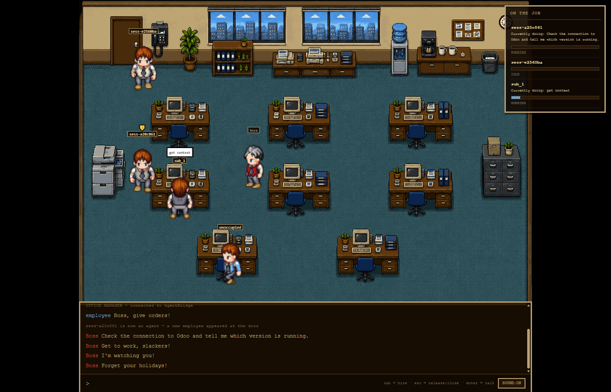

# 23. Офис в конце коридора

У ассистента есть две входные двери, и большинство компаний пользуются одной из них в течение месяца, прежде чем обнаруживают вторую.

Первая — это терминальное окно: черный фон, приглашение и ответ под ним. Именно эту дверь использовала эта книга, потому что она показывает работу — вызовы инструментов, промежуточные шаги, журнал. Это мастерская.

Вторая — веб-страница по адресу `http://localhost:5290/OfficeManager`, и это не мастерская. Это офис.

---

## Что показывает страница

Страница рисует небольшую комнату. Там есть столы, дверь, растение и несколько маленьких фигурок, которые ходят туда-сюда, садятся, встают и иногда собираются у кулера с водой. Одна из них — ваш агент. Под комнатой находится окно чата.

Когда поступает инструкция, у двери появляется фигурка и занимает стол, панель справа показывает, что она делает — *получить контекст*, *найти*, *создать* — а журнал чата фиксирует обмен репликами.

Если это звучит причудливо, то так оно и есть — и вместе с тем это самый эффективный интерфейс для такого рода работы, который пробовала Riverton. Причина этого заслуживает понимания, потому что дело не в милости.

Терминальное окно показывает *по одной беседе за раз* и показывает всё: каждый вызов инструмента, каждый промежуточный результат, каждую линию рассуждения. Именно это вам нужно, когда вы строите или отлаживаете задачу. Именно этого вы не хотите, когда вы офис-менеджер, а клиент на телефоне.

Страница офиса показывает *одну вещь*: агент и то, занят ли он. Фигурки ходят, когда агент размышляет, и садятся, когда он бездействует. Вы можете увидеть, не отходя от комнаты, работает ли ассистент — что звучит тривиально и на самом деле является единственной наиболее полезной информацией во всей системе.

«Можно понять, занят ли он, не читая ничего», — сказала Прия. «В терминале мне приходится смотреть на последнюю строку. Здесь я просто смотрю.»

## Когда использовать тот или другой

Через месяц привычки Riverton устали в простое разделение.

**Терминал для всего, что касается денег или изменяет документ.** Создание счета, публикация счета-фактуры, подтверждение заказа. Дело не в том, что веб-страница не может этого сделать — она может, — а в том, что терминал показывает *шаги*, а человек, который видит шаги, может их остановить. На терминале вы наблюдаете, как ассистент находит клиента, читает продукт, создает документ, и можете увидеть момент, когда что-то идет не так. На веб-странице вы видите пузырь с надписью «готово», и вам приходится ему доверять.

**Веб-страница для вопросов и выборок.** *Сколько у нас просроченных счетов? Какие продукты заканчиваются? Что мы продавали на прошлой неделе?* Ничего не меняется, ответ краток, и офисная метафора делает всё это похожим на вопрос к коллеге, а не на работу с машиной.

**Веб-страница для всех, кроме Мэгги.** Ею пользуется Том, Прия, и Дорин — после некоторого сопротивления — тоже ею пользуется. Терминал пугает способом, который не имеет ничего общего с работой: он выглядит как нутро машины, и большую часть офисного персонала учили в течение тридцати лет, что нутро машины не для них. Страница офиса выглядит как место, где кто-то работает.

Последний пункт — это не украшение. Это разница между инструментом, которым пользуются четыре человека, и инструментом, которым один человек пользуется от имени четырех.

## Маленькие люди

Фигурки в офисе — это не аватары персонала. Это *агенты*: установка может запускать несколько, каждый со своей задачей, и страница показывает их всех. Riverton запускает один, потому что у машины одна модель и одна видеокарта, а параллельные агенты на одной машине не добавляют скорости — они ходят по кругу, и могут исчерпать память.

Страница честна по отношению к этому, если на нее смотреть: фигурки делят комнату, и в комнате один телефон. Два агента, пытающихся ответить на него одновременно, — это не особенность.

Е соблазн, увидев офис, наполнить его — дать каждому отделу свою маленькую фигурку со своими инструкциями. Это плохая идея для небольшой компании, и причина та же, что проходит через всю эту книгу: агент не лучше модели, стоящей за ним, и одна модель, отвечающая на четыре беседы, — это четыре медленные беседы. Офис — это окно на одного работника, а не штат сотрудников.

## Третья дверь, которая вовсе не дверь

Есть третий способ войти, и это не экран: ассистент отвечает на HTTP-запросы.

На той же машине, по адресу `http://localhost:5290/v1/chat/completions`, он говорит на том же протоколе, что и крупные облачные сервисы. Всё, что может общаться с совместимым с OpenAI эндпоинтом, может общаться с ним — скрипт, макрос в таблице, другая программа, телефонная система, форма обратной связи на сайте.

Riverton не использовал этого, и стоит объяснить почему, потому что соблазн силен, а риск тонкий.

Соблазн очевиден: клиент пишет запрос по электронной почте, сайт перенаправляет его ассистенту, ассистент создает запись о клиенте и черновой вариант котировки, и Прия обнаруживает работу готовой, когда открывает свой экран. Это реальный рабочий процесс, и это именно тот вид вещей, в котором эта технология хороша.

Риск в том, что каждая дверь в систему — это дверь, и дверь на `localhost:5290` открыта для всего, что работает на машине, включая вкладку браузера, которую обманом заставили сделать запрос. У API нет аутентификации по умолчанию, потому что он был спроектирован так, чтобы к нему обращались с той же машины программы, которыми владец управляет. Это разумный дизайн для мастерской. Это не разумный дизайн для компании, которая однажды подключит её к интернету.

Правило, которое приняла Riverton и которое рекомендует эта книга: **API остается на машине до тех пор, пока у кого-то нет конкретной потребности и конкретного плана.** Когда этот день придет, план будет длиной в три строки — поставить его за прокси, требующий токен, ограничить одним эндпоинтом и логировать каждый запрос. До тех пор двух входных дверей достаточно, и у каждой из них стоит человек.

## Послеnoon Тома

День, когда страница офиса завоевала себе место в компании, был четвергом в феврале, и история невелика.

Том был на складе с доской для записей, делая квартальный пересчет, и ему нужно было знать, поступила ли паллет бумаги по заказу или всё ещё «в пути» в системе. На терминале этот вопрос означает дойти до офиса, сесть за машину, на которой работает ассистент, и напечатать. На странице офиса это означает открыть вкладку браузера на складском ноутбуке — дешевой машине, которая существует, чтобы искать коды продуктов — и напечатать вопрос там.

*Поступила ли паллет бумаги A4 от Pennine по заказу P00008?*

*Поступило: 40 пачек 12 ноября, проверено Томом Бекком, перемещение склада WH/IN/00031. Заказ поступил полностью; счет-фактура еще не создан.*

У него был ответ через девять секунд, стоя рядом с паллетом. Старая версия этого ответа означала поход в офис, беседу и записку на доске для записей.

Это наименее драматичная выгода во всей книге и, возможно, наиболее важная: расстояние между вопросом и его ответом, измеренное шагами. Склад, который может задать системе что-то, не покидая склада, — это склад, который проверяет вещи.

## Что офис не может сделать

Три ограничения стоит знать, прежде чем компания выработает привычку вокруг страницы.

**Она не может полезно вести две беседы одновременно.** Офис рисует несколько фигурок, и соблазн — нанять по одной на отдел. На машине с одной моделью это четыре беседы, ходящие по кругу, и фигурки будут сидеть за своими столами, выглядя занятыми, пока ничего не завершится. Страница честна по отношению к этому, если за ней наблюдать: панель справа перечисляет сессии, и только одна из них *работает* в любой момент.

**Она не может показать вам рассуждение.** Терминал показывает вызовы инструментов по мере их совершения; офис показывает метку (*найти*, *создать*, *получить контекст*), а затем ответ. Это правильный уровень детализации для офис-менеджера и неправильный для человека, отлаживающего задачу. Два входа не взаимозаменяемы, и компания, которая использует только веб-страницу, в конечном итоге нуждается в терминале — обычно в тот день, когда что-то идет не так.

**Она не может оставаться открытой на экране в общественной комнате.** Чат показывает данные компании: имена, суммы, счета-фактуры. Ноутбук на столе в магазине — это окно в бухгалтерскую книгу. У страницы нет собственного входа, потому что её обслуживает ассистент на `localhost` и она предполагает, что машина ваша. Это верное предположение за столом и неверное в зоне ресепшн.

## Звук и выключатель, который его отключает

Страница воспроизводит маленькие звуки: клавиатуру, когда агент печатает, колокольчик, когда задача выполнена. Это очаровательно неделю и сводит с ума месяц, а выключатель находится в правом нижнем углу страницы, подписан как *SOUND: ON*.

Тот факт, что этому стоит посвящать абзац, сам по себе является уроком об офисном программном обеспечении. Функции, которые решают, выживет ли инструмент, редко бывают теми, что в брошюре. Это те, что касаются нервов офиса: делает ли он звук, может ли его оставить открытым, верно ли то, что он показывает.

## Короткая история офисной метафоры

Размещение людей на картинке для представления работы — старая идея в вычислительной технике, и у нее хорошая репутация.

В 1984 году Macintosh от Apple представил метафору рабочего стола — файлы, папки, корзина — и она работала, потому что позволяла людям использовать знания, которые у них уже были. В 1987 году проект Information Visualizer в Xerox PARC пошел дальше и нарисовал офисы, с комнатами и документами, как способ навигации по большим информационным пространствам. В 1993 году игра *Doom* научила поколение, что вид от первого лица на пространство более читаем, чем его диаграмма.

Что все три обнаружили, одинаково: **пространственная метафора несет состояние.** Вам не нужно читать строку состояния, чтобы знать, что комната занята; вы можете это увидеть. Страница офиса в Riverton — прямой потомок этой идеи, и она существует по той же причине — не чтобы быть очаровательной, а чтобы ответить на вопрос *что происходит?* без необходимости читать пользователю.

## Чат и та же дисциплина

Окно чата внизу страницы принимает те же инструкции, что и терминал, и выполняет ту же работу. Всё из двадцать пятой главы о промптах применяется без изменений.

Две вещи отличаются, и обе — следствие интерфейса.

**Ответы короче.** Веб-страница показывает беседу, а не журнал, поэтому ассистент сводит к краткому изложению. Это хорошо для чтения и плохо для проверки: номер счета-фактуры может быть в кратком изложении, но список шагов, которые его породили, — нет. Когда результат важен, задайте уточняющий вопрос — *покажите мне документы за этим номером* — и ответом будет список.

**Соблазн многозадачности сильнее.** Окно чата приглашает задать второй вопрос, пока первый все еще выполняется, а второй вопрос, пока первый выполняется, — это то, что делает установку с одной моделью ощущающейся сломанной. Страница этого не предотвращает. Предотвращает привычка.

---

Собственное использование Мэгги устало в то, чего она не ожидала: она использует веб-страницу утром, а терминал днем.

«Утром я хочу знать вещи, — говорит она. — Я хочу список того, что опоздало, что заканчивается, что пришло ночью. Это беседа, и офис — это то место, где я её имею. Днем я хочу *делать* вещи — публиковать счета-фактуры, гнаться за тремя дебиторскими задолженностями, исправлять то, что нашел Том — и для этого я хочу видеть, как вертятся шестерни.»

Она на минуту задумалась.

«Это как разница между тем, чтобы задать кому-то вопрос в коридоре, и сесть с ним за стол. Тот же человек. Разная комната.»

Это лучшее описание двух интерфейсов, которое может предложить эта книга, и оно намекает на принцип, лежащий в их основе: интерфейс должен соответствовать *виду внимания*, который требует работа, а не виду технологии, стоящей за ней. Вопросу нужна беседа. Публикации — свидетель.
