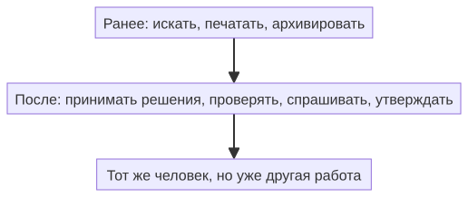

# 27. Что меняется в офисе

Через шесть месяцев после установки Дорин Пратт сделала то, чего не делала тридцать один год: она взяла отпуск посреди месяца.

Не потому, что система это позволяла — хотя и позволяла, — а потому, что ничего не сломалось. Счета были отправлены. Отчеты были отправлены. Ежемесячная сверка ждала, терпеливо, в том смысле, в каком ждет программное обеспечение, и когда она вернулась, это заняло у нее день вместо недели.

Она рассказала Мэгги об этом в свое первое утро после возвращения, стоя в дверном проеме комнаты счетов, а затем сказала то, что Мэгги записала.

"Странно то, что я стала занячее, чем была. Но это другой вид занятости. Я больше не ищу вещи. Я смотрю *на* вещи."

Эта глава о этой разнице, потому что это та часть автоматизации, которую никто не рекламирует и которую все испытывают. Буклеты обещают, что машина сделает работу. Правда более интересна: машина делает *администрирование* работы, а человек остается с самой работой — которая оказывается той частью, которая всегда нуждалась в человеке.

---

Давайте будем точны в том, что изменилось в Ривертоне, потому что неопределенность — враг полезного аргумента.

**Что прекратилось.** Кто-то раньше перебивал заказ клиента в программу учета. Это прекратилось. Кто-то раньше распечатывал счета по одному, проверял каждый против накладной и складывал их в конверты. Это прекратилось, в основном. Кто-то раньше составлял ежемесячный отчет о продажах, экспортируя три электронные таблицы и сверяя их вручную. Это прекратилось. Кто-то раньше шел к складу, чтобы спросить у Тома, есть ли товар в наличии. Это прекратилось, потому что ответ — это вопрос, который можно задать в одном предложении и получить за секунду.

**Что началось.** Дорин начала проверять цены против закупочного реестра каждую пятницу, потому что у нее было время и потому что она всегда подозревала, что поставщик ползуче повышает цены. Прия начала каждую понедельник отправлять команде продаж короткий список клиентов, которые перестали заказывать, с предполагаемой причиной для каждого. Том начал еженедельно проверять корректировки запасов вместо ежегодной, что и позволило компании обнаружить, что один продукт с 2022 года был введен в неправильной единице измерения и что "убыток", в котором все обвиняли ночную смену, был арифметической ошибкой.

Никакое из этих вещей не драматично. Вместе они — это разница между компанией, которая реагирует, и компанией, которая замечает.

**Что вообще не изменилось.** Отношения с Ashfield Academy, которым девять лет и которые основаны на том факте, что Карол доверяет Мэгги отвечать по телефону. Суждение о том, какому клиенту дать кредит. Решение прекратить вести товарную линию. Разговор с поставщиком, который третий раз повысил цены. Извинение, когда что-то идет не так.

Это честная форма изменения, и стоит сформулировать ее как правило, потому что правило действует в любой компании, где оно было опробовано: **автоматизация убирает администрирование работы и оставляет работу.**

---

Есть исторический параллелизм, который более утешителен, чем любая статистика.

В 1979 году два человека в Гарварде — Дан Бриклин и Боб Фрэнкстон — выпустили программу под названием VisiCalc. Это была первая электронная таблица: сетка на экране компьютера, где изменение в одной ячейке пересчитывало все, что от нее зависело. До VisiCalc финансовая модель была листом бумаги, карандашом и калькулятором, и изменение допущения означало пересчитывание вручную, что означало, что большинство моделей рассчитывались один раз, а затем защищались.

VisiCalc и электронные таблицы, которые последовали, сделали с арифметикой бухгалтера то, что стиральная машина сделала с пранием. И предсказание того времени было в том, что бухгалтеры исчезнут.

Они не исчезли. Если что-то, их стало больше. Исчезла работа человека, который складывал столбцы цифр карандашом, и появилась работа человека, который решает, какие цифры складывать, проверяет, имеет ли модель смысл, и объясняет совету директоров, почему числа именно таковы. Инструмент не заменил суждение. Он изменил *цену* суждения, убрав арифметику, которая стояла перед ней.

То же самое происходит сейчас, и происходит быстрее, и происходит на другом слое работы. Электронная таблица убрала арифметику. Агент убирает *поиск* — ту часть работы, которая состоит в том, чтобы узнать, что истинно.

Спросите Дорин, что она делала в 2019 году, и она сказала бы: я веду бумажную работу. Спросите ее, что она делает сейчас, и она скажет: я проверяю вещи. Второй ответ ценнее для компании, и это также ответ человека, который выполняет работу, а не обслуживает систему.

---

Ничего из этого не происходит само по себе, и здесь большинство компаний ошибаются.

Режим отказа хорошо знаком любому, кто наблюдал, как офис принимает новый инструмент. Инструмент устанавливается. Тренер приходит на день. Энтузиасты его используют; другие сохраняют свою электронную таблицу, потому что электронная таблица быстрее *сегодня*, а инструмент быстрее *только после того, как вы поместили свои данные в него*. Через шесть месяцев у компании две системы, одна из которых — истина, а другая — привычка, и спор о том, какая есть какая, потребляет больше времени, чем каждая из них сэкономила.

Есть три вещи, которые предотвращают это, и они не технические.

**Первое — работа должна поступать через новую дверь.** Если заказ можно все еще взять по телефону и записать на блокноте, его возьмут. Если счет можно все еще произвести в старой программе, его произведут. Новая система становится истиной в тот день, когда она становится *единственным* маршрутом, и не днем раньше. Вот почему установка в этой книге заканчивается удалением старых обходных путей, а не тренировочной сессией.

**Второе — кому-то должно быть позволено быть назойливым.** Новая работа Дорин — проверка, замечание, вопрос "почему" — существует только если компания рассматривает ее как работу. В слишком многих фирмах, как только администрирование автоматизировано, человеку дают больше администрирования, потому что администрирование измеримо, а замечание — нет. Компании, которые получают выгоду, — это те, которые вписывают "замечание" в чью-то неделю.

**Третье — машине должно быть дано имя и предел.** Не личность — имя в смысле ответственности. Кто-то должен отвечать за то, что делает ассистент, должен читать его журнал, должен иметь право выключить его. Ассистент, которого никто не владеет, — это ассистент, которого никто не проверяет, а ассистент, которого никто не проверяет, — это слух с клавиатурой.

## Новое описание работы

Стоит записать, чем стала работа Дорин, потому что описания работы — это то место, где этот вид изменения либо становится реальным, либо тихо abandons.

Раньше, на языке офиса: вести книги, выставлять счета, гнать деньги, архивировать бумажную работу, отвечать по телефону, когда речь о деньгах.

После, на том же языке: **вести модель истинной, решать, что является исключением, и отвечать на вопросы, которые поднимают числа.**

Три обязанности, и каждая из них нова в специфическом смысле.

**Ведение модели истинной** означает маленькие дисциплины, которые делают систему заслуживающей доверия: продукт с правильной единицей измерения, клиент с правильными условиями оплаты, доставка, проверенная в день ее совершения, корректировка запасов с причиной. В старом мире это все тоже было ее работой, но они были невидимы — никто не мог увидеть стоимость их неправильного выполнения до конца года. Сейчас они — это разница между ответом и догадкой, и у них есть ежедневное видимое последствие, что делает их легче защищать и труднее пропускать.

**Решение, что является исключением**, означает чтение списков. Просроченные счета, запасы ниже минимума, продукты без цены, доставка без счета. Система производит список; человек решает, какие элементы — шум, а какие — проблема. Это подлинный навык, и это тот, который улучшается с практикой — через три месяца Дорин могла взглянуть на список из двенадцати просроченных счетов и сказать вам, какие четыре были реальными.

**Ответ на вопросы, которые поднимают числа**, — это та часть, которую никто не предсказал. Система, которая может отвечать на вопросы, производит *больше вопросов*: почему транспортные расходы выросли, почему этот клиент затих, почему маржа этого продукта отличается от прошлого месяца. Кто-то должен гнать эти, и человек, который гонит их, — это тот, у кого теперь есть время.

## Что не изменилось, и почему это важно

Три вещи вообще не изменились, и стоит это сказать, потому что литература об автоматизации в основном об изменении.

**По телефону все еще отвечает человек.** Карол из Ashfield звонит, потому что хочет поговорить с Мэгги, а не потому что хочет транзакцию. Отношения — это бизнес, и ни одна система никогда не улучшала их.

**Суждение о людях все еще делается людьми.** Кому дать кредит, кого гнать сильно, кого отпустить. Система предоставляет факты — историю оплаты, образец заказа, просроченные суммы — и факты делают суждение более информированным, но они не делают его.

**Извинение все еще человека.** Когда что-то идет не так, клиент хочет услышать, как человеческое существо говорит извинение. Автоматизированное извинение хуже, чем его отсутствие, потому что оно подтверждает, что никто не обращал внимания.

Эти три — это ядро бизнеса, и это причина, по которой эта книга настойчиво настаивает, что машина берет *терпение*, а человек сохраняет *суждение*. Компания, которая автоматизирует телефон, решение о кредите или извинение, автоматизировала неправильную вещь, и она узнает об этом тем способом, которым компании всегда узнают: медленно, а затем внезапно.

## Час в расписании

Самое важное изменение в Ривертоне не было функцией программного обеспечения. Это был час в расписании Дорин, каждую пятницу, обозначенный как *системы и исключения*, который никому не было позволено бронировать.

Этот час — там, где происходит замечание: проверка цены, чтение журнала, список вещей, которые выглядят странно. Без него время, сэкономленное автоматизацией, было бы заполнено больше администрированием — что происходит в большинстве компаний, и почему большинство компаний сообщают, что автоматизация "на самом деле ничего не сэкономила".

Час в неделю — это пятьдесят часов в году, что является долей того, что экономит система. Это также разница между системой, которая улучшается, и системой, которая разлагается. Строка Сэма — *программное обеспечение не ломается, ломаются привычки* — это весь аргумент, и час в расписании — это то, как привычка защищена.

---

Мэгги задали вопрос на ужине торговой палаты весной, заменила ли она "персонал искусственным интеллектом".

Она подумала об этом вопросе заранее, потому что знала, что он придет, и решила ответить честно, а не дипломатично.

"Нет," — сказала она. "Мы заменили систему архивирования. Персонал все еще здесь, и он выполняет работу, которую система архивирования мешала ему выполнять."

Женщина, которая задала вопрос, выглядела скептически. "Но вам нужно меньше людей."

"Нам нужно то же количество людей и больше их внимания," — сказала Мэгги. "Что, если вы управляете бизнесом, равносильно тому, что нужно больше людей."

Это ее правда, и стоит положить ее в возможно самые простые термины, потому что публичный разговор об искусственном интеллектом доминируется двумя историями, которые обе неверны: что машина сделает все, и что машина возьмет все. Что на самом деле происходит в хорошо управляемой маленькой компании, это то, что машина берет ту часть работы, которую никто не хотел, и люди обнаруживают, что они выполняли ту часть настолько долго, что забыли, какой была остальная часть работы.

Дорин, в свое утро после того отпуска, нашла счет поставщика с ценой, которая выросла на четыре процента без уведомления. У нее был он перед ней через минуту после того, как сесть, потому что ассистент пометил его, пока она была в отъезде. В 2019 году его было бы архивировано, оплачено и обнаружено в конце года, если вообще.

Она не сказала "машина нашла это". Она сказала: "Посмотрите на это. четыре процента, в марте, и никто нам не сказал."

Это предложение, к которому эта книга работала. Машина сделала поиск. Человек сделал замечание. Компания получила выгоду.
